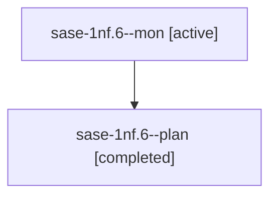

# Session: sase-1nf.6

[Agent Hoods](../README.md) / [bbugyi200](../users/bbugyi200/README.md) / [athena](../users/bbugyi200/machines/athena/README.md) / [sase-1nf](../users/bbugyi200/machines/athena/hoods/sase-1nf/README.md) / sase-1nf.6

Owner: `bbugyi200.athena` · Hood: `sase-1nf` · Members: 2 · Bead: [sase-1nf.6](https://github.com/sase-org/sase--beads/blob/main/pages/sase-1nf/sase-1nf.6.md)

## Lineage

The diagram is an optional enhancement; the ordered table below contains the same lineage in accessible text.

| Role | Agent | State | Model / provider | Timing | Commits | Prompt | Chat |
|---|---|---|---|---|---:|---|---|
| mon | sase-1nf.6--mon | active | gpt-6-luna / codex | 2026-10-20T17:58:07.439878+00:00 | 0 | — | — |
| plan | sase-1nf.6--plan | completed | gpt-6-luna / codex | 2026-10-20T17:49:24.360273+00:00 → 2026-10-20T17:58:40.540667+00:00 | 0 | [Prompt](../agents/bbugyi200.athena.sase-1nf.6--plan/prompt.md) | [Chat](../agents/bbugyi200.athena.sase-1nf.6--plan/chat.md) |

## Neighbors

| Agent | Relation | State |
|---|---|---|
| [sase-1nf.1](../agents/bbugyi200.athena.sase-1nf.1/README.md) | sase-1nf hood | active |
| [sase-1nf.10](../agents/bbugyi200.athena.sase-1nf.10/README.md) | sase-1nf hood | waiting |
| [sase-1nf.11](../agents/bbugyi200.athena.sase-1nf.11/README.md) | sase-1nf hood | waiting |
| [sase-1nf.12](../agents/bbugyi200.athena.sase-1nf.12/README.md) | sase-1nf hood | active |
| [sase-1nf.13](../agents/bbugyi200.athena.sase-1nf.13/README.md) | sase-1nf hood | waiting |
| [sase-1nf.14](../agents/bbugyi200.athena.sase-1nf.14/README.md) | sase-1nf hood | waiting |
| [sase-1nf.2](../agents/bbugyi200.athena.sase-1nf.2/README.md) | sase-1nf hood | waiting |
| [sase-1nf.3](../agents/bbugyi200.athena.sase-1nf.3/README.md) | sase-1nf hood | completed |
| [sase-1nf.4](../agents/bbugyi200.athena.sase-1nf.4/README.md) | sase-1nf hood | active |
| [sase-1nf.5](../agents/bbugyi200.athena.sase-1nf.5/README.md) | sase-1nf hood | active |
| [sase-1nf.7](../agents/bbugyi200.athena.sase-1nf.7/README.md) | sase-1nf hood | waiting |
| [sase-1nf.8](../agents/bbugyi200.athena.sase-1nf.8/README.md) | sase-1nf hood | waiting |
| [sase-1nf.9](../agents/bbugyi200.athena.sase-1nf.9/README.md) | sase-1nf hood | waiting |
| [sase-1nf.land](../agents/bbugyi200.athena.sase-1nf.land/README.md) | sase-1nf hood | waiting |
