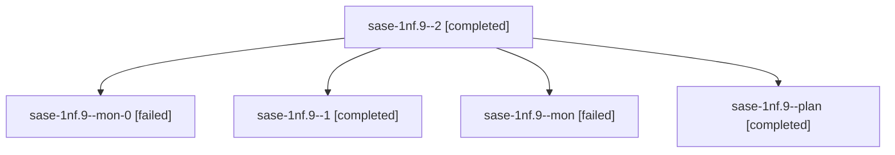

# Session: sase-1nf.9

[Agent Hoods](../README.md) / [bbugyi200](../users/bbugyi200/README.md) / [athena](../users/bbugyi200/machines/athena/README.md) / [sase-1nf](../users/bbugyi200/machines/athena/hoods/sase-1nf/README.md) / sase-1nf.9

Owner: `bbugyi200.athena` · Hood: `sase-1nf` · Members: 5 · Bead: [sase-1nf.9](https://github.com/sase-org/sase--beads/blob/main/pages/sase-1nf/sase-1nf.9.md)

## Lineage



The diagram is an optional enhancement; the ordered table below contains the same lineage in accessible text.

| Role | Agent | State | Model / provider | Timing | Commits | Prompt | Chat |
|---|---|---|---|---|---:|---|---|
| <a id="member-2"></a>2 | sase-1nf.9--2 | completed | muse-spark-1.3-contributor / muse | 2026-10-20T19:02:39.813501+00:00 → 2026-10-20T19:25:54.115329+00:00 | [1](../agents/bbugyi200.athena.sase-1nf.9--2/README.md#commits) | [Prompt](../agents/bbugyi200.athena.sase-1nf.9--2/prompt.md) | [Chat](../agents/bbugyi200.athena.sase-1nf.9--2/chat.md) |
| <a id="member-mon-0"></a>mon-0 | sase-1nf.9--mon-0 | failed | muse-spark-1.3-contributor / muse | 2026-10-20T18:54:32.837990+00:00 → 2026-10-20T19:00:45.610094+00:00 | 0 | — | [Chat](../agents/bbugyi200.athena.sase-1nf.9--mon-0/chat.md) |
| <a id="member-1"></a>1 | sase-1nf.9--1 | completed | muse-spark-1.3-contributor / muse | 2026-10-20T18:50:02.217124+00:00 → 2026-10-20T18:56:45.025910+00:00 | 0 | [Prompt](../agents/bbugyi200.athena.sase-1nf.9--1/prompt.md) | [Chat](../agents/bbugyi200.athena.sase-1nf.9--1/chat.md) |
| <a id="member-mon"></a>mon | sase-1nf.9--mon | failed | muse-spark-1.3-contributor / muse | 2026-10-20T18:43:48.308994+00:00 → 2026-10-20T18:49:53.873674+00:00 | 0 | — | [Chat](../agents/bbugyi200.athena.sase-1nf.9--mon/chat.md) |
| <a id="member-plan"></a>plan | sase-1nf.9--plan | completed | muse-spark-1.3-contributor / muse | 2026-10-20T17:59:51.092461+00:00 → 2026-10-20T18:44:24.852446+00:00 | 0 | [Prompt](../agents/bbugyi200.athena.sase-1nf.9--plan/prompt.md) | [Chat](../agents/bbugyi200.athena.sase-1nf.9--plan/chat.md) |

## Commits

| Role | Repo | Commit | Subject | Committed |
|---|---|---|---|---|
| 2 | sase | [`1325078`](https://github.com/sase-org/sase/commit/1325078a8edd30df84eaa6356863a8fd35f63c80) | feat(agents-sync): instrument and measure publication drains (sase-1nf.9) | 2026-10-20 15:17:08 EDT |

## Variables

| Role | Variable | Value |
|---|---|---|
| plan | `artifacts` | \[{bead: sase-1nf.9, kind: markdown, label: pub-measure drain measurement report, path: /home/bryan/.sase/artifacts/agents/gh\_sase-org\_\_sase/20261020133812/pub\_drain\_measurement-0dd7997cb258.md, ref:… |

#### artifacts

**Role:** `plan`

```yaml
- bead: sase-1nf.9
  kind: markdown
  label: pub-measure drain measurement report
  path: /home/bryan/.sase/artifacts/agents/gh_sase-org__sase/20261020133812/pub_drain_measurement-0dd7997cb258.md
  ref: file:explicit:1332edd16fbe66b228322d62
  source_path: /home/bryan/.local/state/sase/workspaces/sase-org/sase/sase_21/sase/repos/research/202610/pub_drain_measurement.md
```

Values are truncated for display; see each member's agent meta.json for the full values.

## Neighbors

| Agent | Relation | State |
|---|---|---|
| [sase-1nf.1](../agents/bbugyi200.athena.sase-1nf.1/README.md) | sase-1nf hood | completed |
| [sase-1nf.10](bbugyi200.athena.sase-1nf.10.md) (session · 3) | sase-1nf hood | failed 3 |
| [sase-1nf.10.1.1](../agents/bbugyi200.athena.sase-1nf.10.1.1/README.md) | sase-1nf hood | completed |
| [sase-1nf.10.1.2](../agents/bbugyi200.athena.sase-1nf.10.1.2/README.md) | sase-1nf hood | completed |
| [sase-1nf.10.1.3](../agents/bbugyi200.athena.sase-1nf.10.1.3/README.md) | sase-1nf hood | completed |
| [sase-1nf.10.1.4](bbugyi200.athena.sase-1nf.10.1.4.md) (session · 7) | sase-1nf hood | completed 4, failed 3 |
| [sase-1nf.10.1.5](../agents/bbugyi200.athena.sase-1nf.10.1.5/README.md) | sase-1nf hood | completed |
| [sase-1nf.10.1.6](../agents/bbugyi200.athena.sase-1nf.10.1.6/README.md) | sase-1nf hood | completed |
| [sase-1nf.10.1.7](bbugyi200.athena.sase-1nf.10.1.7.md) (session · 5) | sase-1nf hood | completed 3, failed 2 |
| [sase-1nf.10.1.8](../agents/bbugyi200.athena.sase-1nf.10.1.8/README.md) | sase-1nf hood | completed |
| [sase-1nf.10.1.9](bbugyi200.athena.sase-1nf.10.1.9.md) (session · 2) | sase-1nf hood | active 1, completed 1 |
| [sase-1nf.10.1.land](../agents/bbugyi200.athena.sase-1nf.10.1.land/README.md) | sase-1nf hood | waiting |
| [sase-1nf.11](../agents/bbugyi200.athena.sase-1nf.11/README.md) | sase-1nf hood | waiting |
| [sase-1nf.12](../agents/bbugyi200.athena.sase-1nf.12/README.md) | sase-1nf hood | completed |
| [sase-1nf.13](bbugyi200.athena.sase-1nf.13.md) (session · 4) | sase-1nf hood | active 1, completed 2, failed 1 |
| [sase-1nf.14](../agents/bbugyi200.athena.sase-1nf.14/README.md) | sase-1nf hood | waiting |
| [sase-1nf.2](../agents/bbugyi200.athena.sase-1nf.2/README.md) | sase-1nf hood | completed |
| [sase-1nf.3](../agents/bbugyi200.athena.sase-1nf.3/README.md) | sase-1nf hood | completed |
| [sase-1nf.4](bbugyi200.athena.sase-1nf.4.md) (session · 2) | sase-1nf hood | completed 1, failed 1 |
| [sase-1nf.5](../agents/bbugyi200.athena.sase-1nf.5/README.md) | sase-1nf hood | completed |
| [sase-1nf.6](bbugyi200.athena.sase-1nf.6.md) (session · 9) | sase-1nf hood | completed 5, failed 4 |
| [sase-1nf.7](bbugyi200.athena.sase-1nf.7.md) (session · 5) | sase-1nf hood | completed 3, failed 2 |
| [sase-1nf.8](../agents/bbugyi200.athena.sase-1nf.8/README.md) | sase-1nf hood | completed |
| [sase-1nf.land](../agents/bbugyi200.athena.sase-1nf.land/README.md) | sase-1nf hood | waiting |
