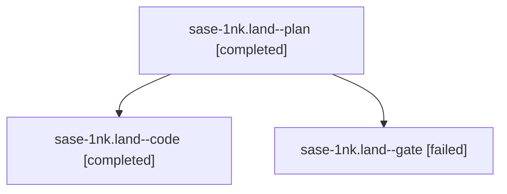

# Session: sase-1nk.land

[Agent Hoods](../README.md) / [bbugyi200](../users/bbugyi200/README.md) / [athena](../users/bbugyi200/machines/athena/README.md) / [sase-1nk](../users/bbugyi200/machines/athena/hoods/sase-1nk/README.md) / sase-1nk.land

Owner: `bbugyi200.athena` · Hood: `sase-1nk` · Members: 3 · Bead: [sase-1nk](https://github.com/sase-org/sase--beads/blob/main/pages/sase-1nk/README.md)

## Lineage

The diagram is an optional enhancement; the ordered table below contains the same lineage in accessible text.

| Role | Agent | State | Model / provider | Timing | Commits | Prompt | Chat |
|---|---|---|---|---|---:|---|---|
| plan | sase-1nk.land--plan | completed | gpt-6-astra / codex | 2026-10-23T14:09:00.505182+00:00 → 2026-10-23T14:55:59.498916+00:00 | 0 | [Prompt](../agents/bbugyi200.athena.sase-1nk.land--plan/prompt.md) | [Chat](../agents/bbugyi200.athena.sase-1nk.land--plan/chat.md) |
| code | sase-1nk.land--code | completed | grok-4.6 / grok | 2026-10-23T14:22:45.240921+00:00 → 2026-10-23T14:55:59.498916+00:00 | [1](../agents/bbugyi200.athena.sase-1nk.land--code/README.md#commits) | — | [Chat](../agents/bbugyi200.athena.sase-1nk.land--code/chat.md) |
| gate | sase-1nk.land--gate | failed | gpt-6-astra / codex | 2026-10-23T14:21:53.797905+00:00 → 2026-10-23T14:22:24.885008+00:00 | 0 | — | [Chat](../agents/bbugyi200.athena.sase-1nk.land--gate/chat.md) |

## Commits

| Role | Repo | Commit | Subject | Committed |
|---|---|---|---|---|
| code | sase | [`7552ebe`](https://github.com/sase-org/sase/commit/7552ebe590c07d4f9bf5fd62bf583a30d79c31b3) | test(monitor): prove proc-backed follow-up prompts show the output tail | 2026-10-23 10:50:56 EDT |

## Neighbors

| Agent | Relation | State |
|---|---|---|
| [sase-1nk.1](../agents/bbugyi200.athena.sase-1nk.1/README.md) | sase-1nk hood | completed |
| [sase-1nk.2](../agents/bbugyi200.athena.sase-1nk.2/README.md) | sase-1nk hood | completed |
