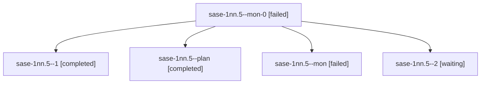

# Session: sase-1nn.5

[Agent Hoods](../README.md) / [bbugyi200](../users/bbugyi200/README.md) / [athena](../users/bbugyi200/machines/athena/README.md) / [sase-1nn](../users/bbugyi200/machines/athena/hoods/sase-1nn/README.md) / sase-1nn.5

Owner: `bbugyi200.athena` · Hood: `sase-1nn` · Members: 5 · Bead: [sase-1nn.5](https://github.com/sase-org/sase--beads/blob/main/pages/sase-1nn/sase-1nn.5.md)

## Lineage

The diagram is an optional enhancement; the ordered table below contains the same lineage in accessible text.

| Role | Agent | State | Model / provider | Timing | Commits | Prompt | Chat |
|---|---|---|---|---|---:|---|---|
| mon-0 | sase-1nn.5--mon-0 | failed | gpt-6-luna / codex | 2026-10-23T17:35:31.005824+00:00 → 2026-10-23T17:58:48.660014+00:00 | 0 | — | [Chat](../agents/bbugyi200.athena.sase-1nn.5--mon-0/chat.md) |
| 1 | sase-1nn.5--1 | completed | gpt-6-luna / codex | 2026-10-23T17:09:32.658834+00:00 → 2026-10-23T17:37:58.276587+00:00 | 0 | [Prompt](../agents/bbugyi200.athena.sase-1nn.5--1/prompt.md) | [Chat](../agents/bbugyi200.athena.sase-1nn.5--1/chat.md) |
| plan | sase-1nn.5--plan | completed | gpt-6-luna / codex | 2026-10-23T16:32:49.381715+00:00 → 2026-10-23T16:38:18.346505+00:00 | 0 | [Prompt](../agents/bbugyi200.athena.sase-1nn.5--plan/prompt.md) | [Chat](../agents/bbugyi200.athena.sase-1nn.5--plan/chat.md) |
| mon | sase-1nn.5--mon | failed | gpt-6-luna / codex | 2026-10-23T16:37:33.718736+00:00 → 2026-10-23T17:02:27.382423+00:00 | 0 | — | [Chat](../agents/bbugyi200.athena.sase-1nn.5--mon/chat.md) |
| 2 | sase-1nn.5--2 | waiting | gpt-6-luna / codex | 20261023135552 | 0 | [Prompt](../agents/bbugyi200.athena.sase-1nn.5--2/prompt.md) | — |

## Neighbors

| Agent | Relation | State |
|---|---|---|
| [sase-1nn.1](../agents/bbugyi200.athena.sase-1nn.1/README.md) | sase-1nn hood | completed |
| [sase-1nn.2](bbugyi200.athena.sase-1nn.2.md) (session · 5) | sase-1nn hood | completed 3, failed 2 |
| [sase-1nn.3](bbugyi200.athena.sase-1nn.3.md) (session · 3) | sase-1nn hood | completed 2, failed 1 |
| [sase-1nn.4](../agents/bbugyi200.athena.sase-1nn.4/README.md) | sase-1nn hood | completed |
| [sase-1nn.6](../agents/bbugyi200.athena.sase-1nn.6/README.md) | sase-1nn hood | active |
| [sase-1nn.7](../agents/bbugyi200.athena.sase-1nn.7/README.md) | sase-1nn hood | waiting |
| [sase-1nn.land](../agents/bbugyi200.athena.sase-1nn.land/README.md) | sase-1nn hood | waiting |
