# Session: sase-1nn.5

[Agent Hoods](../README.md) / [bbugyi200](../users/bbugyi200/README.md) / [athena](../users/bbugyi200/machines/athena/README.md) / [sase-1nn](../users/bbugyi200/machines/athena/hoods/sase-1nn/README.md) / sase-1nn.5

Owner: `bbugyi200.athena` · Hood: `sase-1nn` · Members: 15 · Bead: [sase-1nn.5](https://github.com/sase-org/sase--beads/blob/main/pages/sase-1nn/sase-1nn.5.md)

## Lineage

```mermaid
flowchart TD
  n0["sase-1nn.5--mon-0 [active]"]
  n1["sase-1nn.5--1 [active]"]
  n0 --> n1
  n2["sase-1nn.5--mon-1 [active]"]
  n0 --> n2
  n3["sase-1nn.5--mon-2 [active]"]
  n0 --> n3
  n4["sase-1nn.5--mon-3 [active]"]
  n0 --> n4
  n5["sase-1nn.5--7 [active]"]
  n0 --> n5
  n6["sase-1nn.5--mon-4 [active]"]
  n0 --> n6
  n7["sase-1nn.5--plan [active]"]
  n0 --> n7
  n8["sase-1nn.5--5 [active]"]
  n0 --> n8
  n9["sase-1nn.5--mon [active]"]
  n0 --> n9
  n10["sase-1nn.5--6 [active]"]
  n0 --> n10
  n11["sase-1nn.5--2 [active]"]
  n0 --> n11
  n12["sase-1nn.5--3 [active]"]
  n0 --> n12
  n13["sase-1nn.5--4 [active]"]
  n0 --> n13
  n14["sase-1nn.5--mon-5 [active]"]
  n0 --> n14
```

The diagram is an optional enhancement; the ordered table below contains the same lineage in accessible text.

| Role | Agent | State | Model / provider | Timing | Commits | Prompt | Chat |
|---|---|---|---|---|---:|---|---|
| mon-0 | sase-1nn.5--mon-0 | active | gpt-6-luna / codex | 2026-10-23T17:35:31.005824+00:00 | 0 | — | [Chat](../agents/bbugyi200.athena.sase-1nn.5--mon-0/chat.md) |
| 1 | sase-1nn.5--1 | active | gpt-6-luna / codex | 2026-10-23T17:09:32.658834+00:00 | 0 | [Prompt](../agents/bbugyi200.athena.sase-1nn.5--1/prompt.md) | [Chat](../agents/bbugyi200.athena.sase-1nn.5--1/chat.md) |
| mon-1 | sase-1nn.5--mon-1 | active | gpt-6-luna / codex | 2026-10-23T18:11:48.262509+00:00 | 0 | — | [Chat](../agents/bbugyi200.athena.sase-1nn.5--mon-1/chat.md) |
| mon-2 | sase-1nn.5--mon-2 | active | gpt-6-luna / codex | 2026-10-23T18:24:13.964942+00:00 | 0 | — | [Chat](../agents/bbugyi200.athena.sase-1nn.5--mon-2/chat.md) |
| mon-3 | sase-1nn.5--mon-3 | active | gpt-6-luna / codex | 2026-10-23T18:48:24.830174+00:00 | 0 | — | [Chat](../agents/bbugyi200.athena.sase-1nn.5--mon-3/chat.md) |
| 7 | sase-1nn.5--7 | active | gpt-6-luna / codex | 2026-10-23T19:59:47.255161+00:00 | [1](../agents/bbugyi200.athena.sase-1nn.5--7/README.md#commits) | [Prompt](../agents/bbugyi200.athena.sase-1nn.5--7/prompt.md) | [Chat](../agents/bbugyi200.athena.sase-1nn.5--7/chat.md) |
| mon-4 | sase-1nn.5--mon-4 | active | gpt-6-luna / codex | 2026-10-23T19:24:29.855058+00:00 | 0 | — | [Chat](../agents/bbugyi200.athena.sase-1nn.5--mon-4/chat.md) |
| plan | sase-1nn.5--plan | active | gpt-6-luna / codex | 2026-10-23T16:32:49.381715+00:00 | 0 | [Prompt](../agents/bbugyi200.athena.sase-1nn.5--plan/prompt.md) | [Chat](../agents/bbugyi200.athena.sase-1nn.5--plan/chat.md) |
| 5 | sase-1nn.5--5 | active | gpt-6-luna / codex | 2026-10-23T18:52:29.563340+00:00 | 0 | [Prompt](../agents/bbugyi200.athena.sase-1nn.5--5/prompt.md) | [Chat](../agents/bbugyi200.athena.sase-1nn.5--5/chat.md) |
| mon | sase-1nn.5--mon | active | gpt-6-luna / codex | 2026-10-23T16:37:33.718736+00:00 | 0 | — | [Chat](../agents/bbugyi200.athena.sase-1nn.5--mon/chat.md) |
| 6 | sase-1nn.5--6 | active | gpt-6-luna / codex | 2026-10-23T19:35:42.542910+00:00 | 0 | [Prompt](../agents/bbugyi200.athena.sase-1nn.5--6/prompt.md) | [Chat](../agents/bbugyi200.athena.sase-1nn.5--6/chat.md) |
| 2 | sase-1nn.5--2 | active | gpt-6-luna / codex | 2026-10-23T18:03:46.979741+00:00 | 0 | [Prompt](../agents/bbugyi200.athena.sase-1nn.5--2/prompt.md) | [Chat](../agents/bbugyi200.athena.sase-1nn.5--2/chat.md) |
| 3 | sase-1nn.5--3 | active | gpt-6-luna / codex | 2026-10-23T18:19:48.470792+00:00 | 0 | [Prompt](../agents/bbugyi200.athena.sase-1nn.5--3/prompt.md) | [Chat](../agents/bbugyi200.athena.sase-1nn.5--3/chat.md) |
| 4 | sase-1nn.5--4 | active | gpt-6-luna / codex | 2026-10-23T18:35:44.780594+00:00 | 0 | [Prompt](../agents/bbugyi200.athena.sase-1nn.5--4/prompt.md) | [Chat](../agents/bbugyi200.athena.sase-1nn.5--4/chat.md) |
| mon-5 | sase-1nn.5--mon-5 | active | gpt-6-luna / codex | 2026-10-23T19:48:32.846511+00:00 | 0 | — | [Chat](../agents/bbugyi200.athena.sase-1nn.5--mon-5/chat.md) |

## Commits

| Role | Repo | Commit | Subject | Committed |
|---|---|---|---|---|
| 7 | sase | [`62c5934`](https://github.com/sase-org/sase/commit/62c5934eb6ba1c30f32805cc30d52ae084d4de5c) | test(tui): stabilize visual snapshot lane | 2026-10-23 16:40:38 EDT |

## Neighbors

| Agent | Relation | State |
|---|---|---|
| [sase-1nn.1](../agents/bbugyi200.athena.sase-1nn.1/README.md) | sase-1nn hood | active |
| [sase-1nn.2](bbugyi200.athena.sase-1nn.2.md) (session · 5) | sase-1nn hood | active 5 |
| [sase-1nn.3](bbugyi200.athena.sase-1nn.3.md) (session · 3) | sase-1nn hood | active 3 |
| [sase-1nn.4](../agents/bbugyi200.athena.sase-1nn.4/README.md) | sase-1nn hood | active |
| [sase-1nn.6](../agents/bbugyi200.athena.sase-1nn.6/README.md) | sase-1nn hood | active |
| [sase-1nn.7](bbugyi200.athena.sase-1nn.7.md) (session · 2) | sase-1nn hood | active 2 |
| [sase-1nn.8.1](../agents/bbugyi200.athena.sase-1nn.8.1/README.md) | sase-1nn hood | active |
| [sase-1nn.8.2](bbugyi200.athena.sase-1nn.8.2.md) (session · 5) | sase-1nn hood | active 5 |
| [sase-1nn.8.3](bbugyi200.athena.sase-1nn.8.3.md) (session · 2) | sase-1nn hood | active 2 |
| [sase-1nn.8.4.1](bbugyi200.athena.sase-1nn.8.4.1.md) (session · 3) | sase-1nn hood | completed 2, failed 1 |
| [sase-1nn.8.4.2](bbugyi200.athena.sase-1nn.8.4.2.md) (session · 2) | sase-1nn hood | completed 1, failed 1 |
| [sase-1nn.8.4.3.1](bbugyi200.athena.sase-1nn.8.4.3.1.md) (session · 3) | sase-1nn hood | completed 2, failed 1 |
| [sase-1nn.8.4.3.2](../agents/bbugyi200.athena.sase-1nn.8.4.3.2/README.md) | sase-1nn hood | active |
| [sase-1nn.8.4.3.3](bbugyi200.athena.sase-1nn.8.4.3.3.md) (session · 2) | sase-1nn hood | active 1, completed 1 |
| [sase-1nn.8.4.3.4](../agents/bbugyi200.athena.sase-1nn.8.4.3.4/README.md) | sase-1nn hood | waiting |
| [sase-1nn.8.4.3.land](../agents/bbugyi200.athena.sase-1nn.8.4.3.land/README.md) | sase-1nn hood | waiting |
| [sase-1nn.8.4.land](bbugyi200.athena.sase-1nn.8.4.land.md) (session · 13) | sase-1nn hood | completed 7, failed 6 |
| [sase-1nn.8.land](bbugyi200.athena.sase-1nn.8.land.md) (session · 3) | sase-1nn hood | active 3 |
| [sase-1nn.land](bbugyi200.athena.sase-1nn.land.md) (session · 3) | sase-1nn hood | active 3 |
