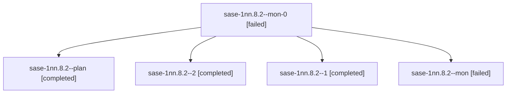

# Session: sase-1nn.8.2

[Agent Hoods](../README.md) / [bbugyi200](../users/bbugyi200/README.md) / [athena](../users/bbugyi200/machines/athena/README.md) / [sase-1nn](../users/bbugyi200/machines/athena/hoods/sase-1nn/README.md) / sase-1nn.8.2

Owner: `bbugyi200.athena` · Hood: `sase-1nn` · Members: 5 · Bead: [sase-1nn.8.2](https://github.com/sase-org/sase--beads/blob/main/pages/sase-1nn/sase-1nn.8.2.md)

## Lineage

The diagram is an optional enhancement; the ordered table below contains the same lineage in accessible text.

| Role | Agent | State | Model / provider | Timing | Commits | Prompt | Chat |
|---|---|---|---|---|---:|---|---|
| mon-0 | sase-1nn.8.2--mon-0 | failed | grok-4.6 / grok | 2026-10-23T22:51:13.011831+00:00 → 2026-10-23T23:44:20.988359+00:00 | 0 | — | [Chat](../agents/bbugyi200.athena.sase-1nn.8.2--mon-0/chat.md) |
| plan | sase-1nn.8.2--plan | completed | grok-4.6 / grok | 2026-10-23T22:35:24.347903+00:00 → 2026-10-23T22:42:19.654911+00:00 | 0 | [Prompt](../agents/bbugyi200.athena.sase-1nn.8.2--plan/prompt.md) | [Chat](../agents/bbugyi200.athena.sase-1nn.8.2--plan/chat.md) |
| 2 | sase-1nn.8.2--2 | completed | grok-4.6 / grok | 2026-10-23T23:45:30.668761+00:00 → 2026-10-24T00:27:40.545251+00:00 | [1](../agents/bbugyi200.athena.sase-1nn.8.2--2/README.md#commits) | [Prompt](../agents/bbugyi200.athena.sase-1nn.8.2--2/prompt.md) | [Chat](../agents/bbugyi200.athena.sase-1nn.8.2--2/chat.md) |
| 1 | sase-1nn.8.2--1 | completed | grok-4.6 / grok | 2026-10-23T22:45:40.837151+00:00 → 2026-10-23T22:52:25.790230+00:00 | 0 | [Prompt](../agents/bbugyi200.athena.sase-1nn.8.2--1/prompt.md) | [Chat](../agents/bbugyi200.athena.sase-1nn.8.2--1/chat.md) |
| mon | sase-1nn.8.2--mon | failed | grok-4.6 / grok | 2026-10-23T22:41:44.245917+00:00 → 2026-10-23T22:44:37.043697+00:00 | 0 | — | [Chat](../agents/bbugyi200.athena.sase-1nn.8.2--mon/chat.md) |

## Commits

| Role | Repo | Commit | Subject | Committed |
|---|---|---|---|---|
| 2 | sase | [`dd0c6d8`](https://github.com/sase-org/sase/commit/dd0c6d8d191d2c7c099ec939dbec80cd5ceaf06a) | chore(deps): pin sase-core-rs to 0.42.3 | 2026-10-23 20:24:14 EDT |

## Neighbors

| Agent | Relation | State |
|---|---|---|
| [sase-1nn.8.1](../agents/bbugyi200.athena.sase-1nn.8.1/README.md) | sase-1nn.8 hood | completed |
| [sase-1nn.8.3](bbugyi200.athena.sase-1nn.8.3.md) (session · 2) | sase-1nn.8 hood | active 1, completed 1 |
| [sase-1nn.8.land](../agents/bbugyi200.athena.sase-1nn.8.land/README.md) | sase-1nn.8 hood | waiting |
| [sase-1nn.1](../agents/bbugyi200.athena.sase-1nn.1/README.md) | sase-1nn hood | completed |
| [sase-1nn.2](bbugyi200.athena.sase-1nn.2.md) (session · 5) | sase-1nn hood | completed 3, failed 2 |
| [sase-1nn.3](bbugyi200.athena.sase-1nn.3.md) (session · 3) | sase-1nn hood | completed 2, failed 1 |
| [sase-1nn.4](../agents/bbugyi200.athena.sase-1nn.4/README.md) | sase-1nn hood | completed |
| [sase-1nn.5](bbugyi200.athena.sase-1nn.5.md) (session · 15) | sase-1nn hood | completed 8, failed 7 |
| [sase-1nn.6](../agents/bbugyi200.athena.sase-1nn.6/README.md) | sase-1nn hood | completed |
| [sase-1nn.7](bbugyi200.athena.sase-1nn.7.md) (session · 2) | sase-1nn hood | completed 1, failed 1 |
| [sase-1nn.land](bbugyi200.athena.sase-1nn.land.md) (session · 3) | sase-1nn hood | failed 3 |
