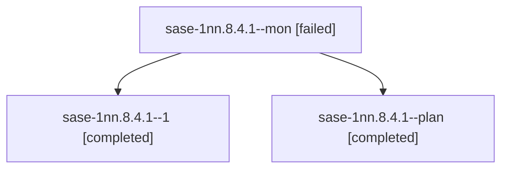

# Session: sase-1nn.8.4.1

[Agent Hoods](../README.md) / [bbugyi200](../users/bbugyi200/README.md) / [athena](../users/bbugyi200/machines/athena/README.md) / [sase-1nn](../users/bbugyi200/machines/athena/hoods/sase-1nn/README.md) / sase-1nn.8.4.1

Owner: `bbugyi200.athena` · Hood: `sase-1nn` · Members: 3 · Bead: [sase-1nn.8.4.1](https://github.com/sase-org/sase--beads/blob/main/pages/sase-1nn/sase-1nn.8.4.1.md)

## Lineage

The diagram is an optional enhancement; the ordered table below contains the same lineage in accessible text.

| Role | Agent | State | Model / provider | Timing | Commits | Prompt | Chat |
|---|---|---|---|---|---:|---|---|
| mon | sase-1nn.8.4.1--mon | failed | grok-4.6 / grok | 2026-10-24T07:16:35.428757+00:00 → 2026-10-24T07:25:55.165349+00:00 | 0 | — | [Chat](../agents/bbugyi200.athena.sase-1nn.8.4.1--mon/chat.md) |
| 1 | sase-1nn.8.4.1--1 | completed | grok-4.6 / grok | 2026-10-24T07:26:48.743906+00:00 → 2026-10-24T07:35:34.743623+00:00 | [1](../agents/bbugyi200.athena.sase-1nn.8.4.1--1/README.md#commits) | [Prompt](../agents/bbugyi200.athena.sase-1nn.8.4.1--1/prompt.md) | [Chat](../agents/bbugyi200.athena.sase-1nn.8.4.1--1/chat.md) |
| plan | sase-1nn.8.4.1--plan | completed | grok-4.6 / grok | 2026-10-24T06:49:15.263206+00:00 → 2026-10-24T07:17:15.224583+00:00 | 0 | [Prompt](../agents/bbugyi200.athena.sase-1nn.8.4.1--plan/prompt.md) | [Chat](../agents/bbugyi200.athena.sase-1nn.8.4.1--plan/chat.md) |

## Commits

| Role | Repo | Commit | Subject | Committed |
|---|---|---|---|---|
| 1 | sase | [`dc2cc11`](https://github.com/sase-org/sase/commit/dc2cc11324f6cd3696603ec56e2458f113936ab1) | test(stats): repair Python 3.12 project help and Archive help goldens | 2026-10-24 03:32:15 EDT |

## Neighbors

| Agent | Relation | State |
|---|---|---|
| [sase-1nn.8.4.2](bbugyi200.athena.sase-1nn.8.4.2.md) (session · 2) | sase-1nn.8.4 hood | completed 1, failed 1 |
| [sase-1nn.8.4.land](bbugyi200.athena.sase-1nn.8.4.land.md) (session · 3) | sase-1nn.8.4 hood | active 2, failed 1 |
| [sase-1nn.8.1](../agents/bbugyi200.athena.sase-1nn.8.1/README.md) | sase-1nn.8 hood | active |
| [sase-1nn.8.2](bbugyi200.athena.sase-1nn.8.2.md) (session · 5) | sase-1nn.8 hood | active 5 |
| [sase-1nn.8.3](bbugyi200.athena.sase-1nn.8.3.md) (session · 2) | sase-1nn.8 hood | active 2 |
| [sase-1nn.8.land](bbugyi200.athena.sase-1nn.8.land.md) (session · 3) | sase-1nn.8 hood | active 3 |
| [sase-1nn.1](../agents/bbugyi200.athena.sase-1nn.1/README.md) | sase-1nn hood | active |
| [sase-1nn.2](bbugyi200.athena.sase-1nn.2.md) (session · 5) | sase-1nn hood | active 5 |
| [sase-1nn.3](bbugyi200.athena.sase-1nn.3.md) (session · 3) | sase-1nn hood | active 3 |
| [sase-1nn.4](../agents/bbugyi200.athena.sase-1nn.4/README.md) | sase-1nn hood | active |
| [sase-1nn.5](bbugyi200.athena.sase-1nn.5.md) (session · 15) | sase-1nn hood | active 15 |
| [sase-1nn.6](../agents/bbugyi200.athena.sase-1nn.6/README.md) | sase-1nn hood | active |
| [sase-1nn.7](bbugyi200.athena.sase-1nn.7.md) (session · 2) | sase-1nn hood | active 2 |
| [sase-1nn.land](bbugyi200.athena.sase-1nn.land.md) (session · 3) | sase-1nn hood | active 3 |
