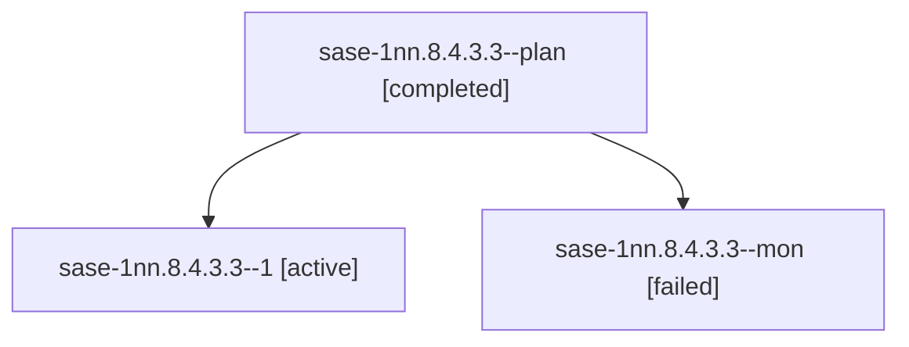

# Session: sase-1nn.8.4.3.3

[Agent Hoods](../README.md) / [bbugyi200](../users/bbugyi200/README.md) / [athena](../users/bbugyi200/machines/athena/README.md) / [sase-1nn](../users/bbugyi200/machines/athena/hoods/sase-1nn/README.md) / sase-1nn.8.4.3.3

Owner: `bbugyi200.athena` · Hood: `sase-1nn` · Members: 3 · Bead: [sase-1nn.8.4.3.3](https://github.com/sase-org/sase--beads/blob/main/pages/sase-1nn/sase-1nn.8.4.3.3.md)

## Lineage

The diagram is an optional enhancement; the ordered table below contains the same lineage in accessible text.

| Role | Agent | State | Model / provider | Timing | Commits | Prompt | Chat |
|---|---|---|---|---|---:|---|---|
| plan | sase-1nn.8.4.3.3--plan | completed | muse-spark-1.3-contributor / muse | 2026-10-24T20:41:17.151698+00:00 → 2026-10-24T21:00:22.496618+00:00 | 0 | [Prompt](../agents/bbugyi200.athena.sase-1nn.8.4.3.3--plan/prompt.md) | [Chat](../agents/bbugyi200.athena.sase-1nn.8.4.3.3--plan/chat.md) |
| 1 | sase-1nn.8.4.3.3--1 | active | muse-spark-1.3-contributor / muse | 2026-10-24T21:10:57.613105+00:00 | [1](../agents/bbugyi200.athena.sase-1nn.8.4.3.3--1/README.md#commits) | [Prompt](../agents/bbugyi200.athena.sase-1nn.8.4.3.3--1/prompt.md) | — |
| mon | sase-1nn.8.4.3.3--mon | failed | muse-spark-1.3-contributor / muse | 2026-10-24T20:59:45.507932+00:00 → 2026-10-24T21:09:48.469482+00:00 | 0 | — | [Chat](../agents/bbugyi200.athena.sase-1nn.8.4.3.3--mon/chat.md) |

## Commits

| Role | Repo | Commit | Subject | Committed |
|---|---|---|---|---|
| 1 | sase | [`5e79f64`](https://github.com/sase-org/sase/commit/5e79f6405f263f48fffc2e9f9f59ca34fa2ce23f) | fix(visual): regenerate stranded Beads golden and prove full screenshot check clean | 2026-10-24 17:14:56 EDT |

## Neighbors

| Agent | Relation | State |
|---|---|---|
| [sase-1nn.8.4.3.1](bbugyi200.athena.sase-1nn.8.4.3.1.md) (session · 3) | sase-1nn.8.4.3 hood | completed 2, failed 1 |
| [sase-1nn.8.4.3.2](../agents/bbugyi200.athena.sase-1nn.8.4.3.2/README.md) | sase-1nn.8.4.3 hood | completed |
| [sase-1nn.8.4.3.4](../agents/bbugyi200.athena.sase-1nn.8.4.3.4/README.md) | sase-1nn.8.4.3 hood | waiting |
| [sase-1nn.8.4.3.land](../agents/bbugyi200.athena.sase-1nn.8.4.3.land/README.md) | sase-1nn.8.4.3 hood | waiting |
| [sase-1nn.8.4.1](bbugyi200.athena.sase-1nn.8.4.1.md) (session · 3) | sase-1nn.8.4 hood | completed 2, failed 1 |
| [sase-1nn.8.4.2](bbugyi200.athena.sase-1nn.8.4.2.md) (session · 2) | sase-1nn.8.4 hood | completed 1, failed 1 |
| [sase-1nn.8.4.land](bbugyi200.athena.sase-1nn.8.4.land.md) (session · 13) | sase-1nn.8.4 hood | completed 7, failed 6 |
| [sase-1nn.8.1](../agents/bbugyi200.athena.sase-1nn.8.1/README.md) | sase-1nn.8 hood | active |
| [sase-1nn.8.2](bbugyi200.athena.sase-1nn.8.2.md) (session · 5) | sase-1nn.8 hood | active 5 |
| [sase-1nn.8.3](bbugyi200.athena.sase-1nn.8.3.md) (session · 2) | sase-1nn.8 hood | active 2 |
| [sase-1nn.8.land](bbugyi200.athena.sase-1nn.8.land.md) (session · 3) | sase-1nn.8 hood | active 3 |
| [sase-1nn.1](../agents/bbugyi200.athena.sase-1nn.1/README.md) | sase-1nn hood | active |
| [sase-1nn.2](bbugyi200.athena.sase-1nn.2.md) (session · 5) | sase-1nn hood | active 5 |
| [sase-1nn.3](bbugyi200.athena.sase-1nn.3.md) (session · 3) | sase-1nn hood | active 3 |
| [sase-1nn.4](../agents/bbugyi200.athena.sase-1nn.4/README.md) | sase-1nn hood | active |
| [sase-1nn.5](bbugyi200.athena.sase-1nn.5.md) (session · 15) | sase-1nn hood | active 15 |
| [sase-1nn.6](../agents/bbugyi200.athena.sase-1nn.6/README.md) | sase-1nn hood | active |
| [sase-1nn.7](bbugyi200.athena.sase-1nn.7.md) (session · 2) | sase-1nn hood | active 2 |
| [sase-1nn.land](bbugyi200.athena.sase-1nn.land.md) (session · 3) | sase-1nn hood | active 3 |
