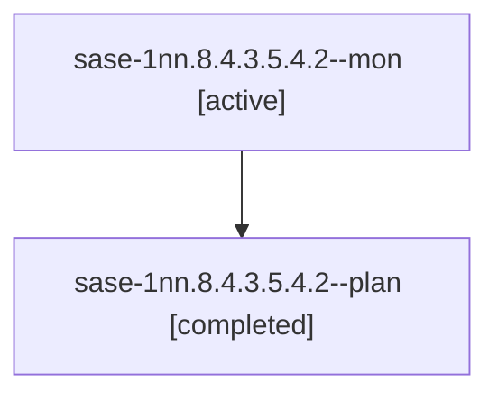

# Session: sase-1nn.8.4.3.5.4.2

[Agent Hoods](../README.md) / [bbugyi200](../users/bbugyi200/README.md) / [athena](../users/bbugyi200/machines/athena/README.md) / [sase-1nn](../users/bbugyi200/machines/athena/hoods/sase-1nn/README.md) / sase-1nn.8.4.3.5.4.2

Owner: `bbugyi200.athena` · Hood: `sase-1nn` · Members: 2 · Bead: [sase-1nn.8.4.3.5.4.2](https://github.com/sase-org/sase--beads/blob/main/pages/sase-1nn/sase-1nn.8.4.3.5.4.2.md)

## Lineage



The diagram is an optional enhancement; the ordered table below contains the same lineage in accessible text.

| Role | Agent | State | Model / provider | Timing | Commits | Prompt | Chat |
|---|---|---|---|---|---:|---|---|
| <a id="member-mon"></a>mon | sase-1nn.8.4.3.5.4.2--mon | active | muse-spark-1.3-contributor / muse | 2026-10-25T08:30:18.824937+00:00 | 0 | — | — |
| <a id="member-plan"></a>plan | sase-1nn.8.4.3.5.4.2--plan | completed | muse-spark-1.3-contributor / muse | 2026-10-25T08:03:30.309611+00:00 → 2026-10-25T08:30:53.739428+00:00 | 0 | [Prompt](../agents/bbugyi200.athena.sase-1nn.8.4.3.5.4.2--plan/prompt.md) | [Chat](../agents/bbugyi200.athena.sase-1nn.8.4.3.5.4.2--plan/chat.md) |

## Variables

| Role | Variable | Value |
|---|---|---|
| plan | `artifacts` | \[{bead: sase-1nn.8.4.3.5.4.2, kind: file, label: watch-sase-1nn.8.4.3.5.4.2.sh, path: /home/bryan/.sase/artifacts/agents/gh\_sase-org\_\_sase/20261025033845/watch-ea920e6bcac5.sh, ref: file:explicit:779… |

#### artifacts

**Role:** `plan`

```yaml
- bead: sase-1nn.8.4.3.5.4.2
  kind: file
  label: watch-sase-1nn.8.4.3.5.4.2.sh
  path: /home/bryan/.sase/artifacts/agents/gh_sase-org__sase/20261025033845/watch-ea920e6bcac5.sh
  ref: file:explicit:779c018d76cca5d8d93d8d3f
  source_path: /tmp/sase-release-watch-sase-1nn.8.4.3.5.4.2/watch.sh
- bead: sase-1nn.8.4.3.5.4.2
  kind: file
  label: wrapper-sase-1nn.8.4.3.5.4.2.sh
  path: /home/bryan/.sase/artifacts/agents/gh_sase-org__sase/20261025033845/wrapper-47a062678f9d.sh
  ref: file:explicit:94ffb1bee494b28f971676cd
  source_path: /tmp/sase-release-watch-sase-1nn.8.4.3.5.4.2/wrapper.sh
- bead: sase-1nn.8.4.3.5.4.2
  kind: file
  label: watch-sase-1nn.8.4.3.5.4.2-proof.log
  path: /home/bryan/.sase/artifacts/agents/gh_sase-org__sase/20261025033845/proof-stub-tests-557ee1526659.log
  ref: file:explicit:11e532db57f8414644dab3e5
  source_path: /tmp/sase-release-watch-sase-1nn.8.4.3.5.4.2/proof-stub-tests.log
```

Values are truncated for display; see each member's agent meta.json for the full values.

## Neighbors

| Agent | Relation | State |
|---|---|---|
| [sase-1nn.8.4.3.5.4.1](../agents/bbugyi200.athena.sase-1nn.8.4.3.5.4.1/README.md) | sase-1nn.8.4.3.5.4 hood | completed |
| [sase-1nn.8.4.3.5.4.land](../agents/bbugyi200.athena.sase-1nn.8.4.3.5.4.land/README.md) | sase-1nn.8.4.3.5.4 hood | waiting |
| [sase-1nn.8.4.3.5.1](bbugyi200.athena.sase-1nn.8.4.3.5.1.md) (session · 3) | sase-1nn.8.4.3.5 hood | active 3 |
| [sase-1nn.8.4.3.5.2](../agents/bbugyi200.athena.sase-1nn.8.4.3.5.2/README.md) | sase-1nn.8.4.3.5 hood | active |
| [sase-1nn.8.4.3.5.3](bbugyi200.athena.sase-1nn.8.4.3.5.3.md) (session · 2) | sase-1nn.8.4.3.5 hood | active 2 |
| [sase-1nn.8.4.3.5.land](bbugyi200.athena.sase-1nn.8.4.3.5.land.md) (session · 3) | sase-1nn.8.4.3.5 hood | active 3 |
| [sase-1nn.8.4.3.1](bbugyi200.athena.sase-1nn.8.4.3.1.md) (session · 3) | sase-1nn.8.4.3 hood | active 3 |
| [sase-1nn.8.4.3.2](../agents/bbugyi200.athena.sase-1nn.8.4.3.2/README.md) | sase-1nn.8.4.3 hood | active |
| [sase-1nn.8.4.3.3](bbugyi200.athena.sase-1nn.8.4.3.3.md) (session · 3) | sase-1nn.8.4.3 hood | active 3 |
| [sase-1nn.8.4.3.4](bbugyi200.athena.sase-1nn.8.4.3.4.md) (session · 2) | sase-1nn.8.4.3 hood | active 2 |
| [sase-1nn.8.4.3.land](bbugyi200.athena.sase-1nn.8.4.3.land.md) (session · 3) | sase-1nn.8.4.3 hood | active 3 |
| [sase-1nn.8.4.1](bbugyi200.athena.sase-1nn.8.4.1.md) (session · 3) | sase-1nn.8.4 hood | active 3 |
| [sase-1nn.8.4.2](bbugyi200.athena.sase-1nn.8.4.2.md) (session · 2) | sase-1nn.8.4 hood | active 2 |
| [sase-1nn.8.4.land](bbugyi200.athena.sase-1nn.8.4.land.md) (session · 13) | sase-1nn.8.4 hood | active 11, completed 1, failed 1 |
| [sase-1nn.8.1](../agents/bbugyi200.athena.sase-1nn.8.1/README.md) | sase-1nn.8 hood | active |
| [sase-1nn.8.2](bbugyi200.athena.sase-1nn.8.2.md) (session · 5) | sase-1nn.8 hood | active 5 |
| [sase-1nn.8.3](bbugyi200.athena.sase-1nn.8.3.md) (session · 2) | sase-1nn.8 hood | active 2 |
| [sase-1nn.8.land](bbugyi200.athena.sase-1nn.8.land.md) (session · 3) | sase-1nn.8 hood | active 3 |
| [sase-1nn.1](../agents/bbugyi200.athena.sase-1nn.1/README.md) | sase-1nn hood | active |
| [sase-1nn.2](bbugyi200.athena.sase-1nn.2.md) (session · 5) | sase-1nn hood | active 5 |
| [sase-1nn.3](bbugyi200.athena.sase-1nn.3.md) (session · 3) | sase-1nn hood | active 3 |
| [sase-1nn.4](../agents/bbugyi200.athena.sase-1nn.4/README.md) | sase-1nn hood | active |
| [sase-1nn.5](bbugyi200.athena.sase-1nn.5.md) (session · 15) | sase-1nn hood | active 15 |
| [sase-1nn.6](../agents/bbugyi200.athena.sase-1nn.6/README.md) | sase-1nn hood | active |
| [sase-1nn.7](bbugyi200.athena.sase-1nn.7.md) (session · 2) | sase-1nn hood | active 2 |
| [sase-1nn.land](bbugyi200.athena.sase-1nn.land.md) (session · 3) | sase-1nn hood | active 3 |
