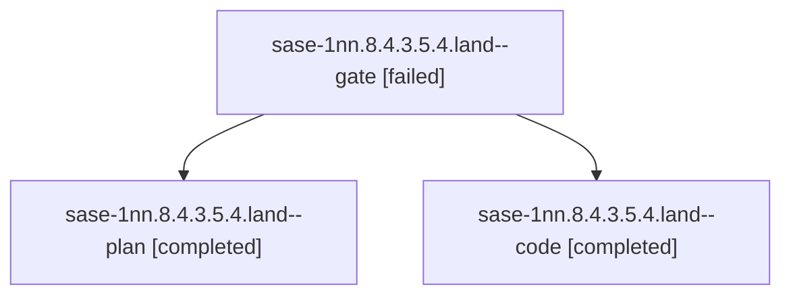

# Session: sase-1nn.8.4.3.5.4.land

[Agent Hoods](../README.md) / [bbugyi200](../users/bbugyi200/README.md) / [athena](../users/bbugyi200/machines/athena/README.md) / [sase-1nn](../users/bbugyi200/machines/athena/hoods/sase-1nn/README.md) / sase-1nn.8.4.3.5.4.land

Owner: `bbugyi200.athena` · Hood: `sase-1nn` · Members: 3 · Bead: [sase-1nn.8.4.3.5.4](https://github.com/sase-org/sase--beads/blob/main/pages/sase-1nn/sase-1nn.8.4.3.5.4.md)

## Lineage



The diagram is an optional enhancement; the ordered table below contains the same lineage in accessible text.

| Role | Agent | State | Model / provider | Timing | Commits | Prompt | Chat |
|---|---|---|---|---|---:|---|---|
| <a id="member-gate"></a>gate | sase-1nn.8.4.3.5.4.land--gate | failed | gpt-6-astra / codex | 2026-10-25T16:36:10.851893+00:00 → 2026-10-25T16:36:44.540180+00:00 | 0 | — | [Chat](../agents/bbugyi200.athena.sase-1nn.8.4.3.5.4.land--gate/chat.md) |
| <a id="member-plan"></a>plan | sase-1nn.8.4.3.5.4.land--plan | completed | gpt-6-astra / codex | 2026-10-25T16:22:56.579675+00:00 → 2026-10-25T17:27:11.282169+00:00 | 0 | [Prompt](../agents/bbugyi200.athena.sase-1nn.8.4.3.5.4.land--plan/prompt.md) | [Chat](../agents/bbugyi200.athena.sase-1nn.8.4.3.5.4.land--plan/chat.md) |
| <a id="member-code"></a>code | sase-1nn.8.4.3.5.4.land--code | completed | muse-spark-1.3-contributor / muse | 2026-10-25T16:37:18.949583+00:00 → 2026-10-25T17:27:11.282169+00:00 | 0 | — | [Chat](../agents/bbugyi200.athena.sase-1nn.8.4.3.5.4.land--code/chat.md) |

## Variables

| Role | Variable | Value |
|---|---|---|
| code | `artifacts` | \[{bead: sase-1nn.8.4.3.5.4, kind: file, label: watch-corrected-sase-1nn.8.4.3.5.4.sh, path: /home/bryan/.sase/artifacts/agents/gh\_sase-org\_\_sase/20261025123718/watch-e1259819ab9c.sh, ref: file:explic… |
| plan | `artifacts` | \[{bead: sase-1nn.8.4.3.5.4, kind: file, label: 0.18.1 release proof and watcher regression reproductions, path: /home/bryan/.sase/artifacts/agents/gh\_sase-org\_\_sase/20261025033846/audit-bundle.tar-47… |

#### artifacts

**Role:** `code`

```yaml
- bead: sase-1nn.8.4.3.5.4
  kind: file
  label: watch-corrected-sase-1nn.8.4.3.5.4.sh
  path: /home/bryan/.sase/artifacts/agents/gh_sase-org__sase/20261025123718/watch-e1259819ab9c.sh
  ref: file:explicit:c9c67d045dc4ab3914700c7f
  source_path: /tmp/sase-final-repairs-corrected/watch.sh
- bead: sase-1nn.8.4.3.5.4
  kind: file
  label: wrapper-corrected-sase-1nn.8.4.3.5.4.sh
  path: /home/bryan/.sase/artifacts/agents/gh_sase-org__sase/20261025123718/wrapper-105600eddc4b.sh
  ref: file:explicit:1e0ab9ab99957072dc97bc3c
  source_path: /tmp/sase-final-repairs-corrected/wrapper.sh
- bead: sase-1nn.8.4.3.5.4
  kind: file
  label: watcher-harness-corrected-sase-1nn.8.4.3.5.4.sh
  path: /home/bryan/.sase/artifacts/agents/gh_sase-org__sase/20261025123718/run_tests-5df0f2263d51.sh
  ref: file:explicit:94a8441efe4a276c445ed91d
  source_path: /tmp/sase-final-repairs-corrected/tests/run_tests.sh
- bead: sase-1nn.8.4.3.5.4
  kind: file
  label: watcher-proof-corrected-sase-1nn.8.4.3.5.4.log
  path: /home/bryan/.sase/artifacts/agents/gh_sase-org__sase/20261025123718/results-0b7d5e5a0916.log
  ref: file:explicit:0e4a6b022c54bb52b5c89b40
  source_path: /tmp/sase-final-repairs-corrected/results.log
- bead: sase-1nn.8.4.3.5.4
  kind: file
  label: watcher-bundle-corrected-sase-1nn.8.4.3.5.4.tar.gz
  path: /home/bryan/.sase/artifacts/agents/gh_sase-org__sase/20261025123718/corrected-watcher-bundle.tar-8e7ef559c57c.gz
  ref: file:explicit:4ba0356b7df4109c81997f99
  source_path: /tmp/corrected-watcher-bundle.tar.gz
```

#### artifacts

**Role:** `plan`

```yaml
- bead: sase-1nn.8.4.3.5.4
  kind: file
  label: 0.18.1 release proof and watcher regression reproductions
  path: /home/bryan/.sase/artifacts/agents/gh_sase-org__sase/20261025033846/audit-bundle.tar-47d8cda67841.gz
  ref: file:explicit:fc94b2bb95274482414ab2f3
  source_path: /tmp/sase-land-1nn-8-4-3-5-4/audit-bundle.tar.gz
- bead: sase-1nn.8.4.3.5.4
  kind: markdown
  label: Landing audit: released 0.18.1, remaining watcher defects
  path: /home/bryan/.sase/artifacts/agents/gh_sase-org__sase/20261025033846/audit-bf3c2da9e86a.md
  ref: file:explicit:fed0aeb43856ff96f2c10495
  source_path: /tmp/sase-land-1nn-8-4-3-5-4/audit.md
```

Values are truncated for display; see each member's agent meta.json for the full values.

## Neighbors

| Agent | Relation | State |
|---|---|---|
| [sase-1nn.8.4.3.5.4.1](../agents/bbugyi200.athena.sase-1nn.8.4.3.5.4.1/README.md) | sase-1nn.8.4.3.5.4 hood | completed |
| [sase-1nn.8.4.3.5.4.2](bbugyi200.athena.sase-1nn.8.4.3.5.4.2.md) (session · 2) | sase-1nn.8.4.3.5.4 hood | completed 1, failed 1 |
| [sase-1nn.8.4.3.5.1](bbugyi200.athena.sase-1nn.8.4.3.5.1.md) (session · 3) | sase-1nn.8.4.3.5 hood | active 3 |
| [sase-1nn.8.4.3.5.2](../agents/bbugyi200.athena.sase-1nn.8.4.3.5.2/README.md) | sase-1nn.8.4.3.5 hood | active |
| [sase-1nn.8.4.3.5.3](bbugyi200.athena.sase-1nn.8.4.3.5.3.md) (session · 2) | sase-1nn.8.4.3.5 hood | active 2 |
| [sase-1nn.8.4.3.5.land](bbugyi200.athena.sase-1nn.8.4.3.5.land.md) (session · 3) | sase-1nn.8.4.3.5 hood | active 3 |
| [sase-1nn.8.4.3.1](bbugyi200.athena.sase-1nn.8.4.3.1.md) (session · 3) | sase-1nn.8.4.3 hood | active 3 |
| [sase-1nn.8.4.3.2](../agents/bbugyi200.athena.sase-1nn.8.4.3.2/README.md) | sase-1nn.8.4.3 hood | active |
| [sase-1nn.8.4.3.3](bbugyi200.athena.sase-1nn.8.4.3.3.md) (session · 3) | sase-1nn.8.4.3 hood | active 3 |
| [sase-1nn.8.4.3.4](bbugyi200.athena.sase-1nn.8.4.3.4.md) (session · 2) | sase-1nn.8.4.3 hood | active 2 |
| [sase-1nn.8.4.3.land](bbugyi200.athena.sase-1nn.8.4.3.land.md) (session · 3) | sase-1nn.8.4.3 hood | active 3 |
| [sase-1nn.8.4.1](bbugyi200.athena.sase-1nn.8.4.1.md) (session · 3) | sase-1nn.8.4 hood | active 3 |
| [sase-1nn.8.4.2](bbugyi200.athena.sase-1nn.8.4.2.md) (session · 2) | sase-1nn.8.4 hood | active 2 |
| [sase-1nn.8.4.land](bbugyi200.athena.sase-1nn.8.4.land.md) (session · 13) | sase-1nn.8.4 hood | active 11, completed 1, failed 1 |
| [sase-1nn.8.1](../agents/bbugyi200.athena.sase-1nn.8.1/README.md) | sase-1nn.8 hood | active |
| [sase-1nn.8.2](bbugyi200.athena.sase-1nn.8.2.md) (session · 5) | sase-1nn.8 hood | active 5 |
| [sase-1nn.8.3](bbugyi200.athena.sase-1nn.8.3.md) (session · 2) | sase-1nn.8 hood | active 2 |
| [sase-1nn.8.land](bbugyi200.athena.sase-1nn.8.land.md) (session · 3) | sase-1nn.8 hood | active 3 |
| [sase-1nn.1](../agents/bbugyi200.athena.sase-1nn.1/README.md) | sase-1nn hood | active |
| [sase-1nn.2](bbugyi200.athena.sase-1nn.2.md) (session · 5) | sase-1nn hood | active 5 |
| [sase-1nn.3](bbugyi200.athena.sase-1nn.3.md) (session · 3) | sase-1nn hood | active 3 |
| [sase-1nn.4](../agents/bbugyi200.athena.sase-1nn.4/README.md) | sase-1nn hood | active |
| [sase-1nn.5](bbugyi200.athena.sase-1nn.5.md) (session · 15) | sase-1nn hood | active 15 |
| [sase-1nn.6](../agents/bbugyi200.athena.sase-1nn.6/README.md) | sase-1nn hood | active |
| [sase-1nn.7](bbugyi200.athena.sase-1nn.7.md) (session · 2) | sase-1nn hood | active 2 |
| [sase-1nn.land](bbugyi200.athena.sase-1nn.land.md) (session · 3) | sase-1nn hood | active 3 |
