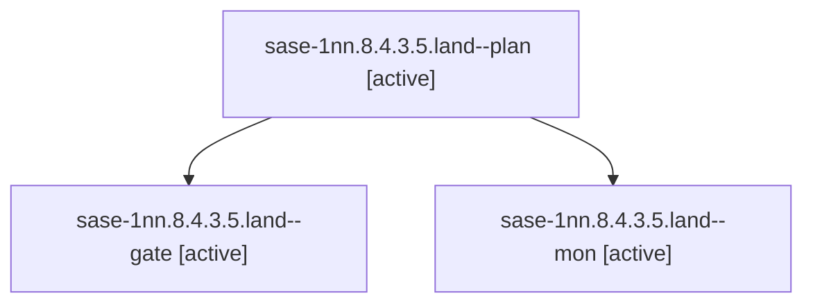

# Session: sase-1nn.8.4.3.5.land

[Agent Hoods](../README.md) / [bbugyi200](../users/bbugyi200/README.md) / [athena](../users/bbugyi200/machines/athena/README.md) / [sase-1nn](../users/bbugyi200/machines/athena/hoods/sase-1nn/README.md) / sase-1nn.8.4.3.5.land

Owner: `bbugyi200.athena` · Hood: `sase-1nn` · Members: 3 · Bead: [sase-1nn.8.4.3.5](https://github.com/sase-org/sase--beads/blob/main/pages/sase-1nn/sase-1nn.8.4.3.5.md)

## Lineage



The diagram is an optional enhancement; the ordered table below contains the same lineage in accessible text.

| Role | Agent | State | Model / provider | Timing | Commits | Prompt | Chat |
|---|---|---|---|---|---:|---|---|
| <a id="member-plan"></a>plan | sase-1nn.8.4.3.5.land--plan | active | gpt-6-astra / codex | 2026-10-25T07:15:24.199745+00:00 | 0 | [Prompt](../agents/bbugyi200.athena.sase-1nn.8.4.3.5.land--plan/prompt.md) | [Chat](../agents/bbugyi200.athena.sase-1nn.8.4.3.5.land--plan/chat.md) |
| <a id="member-gate"></a>gate | sase-1nn.8.4.3.5.land--gate | active | gpt-6-astra / codex | 2026-10-25T07:35:47.284807+00:00 | 0 | — | [Chat](../agents/bbugyi200.athena.sase-1nn.8.4.3.5.land--gate/chat.md) |
| <a id="member-mon"></a>mon | sase-1nn.8.4.3.5.land--mon | active | gpt-6-astra / codex | 2026-10-25T07:37:08.576089+00:00 | 0 | — | [Chat](../agents/bbugyi200.athena.sase-1nn.8.4.3.5.land--mon/chat.md) |

## Variables

| Role | Variable | Value |
|---|---|---|
| plan | `artifacts` | \[{bead: sase-1nn.8.4.3.5, kind: markdown, label: Release integration landing audit and CI excerpts, path: /home/bryan/.sase/artifacts/agents/gh\_sase-org\_\_sase/20261024222320/sase-1nn-release-landing-… |

#### artifacts

**Role:** `plan`

```yaml
- bead: sase-1nn.8.4.3.5
  kind: markdown
  label: Release integration landing audit and CI excerpts
  path: /home/bryan/.sase/artifacts/agents/gh_sase-org__sase/20261024222320/sase-1nn-release-landing-evidence-e6e7b3e0f003.md
  ref: file:explicit:133becdc381754837787779d
  source_path: /tmp/sase-1nn-release-landing-evidence.md
- bead: sase-1nn.8.4.3.5
  kind: file
  label: Question timezone reproduction and singleton serial pass
  path: /home/bryan/.sase/artifacts/agents/gh_sase-org__sase/20261024222320/sase-1nn-landing-local-proof-ac0e6bcdc0bd.txt
  ref: file:explicit:c855286573bb6fa4ceb034f1
  source_path: /tmp/sase-1nn-landing-local-proof.txt
```

Values are truncated for display; see each member's agent meta.json for the full values.

## Neighbors

| Agent | Relation | State |
|---|---|---|
| [sase-1nn.8.4.3.5.1](bbugyi200.athena.sase-1nn.8.4.3.5.1.md) (session · 3) | sase-1nn.8.4.3.5 hood | active 3 |
| [sase-1nn.8.4.3.5.2](../agents/bbugyi200.athena.sase-1nn.8.4.3.5.2/README.md) | sase-1nn.8.4.3.5 hood | active |
| [sase-1nn.8.4.3.5.3](bbugyi200.athena.sase-1nn.8.4.3.5.3.md) (session · 2) | sase-1nn.8.4.3.5 hood | active 2 |
| [sase-1nn.8.4.3.5.4.1](../agents/bbugyi200.athena.sase-1nn.8.4.3.5.4.1/README.md) | sase-1nn.8.4.3.5 hood | completed |
| [sase-1nn.8.4.3.5.4.2](bbugyi200.athena.sase-1nn.8.4.3.5.4.2.md) (session · 2) | sase-1nn.8.4.3.5 hood | completed 1, failed 1 |
| [sase-1nn.8.4.3.5.4.land](bbugyi200.athena.sase-1nn.8.4.3.5.4.land.md) (session · 3) | sase-1nn.8.4.3.5 hood | active 2, failed 1 |
| [sase-1nn.8.4.3.1](bbugyi200.athena.sase-1nn.8.4.3.1.md) (session · 3) | sase-1nn.8.4.3 hood | active 3 |
| [sase-1nn.8.4.3.2](../agents/bbugyi200.athena.sase-1nn.8.4.3.2/README.md) | sase-1nn.8.4.3 hood | active |
| [sase-1nn.8.4.3.3](bbugyi200.athena.sase-1nn.8.4.3.3.md) (session · 3) | sase-1nn.8.4.3 hood | active 3 |
| [sase-1nn.8.4.3.4](bbugyi200.athena.sase-1nn.8.4.3.4.md) (session · 2) | sase-1nn.8.4.3 hood | active 2 |
| [sase-1nn.8.4.3.land](bbugyi200.athena.sase-1nn.8.4.3.land.md) (session · 3) | sase-1nn.8.4.3 hood | active 3 |
| [sase-1nn.8.4.1](bbugyi200.athena.sase-1nn.8.4.1.md) (session · 3) | sase-1nn.8.4 hood | active 3 |
| [sase-1nn.8.4.2](bbugyi200.athena.sase-1nn.8.4.2.md) (session · 2) | sase-1nn.8.4 hood | active 2 |
| [sase-1nn.8.4.land](bbugyi200.athena.sase-1nn.8.4.land.md) (session · 13) | sase-1nn.8.4 hood | active 11, completed 1, failed 1 |
| [sase-1nn.8.1](../agents/bbugyi200.athena.sase-1nn.8.1/README.md) | sase-1nn.8 hood | active |
| [sase-1nn.8.2](bbugyi200.athena.sase-1nn.8.2.md) (session · 5) | sase-1nn.8 hood | active 5 |
| [sase-1nn.8.3](bbugyi200.athena.sase-1nn.8.3.md) (session · 2) | sase-1nn.8 hood | active 2 |
| [sase-1nn.8.land](bbugyi200.athena.sase-1nn.8.land.md) (session · 3) | sase-1nn.8 hood | active 3 |
| [sase-1nn.1](../agents/bbugyi200.athena.sase-1nn.1/README.md) | sase-1nn hood | active |
| [sase-1nn.2](bbugyi200.athena.sase-1nn.2.md) (session · 5) | sase-1nn hood | active 5 |
| [sase-1nn.3](bbugyi200.athena.sase-1nn.3.md) (session · 3) | sase-1nn hood | active 3 |
| [sase-1nn.4](../agents/bbugyi200.athena.sase-1nn.4/README.md) | sase-1nn hood | active |
| [sase-1nn.5](bbugyi200.athena.sase-1nn.5.md) (session · 15) | sase-1nn hood | active 15 |
| [sase-1nn.6](../agents/bbugyi200.athena.sase-1nn.6/README.md) | sase-1nn hood | active |
| [sase-1nn.7](bbugyi200.athena.sase-1nn.7.md) (session · 2) | sase-1nn hood | active 2 |
| [sase-1nn.land](bbugyi200.athena.sase-1nn.land.md) (session · 3) | sase-1nn hood | active 3 |
