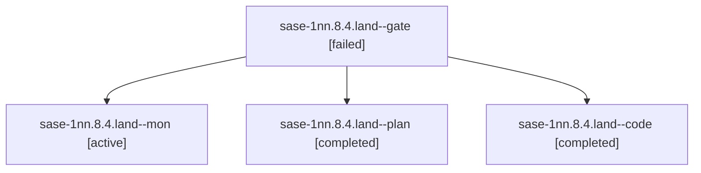

# Session: sase-1nn.8.4.land

[Agent Hoods](../README.md) / [bbugyi200](../users/bbugyi200/README.md) / [athena](../users/bbugyi200/machines/athena/README.md) / [sase-1nn](../users/bbugyi200/machines/athena/hoods/sase-1nn/README.md) / sase-1nn.8.4.land

Owner: `bbugyi200.athena` · Hood: `sase-1nn` · Members: 4 · Bead: [sase-1nn.8.4](https://github.com/sase-org/sase--beads/blob/main/pages/sase-1nn/sase-1nn.8.4.md)

## Lineage



The diagram is an optional enhancement; the ordered table below contains the same lineage in accessible text.

| Role | Agent | State | Model / provider | Timing | Commits | Prompt | Chat |
|---|---|---|---|---|---:|---|---|
| <a id="member-gate"></a>gate | sase-1nn.8.4.land--gate | failed | gpt-6-astra / codex | 2026-10-24T13:00:05.505318+00:00 → 2026-10-24T13:01:17.917037+00:00 | 0 | — | [Chat](../agents/bbugyi200.athena.sase-1nn.8.4.land--gate/chat.md) |
| <a id="member-mon"></a>mon | sase-1nn.8.4.land--mon | active | gpt-6-luna / codex | 2026-10-24T13:06:36.994739+00:00 | 0 | — | — |
| <a id="member-plan"></a>plan | sase-1nn.8.4.land--plan | completed | gpt-6-astra / codex | 2026-10-24T12:37:52.279582+00:00 → 2026-10-24T13:07:11.841032+00:00 | 0 | [Prompt](../agents/bbugyi200.athena.sase-1nn.8.4.land--plan/prompt.md) | [Chat](../agents/bbugyi200.athena.sase-1nn.8.4.land--plan/chat.md) |
| <a id="member-code"></a>code | sase-1nn.8.4.land--code | completed | gpt-6-luna / codex | 2026-10-24T13:02:04.488948+00:00 → 2026-10-24T13:07:11.841032+00:00 | 0 | — | [Chat](../agents/bbugyi200.athena.sase-1nn.8.4.land--code/chat.md) |

## Variables

| Role | Variable | Value |
|---|---|---|
| plan | `artifacts` | \[{bead: sase-1nn.8.4, kind: markdown, label: sase-1nn.8.4 landing audit and independent CI failure evidence, path: /home/bryan/.sase/artifacts/agents/gh\_sase-org\_\_sase/20261024024810/sase-1nn-8-4-lan… |

#### artifacts

**Role:** `plan`

```yaml
- bead: sase-1nn.8.4
  kind: markdown
  label: sase-1nn.8.4 landing audit and independent CI failure evidence
  path: /home/bryan/.sase/artifacts/agents/gh_sase-org__sase/20261024024810/sase-1nn-8-4-landing-audit-51cb43c2ebe7.md
  ref: file:explicit:c12008cebe29a875c6afb8fe
  source_path: /tmp/sase-1nn-8-4-landing-audit.md
```

Values are truncated for display; see each member's agent meta.json for the full values.

## Neighbors

| Agent | Relation | State |
|---|---|---|
| [sase-1nn.8.4.1](bbugyi200.athena.sase-1nn.8.4.1.md) (session · 3) | sase-1nn.8.4 hood | completed 2, failed 1 |
| [sase-1nn.8.4.2](bbugyi200.athena.sase-1nn.8.4.2.md) (session · 2) | sase-1nn.8.4 hood | completed 1, failed 1 |
| [sase-1nn.8.1](../agents/bbugyi200.athena.sase-1nn.8.1/README.md) | sase-1nn.8 hood | active |
| [sase-1nn.8.2](bbugyi200.athena.sase-1nn.8.2.md) (session · 5) | sase-1nn.8 hood | active 5 |
| [sase-1nn.8.3](bbugyi200.athena.sase-1nn.8.3.md) (session · 2) | sase-1nn.8 hood | active 2 |
| [sase-1nn.8.land](bbugyi200.athena.sase-1nn.8.land.md) (session · 3) | sase-1nn.8 hood | active 3 |
| [sase-1nn.1](../agents/bbugyi200.athena.sase-1nn.1/README.md) | sase-1nn hood | active |
| [sase-1nn.2](bbugyi200.athena.sase-1nn.2.md) (session · 5) | sase-1nn hood | active 5 |
| [sase-1nn.3](bbugyi200.athena.sase-1nn.3.md) (session · 3) | sase-1nn hood | active 3 |
| [sase-1nn.4](../agents/bbugyi200.athena.sase-1nn.4/README.md) | sase-1nn hood | active |
| [sase-1nn.5](bbugyi200.athena.sase-1nn.5.md) (session · 15) | sase-1nn hood | active 15 |
| [sase-1nn.6](../agents/bbugyi200.athena.sase-1nn.6/README.md) | sase-1nn hood | active |
| [sase-1nn.7](bbugyi200.athena.sase-1nn.7.md) (session · 2) | sase-1nn hood | active 2 |
| [sase-1nn.land](bbugyi200.athena.sase-1nn.land.md) (session · 3) | sase-1nn hood | active 3 |
