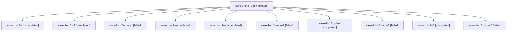

# Session: sase-1no.2

[Agent Hoods](../README.md) / [bbugyi200](../users/bbugyi200/README.md) / [athena](../users/bbugyi200/machines/athena/README.md) / [sase-1no](../users/bbugyi200/machines/athena/hoods/sase-1no/README.md) / sase-1no.2

Owner: `bbugyi200.athena` · Hood: `sase-1no` · Members: 11 · Bead: [sase-1no.2](https://github.com/sase-org/sase--beads/blob/main/pages/sase-1no/sase-1no.2.md)

## Lineage

The diagram is an optional enhancement; the ordered table below contains the same lineage in accessible text.

| Role | Agent | State | Model / provider | Timing | Commits | Prompt | Chat |
|---|---|---|---|---|---:|---|---|
| 2 | sase-1no.2--2 | completed | grok-4.6 / grok | 2026-10-23T19:54:05.334756+00:00 → 2026-10-23T19:59:57.344410+00:00 | 0 | [Prompt](../agents/bbugyi200.athena.sase-1no.2--2/prompt.md) | [Chat](../agents/bbugyi200.athena.sase-1no.2--2/chat.md) |
| 1 | sase-1no.2--1 | completed | grok-4.6 / grok | 2026-10-23T19:42:17.679174+00:00 → 2026-10-23T19:47:41.540031+00:00 | 0 | [Prompt](../agents/bbugyi200.athena.sase-1no.2--1/prompt.md) | [Chat](../agents/bbugyi200.athena.sase-1no.2--1/chat.md) |
| 3 | sase-1no.2--3 | completed | grok-4.6 / grok | 2026-10-23T20:21:25.343891+00:00 → 2026-10-23T20:29:13.770811+00:00 | 0 | [Prompt](../agents/bbugyi200.athena.sase-1no.2--3/prompt.md) | [Chat](../agents/bbugyi200.athena.sase-1no.2--3/chat.md) |
| mon-1 | sase-1no.2--mon-1 | failed | grok-4.6 / grok | 2026-10-23T19:59:25.325150+00:00 → 2026-10-23T20:20:09.762054+00:00 | 0 | — | [Chat](../agents/bbugyi200.athena.sase-1no.2--mon-1/chat.md) |
| mon | sase-1no.2--mon | failed | grok-4.6 / grok | 2026-10-23T19:38:03.918109+00:00 → 2026-10-23T19:41:07.100553+00:00 | 0 | — | [Chat](../agents/bbugyi200.athena.sase-1no.2--mon/chat.md) |
| 4 | sase-1no.2--4 | completed | grok-4.6 / grok | 2026-10-23T20:49:08.821012+00:00 → 2026-10-23T20:55:17.865576+00:00 | 0 | [Prompt](../agents/bbugyi200.athena.sase-1no.2--4/prompt.md) | [Chat](../agents/bbugyi200.athena.sase-1no.2--4/chat.md) |
| mon-2 | sase-1no.2--mon-2 | failed | grok-4.6 / grok | 2026-10-23T20:28:19.064762+00:00 → 2026-10-23T20:47:48.425076+00:00 | 0 | — | [Chat](../agents/bbugyi200.athena.sase-1no.2--mon-2/chat.md) |
| plan | sase-1no.2--plan | completed | grok-4.6 / grok | 2026-10-23T19:07:58.059977+00:00 → 2026-10-23T19:38:39.475388+00:00 | 0 | [Prompt](../agents/bbugyi200.athena.sase-1no.2--plan/prompt.md) | [Chat](../agents/bbugyi200.athena.sase-1no.2--plan/chat.md) |
| mon-3 | sase-1no.2--mon-3 | failed | grok-4.6 / grok | 2026-10-23T20:54:43.616046+00:00 → 2026-10-23T21:13:52.717079+00:00 | 0 | — | [Chat](../agents/bbugyi200.athena.sase-1no.2--mon-3/chat.md) |
| 5 | sase-1no.2--5 | completed | grok-4.6 / grok | 2026-10-23T21:15:02.443061+00:00 → 2026-10-23T21:24:22.257738+00:00 | [1](../agents/bbugyi200.athena.sase-1no.2--5/README.md#commits) | [Prompt](../agents/bbugyi200.athena.sase-1no.2--5/prompt.md) | [Chat](../agents/bbugyi200.athena.sase-1no.2--5/chat.md) |
| mon-0 | sase-1no.2--mon-0 | failed | grok-4.6 / grok | 2026-10-23T19:47:10.172969+00:00 → 2026-10-23T19:52:52.130416+00:00 | 0 | — | [Chat](../agents/bbugyi200.athena.sase-1no.2--mon-0/chat.md) |

## Commits

| Role | Repo | Commit | Subject | Committed |
|---|---|---|---|---|
| 5 | sase | [`5d982d2`](https://github.com/sase-org/sase/commit/5d982d2bb9241a5b4e3db8baf38d0cae7ebeb53f) | feat(beads): collect stranded-work facts and doctor WARNING | 2026-10-23 17:21:03 EDT |

## Neighbors

| Agent | Relation | State |
|---|---|---|
| [sase-1no.1](../agents/bbugyi200.athena.sase-1no.1/README.md) | sase-1no hood | completed |
| [sase-1no.3](../agents/bbugyi200.athena.sase-1no.3/README.md) | sase-1no hood | completed |
| [sase-1no.4](bbugyi200.athena.sase-1no.4.md) (session · 5) | sase-1no hood | completed 3, failed 2 |
| [sase-1no.5](bbugyi200.athena.sase-1no.5.md) (session · 3) | sase-1no hood | completed 1, failed 2 |
| [sase-1no.6](../agents/bbugyi200.athena.sase-1no.6/README.md) | sase-1no hood | waiting |
| [sase-1no.land](../agents/bbugyi200.athena.sase-1no.land/README.md) | sase-1no hood | waiting |
