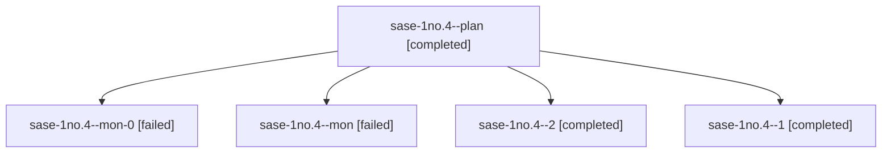

# Session: sase-1no.4

[Agent Hoods](../README.md) / [bbugyi200](../users/bbugyi200/README.md) / [athena](../users/bbugyi200/machines/athena/README.md) / [sase-1no](../users/bbugyi200/machines/athena/hoods/sase-1no/README.md) / sase-1no.4

Owner: `bbugyi200.athena` · Hood: `sase-1no` · Members: 5 · Bead: [sase-1no.4](https://github.com/sase-org/sase--beads/blob/main/pages/sase-1no/sase-1no.4.md)

## Lineage

The diagram is an optional enhancement; the ordered table below contains the same lineage in accessible text.

| Role | Agent | State | Model / provider | Timing | Commits | Prompt | Chat |
|---|---|---|---|---|---:|---|---|
| plan | sase-1no.4--plan | completed | gpt-6-luna / codex | 2026-10-23T22:27:54.367196+00:00 → 2026-10-23T22:36:32.771382+00:00 | 0 | [Prompt](../agents/bbugyi200.athena.sase-1no.4--plan/prompt.md) | [Chat](../agents/bbugyi200.athena.sase-1no.4--plan/chat.md) |
| mon-0 | sase-1no.4--mon-0 | failed | gpt-6-luna / codex | 2026-10-23T22:44:52.583240+00:00 → 2026-10-23T22:47:44.720993+00:00 | 0 | — | [Chat](../agents/bbugyi200.athena.sase-1no.4--mon-0/chat.md) |
| mon | sase-1no.4--mon | failed | gpt-6-luna / codex | 2026-10-23T22:35:41.717379+00:00 → 2026-10-23T22:38:38.900169+00:00 | 0 | — | [Chat](../agents/bbugyi200.athena.sase-1no.4--mon/chat.md) |
| 2 | sase-1no.4--2 | completed | gpt-6-luna / codex | 2026-10-23T22:49:17.471644+00:00 → 2026-10-24T00:15:56.375599+00:00 | [1](../agents/bbugyi200.athena.sase-1no.4--2/README.md#commits) | [Prompt](../agents/bbugyi200.athena.sase-1no.4--2/prompt.md) | [Chat](../agents/bbugyi200.athena.sase-1no.4--2/chat.md) |
| 1 | sase-1no.4--1 | completed | gpt-6-luna / codex | 2026-10-23T22:40:09.111011+00:00 → 2026-10-23T22:45:44.659402+00:00 | 0 | [Prompt](../agents/bbugyi200.athena.sase-1no.4--1/prompt.md) | [Chat](../agents/bbugyi200.athena.sase-1no.4--1/chat.md) |

## Commits

| Role | Repo | Commit | Subject | Committed |
|---|---|---|---|---|
| 2 | sase | [`a7996c3`](https://github.com/sase-org/sase/commit/a7996c3b77d155a9b3449d97b5e79b46b0ddd7f3) | feat(ace): show stranded work in agent details | 2026-10-23 20:06:53 EDT |

## Neighbors

| Agent | Relation | State |
|---|---|---|
| [sase-1no.1](../agents/bbugyi200.athena.sase-1no.1/README.md) | sase-1no hood | completed |
| [sase-1no.2](bbugyi200.athena.sase-1no.2.md) (session · 11) | sase-1no hood | completed 6, failed 5 |
| [sase-1no.3](../agents/bbugyi200.athena.sase-1no.3/README.md) | sase-1no hood | completed |
| [sase-1no.5](bbugyi200.athena.sase-1no.5.md) (session · 5) | sase-1no hood | active 1, completed 2, failed 2 |
| [sase-1no.6](../agents/bbugyi200.athena.sase-1no.6/README.md) | sase-1no hood | waiting |
| [sase-1no.land](../agents/bbugyi200.athena.sase-1no.land/README.md) | sase-1no hood | waiting |
