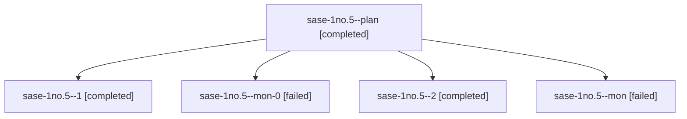

# Session: sase-1no.5

[Agent Hoods](../README.md) / [bbugyi200](../users/bbugyi200/README.md) / [athena](../users/bbugyi200/machines/athena/README.md) / [sase-1no](../users/bbugyi200/machines/athena/hoods/sase-1no/README.md) / sase-1no.5

Owner: `bbugyi200.athena` · Hood: `sase-1no` · Members: 5 · Bead: [sase-1no.5](https://github.com/sase-org/sase--beads/blob/main/pages/sase-1no/sase-1no.5.md)

## Lineage

The diagram is an optional enhancement; the ordered table below contains the same lineage in accessible text.

| Role | Agent | State | Model / provider | Timing | Commits | Prompt | Chat |
|---|---|---|---|---|---:|---|---|
| plan | sase-1no.5--plan | completed | gpt-6-astra / codex | 2026-10-24T09:20:31.240706+00:00 → 2026-10-24T10:00:24.008105+00:00 | 0 | [Prompt](../agents/bbugyi200.athena.sase-1no.5--plan/prompt.md) | [Chat](../agents/bbugyi200.athena.sase-1no.5--plan/chat.md) |
| 1 | sase-1no.5--1 | completed | gpt-6-astra / codex | 2026-10-24T10:06:26.273138+00:00 → 2026-10-24T10:16:07.357670+00:00 | 0 | [Prompt](../agents/bbugyi200.athena.sase-1no.5--1/prompt.md) | [Chat](../agents/bbugyi200.athena.sase-1no.5--1/chat.md) |
| mon-0 | sase-1no.5--mon-0 | failed | gpt-6-astra / codex | 2026-10-24T10:13:43.605685+00:00 → 2026-10-24T10:43:01.478163+00:00 | 0 | — | [Chat](../agents/bbugyi200.athena.sase-1no.5--mon-0/chat.md) |
| 2 | sase-1no.5--2 | completed | gpt-6-astra / codex | 2026-10-24T10:44:53.142659+00:00 → 2026-10-24T10:57:06.655100+00:00 | [1](../agents/bbugyi200.athena.sase-1no.5--2/README.md#commits) | [Prompt](../agents/bbugyi200.athena.sase-1no.5--2/prompt.md) | [Chat](../agents/bbugyi200.athena.sase-1no.5--2/chat.md) |
| mon | sase-1no.5--mon | failed | gpt-6-astra / codex | 2026-10-24T09:58:54.682509+00:00 → 2026-10-24T10:04:08.779708+00:00 | 0 | — | [Chat](../agents/bbugyi200.athena.sase-1no.5--mon/chat.md) |

## Commits

| Role | Repo | Commit | Subject | Committed |
|---|---|---|---|---|
| 2 | sase | [`c793bff`](https://github.com/sase-org/sase/commit/c793bff54b0382194527c3c422b0416b11d87a1f) | feat(tui): flag stranded work in the Beads pane | 2026-10-24 06:53:28 EDT |

## Neighbors

| Agent | Relation | State |
|---|---|---|
| [sase-1no.1](../agents/bbugyi200.athena.sase-1no.1/README.md) | sase-1no hood | completed |
| [sase-1no.2](bbugyi200.athena.sase-1no.2.md) (session · 11) | sase-1no hood | completed 6, failed 5 |
| [sase-1no.3](../agents/bbugyi200.athena.sase-1no.3/README.md) | sase-1no hood | completed |
| [sase-1no.4](bbugyi200.athena.sase-1no.4.md) (session · 5) | sase-1no hood | completed 3, failed 2 |
| [sase-1no.6](bbugyi200.athena.sase-1no.6.md) (session · 3) | sase-1no hood | active 1, completed 1, failed 1 |
| [sase-1no.land](../agents/bbugyi200.athena.sase-1no.land/README.md) | sase-1no hood | waiting |
