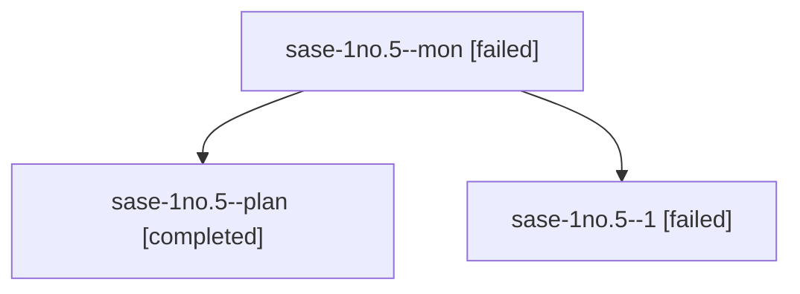

# Session: sase-1no.5

[Agent Hoods](../README.md) / [bbugyi200](../users/bbugyi200/README.md) / [athena](../users/bbugyi200/machines/athena/README.md) / [sase-1no](../users/bbugyi200/machines/athena/hoods/sase-1no/README.md) / sase-1no.5

Owner: `bbugyi200.athena` · Hood: `sase-1no` · Members: 3 · Bead: [sase-1no.5](https://github.com/sase-org/sase--beads/blob/main/pages/sase-1no/sase-1no.5.md)

## Lineage

The diagram is an optional enhancement; the ordered table below contains the same lineage in accessible text.

| Role | Agent | State | Model / provider | Timing | Commits | Prompt | Chat |
|---|---|---|---|---|---:|---|---|
| mon | sase-1no.5--mon | failed | muse-spark-1.3-contributor / muse | 2026-10-23T22:05:39.668706+00:00 → 2026-10-23T22:09:37.316483+00:00 | 0 | — | [Chat](../agents/bbugyi200.athena.sase-1no.5--mon/chat.md) |
| plan | sase-1no.5--plan | completed | muse-spark-1.3-contributor / muse | 2026-10-23T21:25:20.367177+00:00 → 2026-10-23T22:07:03.433299+00:00 | 0 | [Prompt](../agents/bbugyi200.athena.sase-1no.5--plan/prompt.md) | [Chat](../agents/bbugyi200.athena.sase-1no.5--plan/chat.md) |
| 1 | sase-1no.5--1 | failed | muse-spark-1.3-contributor / muse | 2026-10-23T22:11:36.372562+00:00 → 2026-10-23T23:36:08.205508+00:00 | 0 | [Prompt](../agents/bbugyi200.athena.sase-1no.5--1/prompt.md) | — |

## Neighbors

| Agent | Relation | State |
|---|---|---|
| [sase-1no.1](../agents/bbugyi200.athena.sase-1no.1/README.md) | sase-1no hood | completed |
| [sase-1no.2](bbugyi200.athena.sase-1no.2.md) (session · 11) | sase-1no hood | completed 6, failed 5 |
| [sase-1no.3](../agents/bbugyi200.athena.sase-1no.3/README.md) | sase-1no hood | completed |
| [sase-1no.4](bbugyi200.athena.sase-1no.4.md) (session · 5) | sase-1no hood | active 1, completed 2, failed 2 |
| [sase-1no.6](../agents/bbugyi200.athena.sase-1no.6/README.md) | sase-1no hood | waiting |
| [sase-1no.land](../agents/bbugyi200.athena.sase-1no.land/README.md) | sase-1no hood | waiting |
