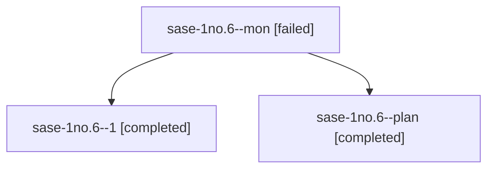

# Session: sase-1no.6

[Agent Hoods](../README.md) / [bbugyi200](../users/bbugyi200/README.md) / [athena](../users/bbugyi200/machines/athena/README.md) / [sase-1no](../users/bbugyi200/machines/athena/hoods/sase-1no/README.md) / sase-1no.6

Owner: `bbugyi200.athena` · Hood: `sase-1no` · Members: 3 · Bead: [sase-1no.6](https://github.com/sase-org/sase--beads/blob/main/pages/sase-1no/sase-1no.6.md)

## Lineage

The diagram is an optional enhancement; the ordered table below contains the same lineage in accessible text.

| Role | Agent | State | Model / provider | Timing | Commits | Prompt | Chat |
|---|---|---|---|---|---:|---|---|
| mon | sase-1no.6--mon | failed | grok-4.6 / grok | 2026-10-24T11:25:24.916130+00:00 → 2026-10-24T11:28:31.990771+00:00 | 0 | — | [Chat](../agents/bbugyi200.athena.sase-1no.6--mon/chat.md) |
| 1 | sase-1no.6--1 | completed | grok-4.6 / grok | 2026-10-24T11:29:45.937437+00:00 → 2026-10-24T13:06:27.156544+00:00 | [1](../agents/bbugyi200.athena.sase-1no.6--1/README.md#commits) | [Prompt](../agents/bbugyi200.athena.sase-1no.6--1/prompt.md) | [Chat](../agents/bbugyi200.athena.sase-1no.6--1/chat.md) |
| plan | sase-1no.6--plan | completed | grok-4.6 / grok | 2026-10-24T10:57:49.947474+00:00 → 2026-10-24T11:26:34.878616+00:00 | 0 | [Prompt](../agents/bbugyi200.athena.sase-1no.6--plan/prompt.md) | [Chat](../agents/bbugyi200.athena.sase-1no.6--plan/chat.md) |

## Commits

| Role | Repo | Commit | Subject | Committed |
|---|---|---|---|---|
| 1 | sase | [`0a1a8ab`](https://github.com/sase-org/sase/commit/0a1a8aba2fa75e3ab72df3d3ec703086d515ecd9) | feat(ace): add stranded Enter resolve modal and PNG goldens (sase-1no.6) | 2026-10-24 09:02:38 EDT |

## Neighbors

| Agent | Relation | State |
|---|---|---|
| [sase-1no.1](../agents/bbugyi200.athena.sase-1no.1/README.md) | sase-1no hood | completed |
| [sase-1no.2](bbugyi200.athena.sase-1no.2.md) (session · 11) | sase-1no hood | completed 6, failed 5 |
| [sase-1no.3](../agents/bbugyi200.athena.sase-1no.3/README.md) | sase-1no hood | completed |
| [sase-1no.4](bbugyi200.athena.sase-1no.4.md) (session · 5) | sase-1no hood | completed 3, failed 2 |
| [sase-1no.5](bbugyi200.athena.sase-1no.5.md) (session · 5) | sase-1no hood | completed 3, failed 2 |
| [sase-1no.land](bbugyi200.athena.sase-1no.land.md) (session · 5) | sase-1no hood | active 1, completed 2, failed 2 |
