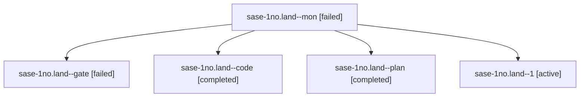

# Session: sase-1no.land

[Agent Hoods](../README.md) / [bbugyi200](../users/bbugyi200/README.md) / [athena](../users/bbugyi200/machines/athena/README.md) / [sase-1no](../users/bbugyi200/machines/athena/hoods/sase-1no/README.md) / sase-1no.land

Owner: `bbugyi200.athena` · Hood: `sase-1no` · Members: 5 · Bead: [sase-1no](https://github.com/sase-org/sase--beads/blob/main/pages/sase-1no/README.md)

## Lineage

The diagram is an optional enhancement; the ordered table below contains the same lineage in accessible text.

| Role | Agent | State | Model / provider | Timing | Commits | Prompt | Chat |
|---|---|---|---|---|---:|---|---|
| mon | sase-1no.land--mon | failed | grok-4.6 / grok | 2026-10-24T13:45:18.665178+00:00 → 2026-10-24T13:50:20.488513+00:00 | 0 | — | [Chat](../agents/bbugyi200.athena.sase-1no.land--mon/chat.md) |
| gate | sase-1no.land--gate | failed | opus / claude | 2026-10-24T13:26:55.565766+00:00 → 2026-10-24T13:28:17.555482+00:00 | 0 | — | [Chat](../agents/bbugyi200.athena.sase-1no.land--gate/chat.md) |
| code | sase-1no.land--code | completed | grok-4.6 / grok | 2026-10-24T13:28:38.377104+00:00 → 2026-10-24T13:46:48.885481+00:00 | 0 | — | [Chat](../agents/bbugyi200.athena.sase-1no.land--code/chat.md) |
| plan | sase-1no.land--plan | completed | opus / claude | 2026-10-24T13:07:56.444348+00:00 → 2026-10-24T13:46:48.885481+00:00 | 0 | [Prompt](../agents/bbugyi200.athena.sase-1no.land--plan/prompt.md) | [Chat](../agents/bbugyi200.athena.sase-1no.land--plan/chat.md) |
| 1 | sase-1no.land--1 | active | grok-4.6 / grok | 2026-10-24T14:02:30.727213+00:00 | 0 | [Prompt](../agents/bbugyi200.athena.sase-1no.land--1/prompt.md) | — |

## Neighbors

| Agent | Relation | State |
|---|---|---|
| [sase-1no.1](../agents/bbugyi200.athena.sase-1no.1/README.md) | sase-1no hood | completed |
| [sase-1no.2](bbugyi200.athena.sase-1no.2.md) (session · 11) | sase-1no hood | completed 6, failed 5 |
| [sase-1no.3](../agents/bbugyi200.athena.sase-1no.3/README.md) | sase-1no hood | completed |
| [sase-1no.4](bbugyi200.athena.sase-1no.4.md) (session · 5) | sase-1no hood | completed 3, failed 2 |
| [sase-1no.5](bbugyi200.athena.sase-1no.5.md) (session · 5) | sase-1no hood | completed 3, failed 2 |
| [sase-1no.6](bbugyi200.athena.sase-1no.6.md) (session · 3) | sase-1no hood | completed 2, failed 1 |
