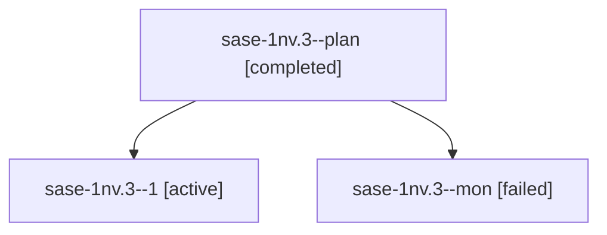

# Session: sase-1nv.3

[Agent Hoods](../README.md) / [bbugyi200](../users/bbugyi200/README.md) / [athena](../users/bbugyi200/machines/athena/README.md) / [sase-1nv](../users/bbugyi200/machines/athena/hoods/sase-1nv/README.md) / sase-1nv.3

Owner: `bbugyi200.athena` · Hood: `sase-1nv` · Members: 3 · Bead: [sase-1nv.3](https://github.com/sase-org/sase--beads/blob/main/pages/sase-1nv/sase-1nv.3.md)

## Lineage

The diagram is an optional enhancement; the ordered table below contains the same lineage in accessible text.

| Role | Agent | State | Model / provider | Timing | Commits | Prompt | Chat |
|---|---|---|---|---|---:|---|---|
| plan | sase-1nv.3--plan | completed | grok-4.6 / grok | 2026-10-24T11:16:24.152319+00:00 → 2026-10-24T12:20:41.331245+00:00 | 0 | [Prompt](../agents/bbugyi200.athena.sase-1nv.3--plan/prompt.md) | [Chat](../agents/bbugyi200.athena.sase-1nv.3--plan/chat.md) |
| 1 | sase-1nv.3--1 | active | grok-4.6 / grok | 2026-10-24T12:49:24.689964+00:00 | 0 | [Prompt](../agents/bbugyi200.athena.sase-1nv.3--1/prompt.md) | — |
| mon | sase-1nv.3--mon | failed | grok-4.6 / grok | 2026-10-24T12:19:38.566895+00:00 → 2026-10-24T12:49:00.566810+00:00 | 0 | — | [Chat](../agents/bbugyi200.athena.sase-1nv.3--mon/chat.md) |

## Neighbors

| Agent | Relation | State |
|---|---|---|
| [sase-1nv.1](../agents/bbugyi200.athena.sase-1nv.1/README.md) | sase-1nv hood | completed |
| [sase-1nv.2](../agents/bbugyi200.athena.sase-1nv.2/README.md) | sase-1nv hood | completed |
| [sase-1nv.4](../agents/bbugyi200.athena.sase-1nv.4/README.md) | sase-1nv hood | waiting |
| [sase-1nv.5](../agents/bbugyi200.athena.sase-1nv.5/README.md) | sase-1nv hood | waiting |
| [sase-1nv.land](../agents/bbugyi200.athena.sase-1nv.land/README.md) | sase-1nv hood | waiting |
