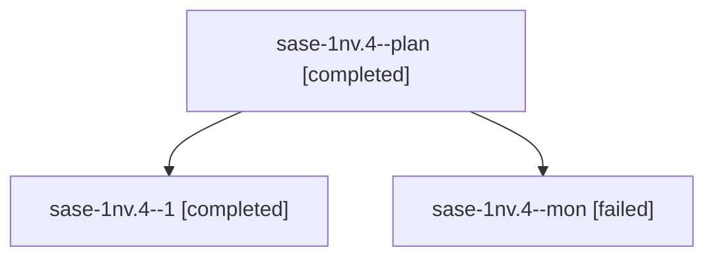

# Session: sase-1nv.4

[Agent Hoods](../README.md) / [bbugyi200](../users/bbugyi200/README.md) / [athena](../users/bbugyi200/machines/athena/README.md) / [sase-1nv](../users/bbugyi200/machines/athena/hoods/sase-1nv/README.md) / sase-1nv.4

Owner: `bbugyi200.athena` · Hood: `sase-1nv` · Members: 3 · Bead: [sase-1nv.4](https://github.com/sase-org/sase--beads/blob/main/pages/sase-1nv/sase-1nv.4.md)

## Lineage

The diagram is an optional enhancement; the ordered table below contains the same lineage in accessible text.

| Role | Agent | State | Model / provider | Timing | Commits | Prompt | Chat |
|---|---|---|---|---|---:|---|---|
| plan | sase-1nv.4--plan | completed | muse-spark-1.3-contributor / muse | 2026-10-24T13:29:25.927635+00:00 → 2026-10-24T15:18:40.569109+00:00 | 0 | [Prompt](../agents/bbugyi200.athena.sase-1nv.4--plan/prompt.md) | [Chat](../agents/bbugyi200.athena.sase-1nv.4--plan/chat.md) |
| 1 | sase-1nv.4--1 | completed | muse-spark-1.3-contributor / muse | 2026-10-24T15:42:50.620069+00:00 → 2026-10-24T15:51:29.999179+00:00 | [1](../agents/bbugyi200.athena.sase-1nv.4--1/README.md#commits) | [Prompt](../agents/bbugyi200.athena.sase-1nv.4--1/prompt.md) | [Chat](../agents/bbugyi200.athena.sase-1nv.4--1/chat.md) |
| mon | sase-1nv.4--mon | failed | muse-spark-1.3-contributor / muse | 2026-10-24T15:18:00.640120+00:00 → 2026-10-24T15:38:43.393477+00:00 | 0 | — | [Chat](../agents/bbugyi200.athena.sase-1nv.4--mon/chat.md) |

## Commits

| Role | Repo | Commit | Subject | Committed |
|---|---|---|---|---|
| 1 | sase | [`7b1b437`](https://github.com/sase-org/sase/commit/7b1b43755821fb4b6fe9ab8f51d09fcff0e46879) | feat(agents-sync): add report-first repair for stale publication revision rows (sase-1nv.4) | 2026-10-24 11:48:49 EDT |

## Neighbors

| Agent | Relation | State |
|---|---|---|
| [sase-1nv.1](../agents/bbugyi200.athena.sase-1nv.1/README.md) | sase-1nv hood | completed |
| [sase-1nv.2](../agents/bbugyi200.athena.sase-1nv.2/README.md) | sase-1nv hood | completed |
| [sase-1nv.3](bbugyi200.athena.sase-1nv.3.md) (session · 3) | sase-1nv hood | completed 2, failed 1 |
| [sase-1nv.5](bbugyi200.athena.sase-1nv.5.md) (session · 39) | sase-1nv hood | completed 19, failed 20 |
| [sase-1nv.5.1.1](../agents/bbugyi200.athena.sase-1nv.5.1.1/README.md) | sase-1nv hood | active |
| [sase-1nv.5.1.2](../agents/bbugyi200.athena.sase-1nv.5.1.2/README.md) | sase-1nv hood | waiting |
| [sase-1nv.5.1.3](../agents/bbugyi200.athena.sase-1nv.5.1.3/README.md) | sase-1nv hood | waiting |
| [sase-1nv.5.1.4](../agents/bbugyi200.athena.sase-1nv.5.1.4/README.md) | sase-1nv hood | waiting |
| [sase-1nv.5.1.5](../agents/bbugyi200.athena.sase-1nv.5.1.5/README.md) | sase-1nv hood | waiting |
| [sase-1nv.5.1.6](../agents/bbugyi200.athena.sase-1nv.5.1.6/README.md) | sase-1nv hood | waiting |
| [sase-1nv.5.1.7](../agents/bbugyi200.athena.sase-1nv.5.1.7/README.md) | sase-1nv hood | waiting |
| [sase-1nv.5.1.land](../agents/bbugyi200.athena.sase-1nv.5.1.land/README.md) | sase-1nv hood | waiting |
| [sase-1nv.land](../agents/bbugyi200.athena.sase-1nv.land/README.md) | sase-1nv hood | waiting |
