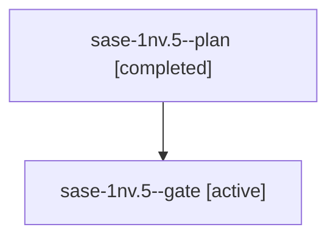

# Session: sase-1nv.5

[Agent Hoods](../README.md) / [bbugyi200](../users/bbugyi200/README.md) / [athena](../users/bbugyi200/machines/athena/README.md) / [sase-1nv](../users/bbugyi200/machines/athena/hoods/sase-1nv/README.md) / sase-1nv.5

Owner: `bbugyi200.athena` · Hood: `sase-1nv` · Members: 2 · Bead: [sase-1nv.5](https://github.com/sase-org/sase--beads/blob/main/pages/sase-1nv/sase-1nv.5.md)

## Lineage

The diagram is an optional enhancement; the ordered table below contains the same lineage in accessible text.

| Role | Agent | State | Model / provider | Timing | Commits | Prompt | Chat |
|---|---|---|---|---|---:|---|---|
| plan | sase-1nv.5--plan | completed | gpt-6-luna / codex | 2026-10-24T15:52:27.644076+00:00 → 2026-10-24T16:02:06.075175+00:00 | 0 | [Prompt](../agents/bbugyi200.athena.sase-1nv.5--plan/prompt.md) | [Chat](../agents/bbugyi200.athena.sase-1nv.5--plan/chat.md) |
| gate | sase-1nv.5--gate | active | gpt-6-luna / codex | 2026-10-24T16:09:05.872141+00:00 | 0 | — | — |

## Neighbors

| Agent | Relation | State |
|---|---|---|
| [sase-1nv.1](../agents/bbugyi200.athena.sase-1nv.1/README.md) | sase-1nv hood | completed |
| [sase-1nv.2](../agents/bbugyi200.athena.sase-1nv.2/README.md) | sase-1nv hood | completed |
| [sase-1nv.3](bbugyi200.athena.sase-1nv.3.md) (session · 3) | sase-1nv hood | completed 2, failed 1 |
| [sase-1nv.4](bbugyi200.athena.sase-1nv.4.md) (session · 3) | sase-1nv hood | completed 2, failed 1 |
| [sase-1nv.land](../agents/bbugyi200.athena.sase-1nv.land/README.md) | sase-1nv hood | waiting |
