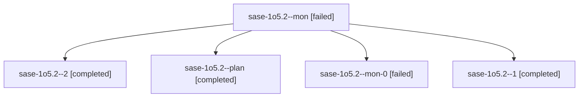

# Session: sase-1o5.2

[Agent Hoods](../README.md) / [bbugyi200](../users/bbugyi200/README.md) / [athena](../users/bbugyi200/machines/athena/README.md) / [sase-1o5](../users/bbugyi200/machines/athena/hoods/sase-1o5/README.md) / sase-1o5.2

Owner: `bbugyi200.athena` · Hood: `sase-1o5` · Members: 5 · Bead: [sase-1o5.2](https://github.com/sase-org/sase--beads/blob/main/pages/sase-1o5/sase-1o5.2.md)

## Lineage

The diagram is an optional enhancement; the ordered table below contains the same lineage in accessible text.

| Role | Agent | State | Model / provider | Timing | Commits | Prompt | Chat |
|---|---|---|---|---|---:|---|---|
| mon | sase-1o5.2--mon | failed | muse-spark-1.3-contributor / muse | 2026-10-25T00:24:28.575125+00:00 → 2026-10-25T00:27:03.906178+00:00 | 0 | — | [Chat](../agents/bbugyi200.athena.sase-1o5.2--mon/chat.md) |
| 2 | sase-1o5.2--2 | completed | muse-spark-1.3-contributor / muse | 2026-10-25T01:00:39.284067+00:00 → 2026-10-25T01:09:12.458620+00:00 | [1](../agents/bbugyi200.athena.sase-1o5.2--2/README.md#commits) | [Prompt](../agents/bbugyi200.athena.sase-1o5.2--2/prompt.md) | [Chat](../agents/bbugyi200.athena.sase-1o5.2--2/chat.md) |
| plan | sase-1o5.2--plan | completed | muse-spark-1.3-contributor / muse | 2026-10-24T23:32:12.322314+00:00 → 2026-10-25T00:25:21.905835+00:00 | 0 | [Prompt](../agents/bbugyi200.athena.sase-1o5.2--plan/prompt.md) | [Chat](../agents/bbugyi200.athena.sase-1o5.2--plan/chat.md) |
| mon-0 | sase-1o5.2--mon-0 | failed | muse-spark-1.3-contributor / muse | 2026-10-25T00:48:16.257502+00:00 → 2026-10-25T00:59:26.551594+00:00 | 0 | — | [Chat](../agents/bbugyi200.athena.sase-1o5.2--mon-0/chat.md) |
| 1 | sase-1o5.2--1 | completed | muse-spark-1.3-contributor / muse | 2026-10-25T00:28:14.587227+00:00 → 2026-10-25T00:49:51.546850+00:00 | 0 | [Prompt](../agents/bbugyi200.athena.sase-1o5.2--1/prompt.md) | [Chat](../agents/bbugyi200.athena.sase-1o5.2--1/chat.md) |

## Commits

| Role | Repo | Commit | Subject | Committed |
|---|---|---|---|---|
| 2 | sase | [`5497b59`](https://github.com/sase-org/sase/commit/5497b59c5ddac82c20cf92bd0f63394a1f5e2d82) | feat(questions): add question-round facade, projection loader, and core binding validation | 2026-10-24 21:06:42 EDT |

## Neighbors

| Agent | Relation | State |
|---|---|---|
| [sase-1o5.1](../agents/bbugyi200.athena.sase-1o5.1/README.md) | sase-1o5 hood | completed |
| [sase-1o5.3](../agents/bbugyi200.athena.sase-1o5.3/README.md) | sase-1o5 hood | completed |
| [sase-1o5.4](bbugyi200.athena.sase-1o5.4.md) (session · 3) | sase-1o5 hood | completed 2, failed 1 |
| [sase-1o5.5](../agents/bbugyi200.athena.sase-1o5.5/README.md) | sase-1o5 hood | completed |
| [sase-1o5.6](../agents/bbugyi200.athena.sase-1o5.6/README.md) | sase-1o5 hood | active |
| [sase-1o5.land](../agents/bbugyi200.athena.sase-1o5.land/README.md) | sase-1o5 hood | waiting |
