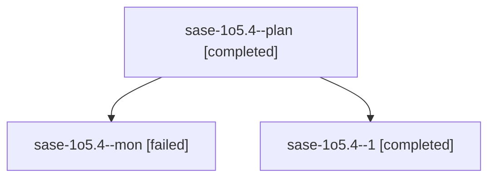

# Session: sase-1o5.4

[Agent Hoods](../README.md) / [bbugyi200](../users/bbugyi200/README.md) / [athena](../users/bbugyi200/machines/athena/README.md) / [sase-1o5](../users/bbugyi200/machines/athena/hoods/sase-1o5/README.md) / sase-1o5.4

Owner: `bbugyi200.athena` · Hood: `sase-1o5` · Members: 3 · Bead: [sase-1o5.4](https://github.com/sase-org/sase--beads/blob/main/pages/sase-1o5/sase-1o5.4.md)

## Lineage

The diagram is an optional enhancement; the ordered table below contains the same lineage in accessible text.

| Role | Agent | State | Model / provider | Timing | Commits | Prompt | Chat |
|---|---|---|---|---|---:|---|---|
| plan | sase-1o5.4--plan | completed | muse-spark-1.3-contributor / muse | 2026-10-25T01:10:47.462810+00:00 → 2026-10-25T02:07:30.349895+00:00 | 0 | [Prompt](../agents/bbugyi200.athena.sase-1o5.4--plan/prompt.md) | [Chat](../agents/bbugyi200.athena.sase-1o5.4--plan/chat.md) |
| mon | sase-1o5.4--mon | failed | muse-spark-1.3-contributor / muse | 2026-10-25T02:05:16.708466+00:00 → 2026-10-25T02:10:07.768677+00:00 | 0 | — | [Chat](../agents/bbugyi200.athena.sase-1o5.4--mon/chat.md) |
| 1 | sase-1o5.4--1 | completed | muse-spark-1.3-contributor / muse | 2026-10-25T02:11:19.891414+00:00 → 2026-10-25T02:47:35.203095+00:00 | [1](../agents/bbugyi200.athena.sase-1o5.4--1/README.md#commits) | [Prompt](../agents/bbugyi200.athena.sase-1o5.4--1/prompt.md) | [Chat](../agents/bbugyi200.athena.sase-1o5.4--1/chat.md) |

## Commits

| Role | Repo | Commit | Subject | Committed |
|---|---|---|---|---|
| 1 | sase | [`518717c`](https://github.com/sase-org/sase/commit/518717cdaca4b05ed19427ceab4371987c60d16f) | feat(questions): add question-round scoping and questions summary lane | 2026-10-24 22:42:58 EDT |

## Neighbors

| Agent | Relation | State |
|---|---|---|
| [sase-1o5.1](../agents/bbugyi200.athena.sase-1o5.1/README.md) | sase-1o5 hood | completed |
| [sase-1o5.2](bbugyi200.athena.sase-1o5.2.md) (session · 5) | sase-1o5 hood | completed 3, failed 2 |
| [sase-1o5.3](../agents/bbugyi200.athena.sase-1o5.3/README.md) | sase-1o5 hood | completed |
| [sase-1o5.5](../agents/bbugyi200.athena.sase-1o5.5/README.md) | sase-1o5 hood | completed |
| [sase-1o5.6](../agents/bbugyi200.athena.sase-1o5.6/README.md) | sase-1o5 hood | active |
| [sase-1o5.land](../agents/bbugyi200.athena.sase-1o5.land/README.md) | sase-1o5 hood | waiting |
