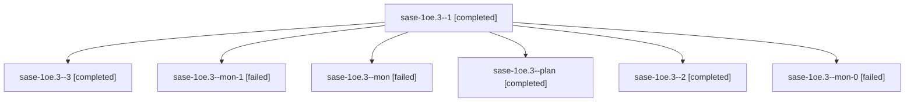

# Session: sase-1oe.3

[Agent Hoods](../README.md) / [bbugyi200](../users/bbugyi200/README.md) / [athena](../users/bbugyi200/machines/athena/README.md) / [sase-1oe](../users/bbugyi200/machines/athena/hoods/sase-1oe/README.md) / sase-1oe.3

Owner: `bbugyi200.athena` · Hood: `sase-1oe` · Members: 7 · Bead: [sase-1oe.3](https://github.com/sase-org/sase--beads/blob/main/pages/sase-1oe/sase-1oe.3.md)

## Lineage

The diagram is an optional enhancement; the ordered table below contains the same lineage in accessible text.

| Role | Agent | State | Model / provider | Timing | Commits | Prompt | Chat |
|---|---|---|---|---|---:|---|---|
| 1 | sase-1oe.3--1 | completed | muse-spark-1.3-contributor / muse | 2026-10-26T20:34:21.541335+00:00 → 2026-10-26T20:49:47.003000+00:00 | 0 | [Prompt](../agents/bbugyi200.athena.sase-1oe.3--1/prompt.md) | [Chat](../agents/bbugyi200.athena.sase-1oe.3--1/chat.md) |
| 3 | sase-1oe.3--3 | completed | muse-spark-1.3-contributor / muse | 2026-10-26T22:20:13.636515+00:00 → 2026-10-27T00:36:57.239648+00:00 | [1](../agents/bbugyi200.athena.sase-1oe.3--3/README.md#commits) | [Prompt](../agents/bbugyi200.athena.sase-1oe.3--3/prompt.md) | [Chat](../agents/bbugyi200.athena.sase-1oe.3--3/chat.md) |
| mon-1 | sase-1oe.3--mon-1 | failed | muse-spark-1.3-contributor / muse | 2026-10-26T21:21:02.983921+00:00 → 2026-10-26T22:16:15.280659+00:00 | 0 | — | [Chat](../agents/bbugyi200.athena.sase-1oe.3--mon-1/chat.md) |
| mon | sase-1oe.3--mon | failed | muse-spark-1.3-contributor / muse | 2026-10-26T14:04:15.817020+00:00 → 2026-10-26T20:33:04.091719+00:00 | 0 | — | [Chat](../agents/bbugyi200.athena.sase-1oe.3--mon/chat.md) |
| plan | sase-1oe.3--plan | completed | muse-spark-1.3-contributor / muse | 2026-10-26T13:59:46.981829+00:00 → 2026-10-26T14:05:09.377637+00:00 | 0 | [Prompt](../agents/bbugyi200.athena.sase-1oe.3--plan/prompt.md) | [Chat](../agents/bbugyi200.athena.sase-1oe.3--plan/chat.md) |
| 2 | sase-1oe.3--2 | completed | muse-spark-1.3-contributor / muse | 2026-10-26T21:02:07.143752+00:00 → 2026-10-26T21:21:42.108687+00:00 | 0 | [Prompt](../agents/bbugyi200.athena.sase-1oe.3--2/prompt.md) | [Chat](../agents/bbugyi200.athena.sase-1oe.3--2/chat.md) |
| mon-0 | sase-1oe.3--mon-0 | failed | muse-spark-1.3-contributor / muse | 2026-10-26T20:47:18.842601+00:00 → 2026-10-26T21:00:32.283494+00:00 | 0 | — | [Chat](../agents/bbugyi200.athena.sase-1oe.3--mon-0/chat.md) |

## Commits

| Role | Repo | Commit | Subject | Committed |
|---|---|---|---|---|
| 3 | sase | [`816efdc`](https://github.com/sase-org/sase/commit/816efdc9d755fc26e8f832956b0ec8936c180213) | chore(core): ratchet sase-core-rs pin to published 0.42.7 | 2026-10-26 20:31:39 EDT |

## Neighbors

| Agent | Relation | State |
|---|---|---|
| [sase-1oe.1](../agents/bbugyi200.athena.sase-1oe.1/README.md) | sase-1oe hood | completed |
| [sase-1oe.2](../agents/bbugyi200.athena.sase-1oe.2/README.md) | sase-1oe hood | completed |
| [sase-1oe.4](../agents/bbugyi200.athena.sase-1oe.4/README.md) | sase-1oe hood | waiting |
| [sase-1oe.land](../agents/bbugyi200.athena.sase-1oe.land/README.md) | sase-1oe hood | waiting |
