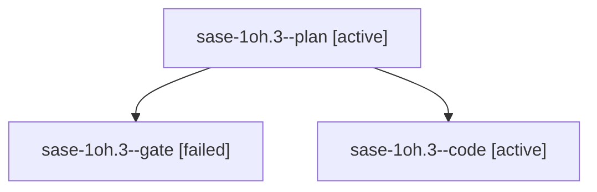

# Session: sase-1oh.3

[Agent Hoods](../README.md) / [bbugyi200](../users/bbugyi200/README.md) / [athena](../users/bbugyi200/machines/athena/README.md) / [sase-1oh](../users/bbugyi200/machines/athena/hoods/sase-1oh/README.md) / sase-1oh.3

Owner: `bbugyi200.athena` · Hood: `sase-1oh` · Members: 3 · Bead: [sase-1oh.3](https://github.com/sase-org/sase--beads/blob/main/pages/sase-1oh/sase-1oh.3.md)

## Lineage

The diagram is an optional enhancement; the ordered table below contains the same lineage in accessible text.

| Role | Agent | State | Model / provider | Timing | Commits | Prompt | Chat |
|---|---|---|---|---|---:|---|---|
| plan | sase-1oh.3--plan | active | gpt-6-astra / codex | 2026-10-26T18:19:15.066793+00:00 | 0 | [Prompt](../agents/bbugyi200.athena.sase-1oh.3--plan/prompt.md) | [Chat](../agents/bbugyi200.athena.sase-1oh.3--plan/chat.md) |
| gate | sase-1oh.3--gate | failed | gpt-6-astra / codex | 2026-10-26T18:28:54.789853+00:00 → 2026-10-26T18:29:35.608435+00:00 | 0 | — | [Chat](../agents/bbugyi200.athena.sase-1oh.3--gate/chat.md) |
| code | sase-1oh.3--code | active | grok-4.6 / grok | 2026-10-26T18:30:01.251178+00:00 | 0 | — | — |

## Neighbors

| Agent | Relation | State |
|---|---|---|
| [sase-1oh.1](../agents/bbugyi200.athena.sase-1oh.1/README.md) | sase-1oh hood | completed |
| [sase-1oh.2](../agents/bbugyi200.athena.sase-1oh.2/README.md) | sase-1oh hood | completed |
| [sase-1oh.4](bbugyi200.athena.sase-1oh.4.md) (session · 3) | sase-1oh hood | failed 3 |
| [sase-1oh.4.1.1](../agents/bbugyi200.athena.sase-1oh.4.1.1/README.md) | sase-1oh hood | completed |
| [sase-1oh.4.1.2](../agents/bbugyi200.athena.sase-1oh.4.1.2/README.md) | sase-1oh hood | active |
| [sase-1oh.4.1.3](../agents/bbugyi200.athena.sase-1oh.4.1.3/README.md) | sase-1oh hood | waiting |
| [sase-1oh.4.1.land](../agents/bbugyi200.athena.sase-1oh.4.1.land/README.md) | sase-1oh hood | waiting |
| [sase-1oh.5](bbugyi200.athena.sase-1oh.5.md) (session · 3) | sase-1oh hood | failed 3 |
| [sase-1oh.5.1.1](../agents/bbugyi200.athena.sase-1oh.5.1.1/README.md) | sase-1oh hood | active |
| [sase-1oh.5.1.2](../agents/bbugyi200.athena.sase-1oh.5.1.2/README.md) | sase-1oh hood | waiting |
| [sase-1oh.5.1.3](../agents/bbugyi200.athena.sase-1oh.5.1.3/README.md) | sase-1oh hood | waiting |
| [sase-1oh.5.1.4](../agents/bbugyi200.athena.sase-1oh.5.1.4/README.md) | sase-1oh hood | waiting |
| [sase-1oh.5.1.5](../agents/bbugyi200.athena.sase-1oh.5.1.5/README.md) | sase-1oh hood | waiting |
| [sase-1oh.5.1.land](../agents/bbugyi200.athena.sase-1oh.5.1.land/README.md) | sase-1oh hood | waiting |
| [sase-1oh.land](../agents/bbugyi200.athena.sase-1oh.land/README.md) | sase-1oh hood | waiting |
