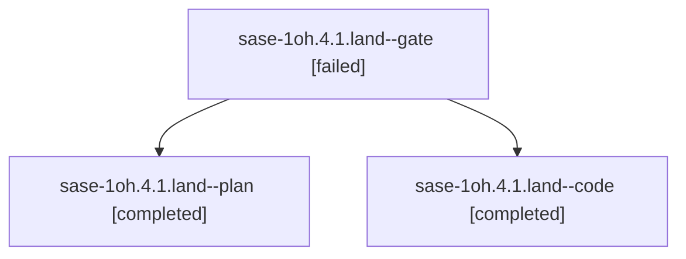

# Session: sase-1oh.4.1.land

[Agent Hoods](../README.md) / [bbugyi200](../users/bbugyi200/README.md) / [athena](../users/bbugyi200/machines/athena/README.md) / [sase-1oh](../users/bbugyi200/machines/athena/hoods/sase-1oh/README.md) / sase-1oh.4.1.land

Owner: `bbugyi200.athena` · Hood: `sase-1oh` · Members: 3 · Bead: [sase-1oh.4.1](https://github.com/sase-org/sase--beads/blob/main/pages/sase-1oh/sase-1oh.4.1.md)

## Lineage

The diagram is an optional enhancement; the ordered table below contains the same lineage in accessible text.

| Role | Agent | State | Model / provider | Timing | Commits | Prompt | Chat |
|---|---|---|---|---|---:|---|---|
| gate | sase-1oh.4.1.land--gate | failed | gpt-6-astra / codex | 2026-10-27T03:24:34.225827+00:00 → 2026-10-27T03:25:12.735988+00:00 | 0 | — | [Chat](../agents/bbugyi200.athena.sase-1oh.4.1.land--gate/chat.md) |
| plan | sase-1oh.4.1.land--plan | completed | gpt-6-astra / codex | 2026-10-27T03:04:34.131021+00:00 → 2026-10-27T06:31:22.298914+00:00 | 0 | [Prompt](../agents/bbugyi200.athena.sase-1oh.4.1.land--plan/prompt.md) | [Chat](../agents/bbugyi200.athena.sase-1oh.4.1.land--plan/chat.md) |
| code | sase-1oh.4.1.land--code | completed | grok-4.6 / grok | 2026-10-27T03:26:19.133124+00:00 → 2026-10-27T06:31:22.298914+00:00 | [1](../agents/bbugyi200.athena.sase-1oh.4.1.land--code/README.md#commits) | — | [Chat](../agents/bbugyi200.athena.sase-1oh.4.1.land--code/chat.md) |

## Commits

| Role | Repo | Commit | Subject | Committed |
|---|---|---|---|---|
| code | sase | [`134e869`](https://github.com/sase-org/sase/commit/134e869e4b9b18f85e0f3a4c003d70a9923c0534) | test: split test\_finalizers\_failed\_close\_recovery into focused modules | 2026-10-27 01:41:26 EDT |

## Neighbors

| Agent | Relation | State |
|---|---|---|
| [sase-1oh.4](bbugyi200.athena.sase-1oh.4.md) (session · 3) | ancestor | failed 3 |
| [sase-1oh.4.1.1](../agents/bbugyi200.athena.sase-1oh.4.1.1/README.md) | sase-1oh.4.1 hood | completed |
| [sase-1oh.4.1.2](../agents/bbugyi200.athena.sase-1oh.4.1.2/README.md) | sase-1oh.4.1 hood | completed |
| [sase-1oh.4.1.3](../agents/bbugyi200.athena.sase-1oh.4.1.3/README.md) | sase-1oh.4.1 hood | completed |
| [sase-1oh.1](../agents/bbugyi200.athena.sase-1oh.1/README.md) | sase-1oh hood | completed |
| [sase-1oh.2](../agents/bbugyi200.athena.sase-1oh.2/README.md) | sase-1oh hood | completed |
| [sase-1oh.3](bbugyi200.athena.sase-1oh.3.md) (session · 3) | sase-1oh hood | completed 2, failed 1 |
| [sase-1oh.5](bbugyi200.athena.sase-1oh.5.md) (session · 3) | sase-1oh hood | failed 3 |
| [sase-1oh.5.1.1](../agents/bbugyi200.athena.sase-1oh.5.1.1/README.md) | sase-1oh hood | completed |
| [sase-1oh.5.1.2](../agents/bbugyi200.athena.sase-1oh.5.1.2/README.md) | sase-1oh hood | completed |
| [sase-1oh.5.1.3](../agents/bbugyi200.athena.sase-1oh.5.1.3/README.md) | sase-1oh hood | completed |
| [sase-1oh.5.1.4](bbugyi200.athena.sase-1oh.5.1.4.md) (session · 5) | sase-1oh hood | active 1, completed 2, failed 2 |
| [sase-1oh.5.1.5](../agents/bbugyi200.athena.sase-1oh.5.1.5/README.md) | sase-1oh hood | waiting |
| [sase-1oh.5.1.land](../agents/bbugyi200.athena.sase-1oh.5.1.land/README.md) | sase-1oh hood | waiting |
| [sase-1oh.land](../agents/bbugyi200.athena.sase-1oh.land/README.md) | sase-1oh hood | waiting |
