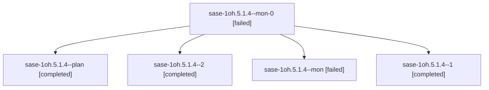

# Session: sase-1oh.5.1.4

[Agent Hoods](../README.md) / [bbugyi200](../users/bbugyi200/README.md) / [athena](../users/bbugyi200/machines/athena/README.md) / [sase-1oh](../users/bbugyi200/machines/athena/hoods/sase-1oh/README.md) / sase-1oh.5.1.4

Owner: `bbugyi200.athena` · Hood: `sase-1oh` · Members: 5 · Bead: [sase-1oh.5.1.4](https://github.com/sase-org/sase--beads/blob/main/pages/sase-1oh/sase-1oh.5.1.4.md)

## Lineage

The diagram is an optional enhancement; the ordered table below contains the same lineage in accessible text.

| Role | Agent | State | Model / provider | Timing | Commits | Prompt | Chat |
|---|---|---|---|---|---:|---|---|
| mon-0 | sase-1oh.5.1.4--mon-0 | failed | muse-spark-1.3-contributor / muse | 2026-10-27T05:56:13.470137+00:00 → 2026-10-27T06:34:59.696108+00:00 | 0 | — | [Chat](../agents/bbugyi200.athena.sase-1oh.5.1.4--mon-0/chat.md) |
| plan | sase-1oh.5.1.4--plan | completed | muse-spark-1.3-contributor / muse | 2026-10-27T05:00:10.699157+00:00 → 2026-10-27T05:34:44.754941+00:00 | 0 | [Prompt](../agents/bbugyi200.athena.sase-1oh.5.1.4--plan/prompt.md) | [Chat](../agents/bbugyi200.athena.sase-1oh.5.1.4--plan/chat.md) |
| 2 | sase-1oh.5.1.4--2 | completed | muse-spark-1.3-contributor / muse | 2026-10-27T06:36:15.524008+00:00 → 2026-10-27T06:47:10.543243+00:00 | [1](../agents/bbugyi200.athena.sase-1oh.5.1.4--2/README.md#commits) | [Prompt](../agents/bbugyi200.athena.sase-1oh.5.1.4--2/prompt.md) | [Chat](../agents/bbugyi200.athena.sase-1oh.5.1.4--2/chat.md) |
| mon | sase-1oh.5.1.4--mon | failed | muse-spark-1.3-contributor / muse | 2026-10-27T05:32:54.160644+00:00 → 2026-10-27T05:40:56.648661+00:00 | 0 | — | [Chat](../agents/bbugyi200.athena.sase-1oh.5.1.4--mon/chat.md) |
| 1 | sase-1oh.5.1.4--1 | completed | muse-spark-1.3-contributor / muse | 2026-10-27T05:42:20.593516+00:00 → 2026-10-27T05:58:49.716581+00:00 | 0 | [Prompt](../agents/bbugyi200.athena.sase-1oh.5.1.4--1/prompt.md) | [Chat](../agents/bbugyi200.athena.sase-1oh.5.1.4--1/chat.md) |

## Commits

| Role | Repo | Commit | Subject | Committed |
|---|---|---|---|---|
| 2 | sase | [`cecfbba`](https://github.com/sase-org/sase/commit/cecfbbab2f40f9457f6565cd8d0a55bb358ffce8) | feat(agents-sync): recover all publisher paths from GH013 without replaying blocked bytes | 2026-10-27 02:44:27 EDT |

## Neighbors

| Agent | Relation | State |
|---|---|---|
| [sase-1oh.5](bbugyi200.athena.sase-1oh.5.md) (session · 3) | ancestor | failed 3 |
| [sase-1oh.5.1.1](../agents/bbugyi200.athena.sase-1oh.5.1.1/README.md) | sase-1oh.5.1 hood | completed |
| [sase-1oh.5.1.2](../agents/bbugyi200.athena.sase-1oh.5.1.2/README.md) | sase-1oh.5.1 hood | completed |
| [sase-1oh.5.1.3](../agents/bbugyi200.athena.sase-1oh.5.1.3/README.md) | sase-1oh.5.1 hood | completed |
| [sase-1oh.5.1.5](bbugyi200.athena.sase-1oh.5.1.5.md) (session · 3) | sase-1oh.5.1 hood | completed 2, failed 1 |
| [sase-1oh.5.1.land](bbugyi200.athena.sase-1oh.5.1.land.md) (session · 7) | sase-1oh.5.1 hood | completed 3, failed 4 |
| [sase-1oh.5.1.land--3--code](../agents/bbugyi200.athena.sase-1oh.5.1.land--3--code/README.md) | sase-1oh.5.1 hood | active |
| [sase-1oh.5.1.land--3--plan](../agents/bbugyi200.athena.sase-1oh.5.1.land--3--plan/README.md) | sase-1oh.5.1 hood | active |
| [sase-1oh.1](../agents/bbugyi200.athena.sase-1oh.1/README.md) | sase-1oh hood | completed |
| [sase-1oh.2](../agents/bbugyi200.athena.sase-1oh.2/README.md) | sase-1oh hood | completed |
| [sase-1oh.3](bbugyi200.athena.sase-1oh.3.md) (session · 3) | sase-1oh hood | completed 2, failed 1 |
| [sase-1oh.4](bbugyi200.athena.sase-1oh.4.md) (session · 3) | sase-1oh hood | failed 3 |
| [sase-1oh.4.1.1](../agents/bbugyi200.athena.sase-1oh.4.1.1/README.md) | sase-1oh hood | completed |
| [sase-1oh.4.1.2](../agents/bbugyi200.athena.sase-1oh.4.1.2/README.md) | sase-1oh hood | completed |
| [sase-1oh.4.1.3](../agents/bbugyi200.athena.sase-1oh.4.1.3/README.md) | sase-1oh hood | completed |
| [sase-1oh.4.1.land](bbugyi200.athena.sase-1oh.4.1.land.md) (session · 3) | sase-1oh hood | completed 2, failed 1 |
| [sase-1oh.land](../agents/bbugyi200.athena.sase-1oh.land/README.md) | sase-1oh hood | active |
