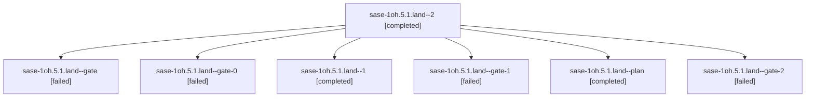

# Session: sase-1oh.5.1.land

[Agent Hoods](../README.md) / [bbugyi200](../users/bbugyi200/README.md) / [athena](../users/bbugyi200/machines/athena/README.md) / [sase-1oh](../users/bbugyi200/machines/athena/hoods/sase-1oh/README.md) / sase-1oh.5.1.land

Owner: `bbugyi200.athena` · Hood: `sase-1oh` · Members: 7 · Bead: [sase-1oh.5.1](https://github.com/sase-org/sase--beads/blob/main/pages/sase-1oh/sase-1oh.5.1.md)

## Lineage

The diagram is an optional enhancement; the ordered table below contains the same lineage in accessible text.

| Role | Agent | State | Model / provider | Timing | Commits | Prompt | Chat |
|---|---|---|---|---|---:|---|---|
| 2 | sase-1oh.5.1.land--2 | completed | opus / claude | 2026-10-27T09:20:00.584594+00:00 → 2026-10-27T09:26:50.519988+00:00 | 0 | [Prompt](../agents/bbugyi200.athena.sase-1oh.5.1.land--2/prompt.md) | [Chat](../agents/bbugyi200.athena.sase-1oh.5.1.land--2/chat.md) |
| gate | sase-1oh.5.1.land--gate | failed | opus / claude | 2026-10-27T09:09:37.515466+00:00 → 2026-10-27T09:11:11.239244+00:00 | 0 | — | [Chat](../agents/bbugyi200.athena.sase-1oh.5.1.land--gate/chat.md) |
| gate-0 | sase-1oh.5.1.land--gate-0 | failed | opus / claude | 2026-10-27T09:17:04.393344+00:00 → 2026-10-27T09:18:38.509197+00:00 | 0 | — | [Chat](../agents/bbugyi200.athena.sase-1oh.5.1.land--gate-0/chat.md) |
| 1 | sase-1oh.5.1.land--1 | completed | opus / claude | 2026-10-27T09:12:52.888810+00:00 → 2026-10-27T09:16:56.097257+00:00 | 0 | [Prompt](../agents/bbugyi200.athena.sase-1oh.5.1.land--1/prompt.md) | [Chat](../agents/bbugyi200.athena.sase-1oh.5.1.land--1/chat.md) |
| gate-1 | sase-1oh.5.1.land--gate-1 | failed | opus / claude | 2026-10-27T09:56:50.108938+00:00 → 2026-10-27T09:58:12.496873+00:00 | 0 | — | [Chat](../agents/bbugyi200.athena.sase-1oh.5.1.land--gate-1/chat.md) |
| plan | sase-1oh.5.1.land--plan | completed | opus / claude | 2026-10-27T07:10:12.870684+00:00 → 2026-10-27T07:42:46.073559+00:00 | 0 | [Prompt](../agents/bbugyi200.athena.sase-1oh.5.1.land--plan/prompt.md) | [Chat](../agents/bbugyi200.athena.sase-1oh.5.1.land--plan/chat.md) |
| gate-2 | sase-1oh.5.1.land--gate-2 | failed | opus / claude | 2026-10-27T10:06:17.212213+00:00 → 2026-10-27T10:06:40.832211+00:00 | 0 | — | [Chat](../agents/bbugyi200.athena.sase-1oh.5.1.land--gate-2/chat.md) |

## Neighbors

| Agent | Relation | State |
|---|---|---|
| [sase-1oh.5](bbugyi200.athena.sase-1oh.5.md) (session · 3) | ancestor | failed 3 |
| [sase-1oh.5.1.1](../agents/bbugyi200.athena.sase-1oh.5.1.1/README.md) | sase-1oh.5.1 hood | completed |
| [sase-1oh.5.1.2](../agents/bbugyi200.athena.sase-1oh.5.1.2/README.md) | sase-1oh.5.1 hood | completed |
| [sase-1oh.5.1.3](../agents/bbugyi200.athena.sase-1oh.5.1.3/README.md) | sase-1oh.5.1 hood | completed |
| [sase-1oh.5.1.4](bbugyi200.athena.sase-1oh.5.1.4.md) (session · 5) | sase-1oh.5.1 hood | completed 3, failed 2 |
| [sase-1oh.5.1.5](bbugyi200.athena.sase-1oh.5.1.5.md) (session · 3) | sase-1oh.5.1 hood | completed 2, failed 1 |
| [sase-1oh.5.1.land--3--code](../agents/bbugyi200.athena.sase-1oh.5.1.land--3--code/README.md) | sase-1oh.5.1 hood | completed |
| [sase-1oh.5.1.land--3--plan](../agents/bbugyi200.athena.sase-1oh.5.1.land--3--plan/README.md) | sase-1oh.5.1 hood | active |
| [sase-1oh.1](../agents/bbugyi200.athena.sase-1oh.1/README.md) | sase-1oh hood | completed |
| [sase-1oh.2](../agents/bbugyi200.athena.sase-1oh.2/README.md) | sase-1oh hood | completed |
| [sase-1oh.3](bbugyi200.athena.sase-1oh.3.md) (session · 3) | sase-1oh hood | completed 2, failed 1 |
| [sase-1oh.4](bbugyi200.athena.sase-1oh.4.md) (session · 3) | sase-1oh hood | failed 3 |
| [sase-1oh.4.1.1](../agents/bbugyi200.athena.sase-1oh.4.1.1/README.md) | sase-1oh hood | active |
| [sase-1oh.4.1.2](../agents/bbugyi200.athena.sase-1oh.4.1.2/README.md) | sase-1oh hood | active |
| [sase-1oh.4.1.3](../agents/bbugyi200.athena.sase-1oh.4.1.3/README.md) | sase-1oh hood | active |
| [sase-1oh.4.1.land](bbugyi200.athena.sase-1oh.4.1.land.md) (session · 3) | sase-1oh hood | active 2, completed 1 |
| [sase-1oh.land](bbugyi200.athena.sase-1oh.land.md) (session · 5) | sase-1oh hood | completed 1, failed 4 |
