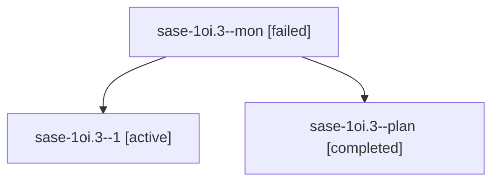

# Session: sase-1oi.3

[Agent Hoods](../README.md) / [bbugyi200](../users/bbugyi200/README.md) / [athena](../users/bbugyi200/machines/athena/README.md) / [sase-1oi](../users/bbugyi200/machines/athena/hoods/sase-1oi/README.md) / sase-1oi.3

Owner: `bbugyi200.athena` · Hood: `sase-1oi` · Members: 3 · Bead: [sase-1oi.3](https://github.com/sase-org/sase--beads/blob/main/pages/sase-1oi/sase-1oi.3.md)

## Lineage

The diagram is an optional enhancement; the ordered table below contains the same lineage in accessible text.

| Role | Agent | State | Model / provider | Timing | Commits | Prompt | Chat |
|---|---|---|---|---|---:|---|---|
| mon | sase-1oi.3--mon | failed | muse-spark-1.3-contributor / muse | 2026-10-27T03:42:30.294873+00:00 → 2026-10-27T04:20:36.844210+00:00 | 0 | — | [Chat](../agents/bbugyi200.athena.sase-1oi.3--mon/chat.md) |
| 1 | sase-1oi.3--1 | active | muse-spark-1.3-contributor / muse | 2026-10-27T04:22:20.481026+00:00 | 0 | [Prompt](../agents/bbugyi200.athena.sase-1oi.3--1/prompt.md) | — |
| plan | sase-1oi.3--plan | completed | muse-spark-1.3-contributor / muse | 2026-10-27T03:14:08.150511+00:00 → 2026-10-27T03:44:52.913252+00:00 | 0 | [Prompt](../agents/bbugyi200.athena.sase-1oi.3--plan/prompt.md) | [Chat](../agents/bbugyi200.athena.sase-1oi.3--plan/chat.md) |

## Neighbors

| Agent | Relation | State |
|---|---|---|
| [sase-1oi.1](../agents/bbugyi200.athena.sase-1oi.1/README.md) | sase-1oi hood | completed |
| [sase-1oi.2](../agents/bbugyi200.athena.sase-1oi.2/README.md) | sase-1oi hood | active |
| [sase-1oi.land](../agents/bbugyi200.athena.sase-1oi.land/README.md) | sase-1oi hood | waiting |
