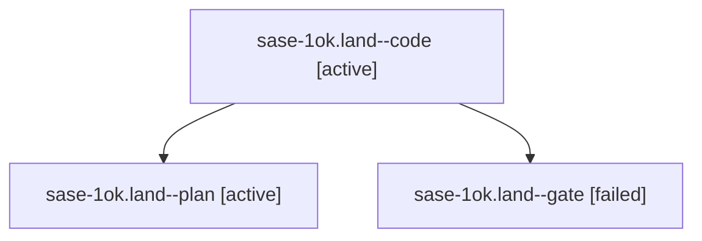

# Session: sase-1ok.land

[Agent Hoods](../README.md) / [bbugyi200](../users/bbugyi200/README.md) / [athena](../users/bbugyi200/machines/athena/README.md) / [sase-1ok](../users/bbugyi200/machines/athena/hoods/sase-1ok/README.md) / sase-1ok.land

Owner: `bbugyi200.athena` · Hood: `sase-1ok` · Members: 3 · Bead: [sase-1ok](https://github.com/sase-org/sase--beads/blob/main/pages/sase-1ok/README.md)

## Lineage

The diagram is an optional enhancement; the ordered table below contains the same lineage in accessible text.

| Role | Agent | State | Model / provider | Timing | Commits | Prompt | Chat |
|---|---|---|---|---|---:|---|---|
| code | sase-1ok.land--code | active | grok-4.6 / grok | 2026-10-27T02:14:29.436684+00:00 | [1](../agents/bbugyi200.athena.sase-1ok.land--code/README.md#commits) | — | — |
| plan | sase-1ok.land--plan | active | gpt-6-astra / codex | 2026-10-27T01:53:39.086729+00:00 | 0 | [Prompt](../agents/bbugyi200.athena.sase-1ok.land--plan/prompt.md) | [Chat](../agents/bbugyi200.athena.sase-1ok.land--plan/chat.md) |
| gate | sase-1ok.land--gate | failed | gpt-6-astra / codex | 2026-10-27T02:12:51.323705+00:00 → 2026-10-27T02:13:49.381827+00:00 | 0 | — | [Chat](../agents/bbugyi200.athena.sase-1ok.land--gate/chat.md) |

## Commits

| Role | Repo | Commit | Subject | Committed |
|---|---|---|---|---|
| code | sase | [`c74a32c`](https://github.com/sase-org/sase/commit/c74a32c5c46afb1687751df2d0e0068dc6353596) | fix(wait-checks): dismiss stranded-bead alerts after external waiter release | 2026-10-26 23:05:05 EDT |

## Neighbors

| Agent | Relation | State |
|---|---|---|
| [sase-1ok.1](../agents/bbugyi200.athena.sase-1ok.1/README.md) | sase-1ok hood | completed |
| [sase-1ok.2](../agents/bbugyi200.athena.sase-1ok.2/README.md) | sase-1ok hood | completed |
| [sase-1ok.3](../agents/bbugyi200.athena.sase-1ok.3/README.md) | sase-1ok hood | completed |
| [sase-1ok.4](../agents/bbugyi200.athena.sase-1ok.4/README.md) | sase-1ok hood | completed |
