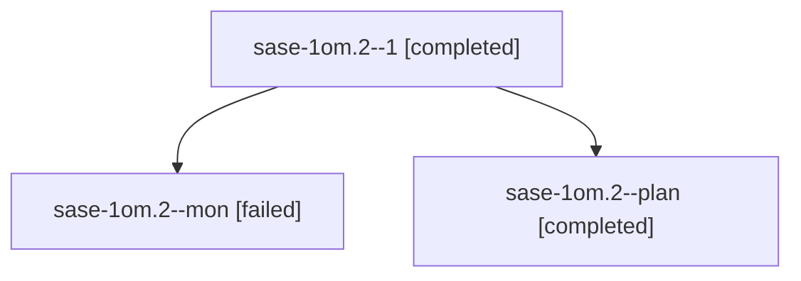

# Session: sase-1om.2

[Agent Hoods](../README.md) / [bbugyi200](../users/bbugyi200/README.md) / [athena](../users/bbugyi200/machines/athena/README.md) / [sase-1om](../users/bbugyi200/machines/athena/hoods/sase-1om/README.md) / sase-1om.2

Owner: `bbugyi200.athena` · Hood: `sase-1om` · Members: 3 · Bead: [sase-1om.2](https://github.com/sase-org/sase--beads/blob/main/pages/sase-1om/sase-1om.2.md)

## Lineage

The diagram is an optional enhancement; the ordered table below contains the same lineage in accessible text.

| Role | Agent | State | Model / provider | Timing | Commits | Prompt | Chat |
|---|---|---|---|---|---:|---|---|
| 1 | sase-1om.2--1 | completed | muse-spark-1.3-contributor / muse | 2026-10-27T01:29:42.690837+00:00 → 2026-10-27T02:39:17.591243+00:00 | [1](../agents/bbugyi200.athena.sase-1om.2--1/README.md#commits) | [Prompt](../agents/bbugyi200.athena.sase-1om.2--1/prompt.md) | [Chat](../agents/bbugyi200.athena.sase-1om.2--1/chat.md) |
| mon | sase-1om.2--mon | failed | muse-spark-1.3-contributor / muse | 2026-10-27T01:15:09.878784+00:00 → 2026-10-27T01:22:17.904538+00:00 | 0 | — | [Chat](../agents/bbugyi200.athena.sase-1om.2--mon/chat.md) |
| plan | sase-1om.2--plan | completed | muse-spark-1.3-contributor / muse | 2026-10-27T00:24:43.460147+00:00 → 2026-10-27T01:17:41.391877+00:00 | 0 | [Prompt](../agents/bbugyi200.athena.sase-1om.2--plan/prompt.md) | [Chat](../agents/bbugyi200.athena.sase-1om.2--plan/chat.md) |

## Commits

| Role | Repo | Commit | Subject | Committed |
|---|---|---|---|---|
| 1 | sase | [`4a64ff9`](https://github.com/sase-org/sase/commit/4a64ff9a28e859e92badc9eb6206a78555ccccfd) | feat: adapt record builders for core capacity accounting | 2026-10-26 22:34:33 EDT |

## Neighbors

| Agent | Relation | State |
|---|---|---|
| [sase-1om.1](bbugyi200.athena.sase-1om.1.md) (session · 3) | sase-1om hood | completed 2, failed 1 |
| [sase-1om.3](../agents/bbugyi200.athena.sase-1om.3/README.md) | sase-1om hood | completed |
| [sase-1om.4](../agents/bbugyi200.athena.sase-1om.4/README.md) | sase-1om hood | completed |
| [sase-1om.5](../agents/bbugyi200.athena.sase-1om.5/README.md) | sase-1om hood | completed |
| [sase-1om.6](bbugyi200.athena.sase-1om.6.md) (session · 5) | sase-1om hood | active 1, completed 2, failed 2 |
| [sase-1om.7](../agents/bbugyi200.athena.sase-1om.7/README.md) | sase-1om hood | waiting |
| [sase-1om.8](../agents/bbugyi200.athena.sase-1om.8/README.md) | sase-1om hood | waiting |
| [sase-1om.9](../agents/bbugyi200.athena.sase-1om.9/README.md) | sase-1om hood | waiting |
| [sase-1om.land](../agents/bbugyi200.athena.sase-1om.land/README.md) | sase-1om hood | waiting |
