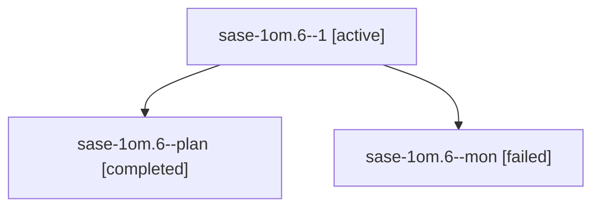

# Session: sase-1om.6

[Agent Hoods](../README.md) / [bbugyi200](../users/bbugyi200/README.md) / [athena](../users/bbugyi200/machines/athena/README.md) / [sase-1om](../users/bbugyi200/machines/athena/hoods/sase-1om/README.md) / sase-1om.6

Owner: `bbugyi200.athena` · Hood: `sase-1om` · Members: 3 · Bead: [sase-1om.6](https://github.com/sase-org/sase--beads/blob/main/pages/sase-1om/sase-1om.6.md)

## Lineage

The diagram is an optional enhancement; the ordered table below contains the same lineage in accessible text.

| Role | Agent | State | Model / provider | Timing | Commits | Prompt | Chat |
|---|---|---|---|---|---:|---|---|
| 1 | sase-1om.6--1 | active | gpt-6-luna / codex | 2026-10-27T04:48:37.134797+00:00 | 0 | [Prompt](../agents/bbugyi200.athena.sase-1om.6--1/prompt.md) | — |
| plan | sase-1om.6--plan | completed | gpt-6-luna / codex | 2026-10-27T04:24:21.923256+00:00 → 2026-10-27T04:42:13.030269+00:00 | 0 | [Prompt](../agents/bbugyi200.athena.sase-1om.6--plan/prompt.md) | [Chat](../agents/bbugyi200.athena.sase-1om.6--plan/chat.md) |
| mon | sase-1om.6--mon | failed | gpt-6-luna / codex | 2026-10-27T04:41:14.010864+00:00 → 2026-10-27T04:47:07.328535+00:00 | 0 | — | [Chat](../agents/bbugyi200.athena.sase-1om.6--mon/chat.md) |

## Neighbors

| Agent | Relation | State |
|---|---|---|
| [sase-1om.1](bbugyi200.athena.sase-1om.1.md) (session · 3) | sase-1om hood | completed 2, failed 1 |
| [sase-1om.2](bbugyi200.athena.sase-1om.2.md) (session · 3) | sase-1om hood | completed 2, failed 1 |
| [sase-1om.3](../agents/bbugyi200.athena.sase-1om.3/README.md) | sase-1om hood | completed |
| [sase-1om.4](../agents/bbugyi200.athena.sase-1om.4/README.md) | sase-1om hood | active |
| [sase-1om.5](../agents/bbugyi200.athena.sase-1om.5/README.md) | sase-1om hood | completed |
| [sase-1om.7](../agents/bbugyi200.athena.sase-1om.7/README.md) | sase-1om hood | waiting |
| [sase-1om.8](../agents/bbugyi200.athena.sase-1om.8/README.md) | sase-1om hood | waiting |
| [sase-1om.9](../agents/bbugyi200.athena.sase-1om.9/README.md) | sase-1om hood | waiting |
| [sase-1om.land](../agents/bbugyi200.athena.sase-1om.land/README.md) | sase-1om hood | waiting |
