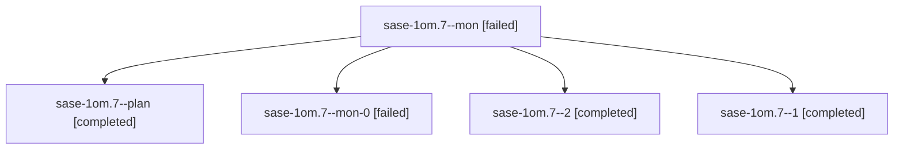

# Session: sase-1om.7

[Agent Hoods](../README.md) / [bbugyi200](../users/bbugyi200/README.md) / [athena](../users/bbugyi200/machines/athena/README.md) / [sase-1om](../users/bbugyi200/machines/athena/hoods/sase-1om/README.md) / sase-1om.7

Owner: `bbugyi200.athena` · Hood: `sase-1om` · Members: 5 · Bead: [sase-1om.7](https://github.com/sase-org/sase--beads/blob/main/pages/sase-1om/sase-1om.7.md)

## Lineage

The diagram is an optional enhancement; the ordered table below contains the same lineage in accessible text.

| Role | Agent | State | Model / provider | Timing | Commits | Prompt | Chat |
|---|---|---|---|---|---:|---|---|
| mon | sase-1om.7--mon | failed | grok-4.6 / grok | 2026-10-27T07:39:11.464538+00:00 → 2026-10-27T07:58:32.909324+00:00 | 0 | — | [Chat](../agents/bbugyi200.athena.sase-1om.7--mon/chat.md) |
| plan | sase-1om.7--plan | completed | grok-4.6 / grok | 2026-10-27T06:54:33.957097+00:00 → 2026-10-27T07:39:58.101442+00:00 | 0 | [Prompt](../agents/bbugyi200.athena.sase-1om.7--plan/prompt.md) | [Chat](../agents/bbugyi200.athena.sase-1om.7--plan/chat.md) |
| mon-0 | sase-1om.7--mon-0 | failed | grok-4.6 / grok | 2026-10-27T08:13:56.228917+00:00 → 2026-10-27T08:46:06.284444+00:00 | [1](../agents/bbugyi200.athena.sase-1om.7--mon-0/README.md#commits) | — | [Chat](../agents/bbugyi200.athena.sase-1om.7--mon-0/chat.md) |
| 2 | sase-1om.7--2 | completed | grok-4.6 / grok | 2026-10-27T08:47:12.305894+00:00 → 2026-10-27T08:54:07.430937+00:00 | 0 | [Prompt](../agents/bbugyi200.athena.sase-1om.7--2/prompt.md) | [Chat](../agents/bbugyi200.athena.sase-1om.7--2/chat.md) |
| 1 | sase-1om.7--1 | completed | grok-4.6 / grok | 2026-10-27T07:59:44.152972+00:00 → 2026-10-27T08:19:13.081219+00:00 | 0 | [Prompt](../agents/bbugyi200.athena.sase-1om.7--1/prompt.md) | [Chat](../agents/bbugyi200.athena.sase-1om.7--1/chat.md) |

## Commits

| Role | Repo | Commit | Subject | Committed |
|---|---|---|---|---|
| mon-0 | sase | [`ff516a4`](https://github.com/sase-org/sase/commit/ff516a42b9ed32e26de10cea74760437de33f086) | feat(tui): restyle Agents header load gauge as a cap chip | 2026-10-27 04:42:49 EDT |

## Neighbors

| Agent | Relation | State |
|---|---|---|
| [sase-1om.1](bbugyi200.athena.sase-1om.1.md) (session · 3) | sase-1om hood | completed 2, failed 1 |
| [sase-1om.2](bbugyi200.athena.sase-1om.2.md) (session · 3) | sase-1om hood | completed 2, failed 1 |
| [sase-1om.3](../agents/bbugyi200.athena.sase-1om.3/README.md) | sase-1om hood | completed |
| [sase-1om.4](../agents/bbugyi200.athena.sase-1om.4/README.md) | sase-1om hood | completed |
| [sase-1om.5](../agents/bbugyi200.athena.sase-1om.5/README.md) | sase-1om hood | completed |
| [sase-1om.6](bbugyi200.athena.sase-1om.6.md) (session · 5) | sase-1om hood | completed 3, failed 2 |
| [sase-1om.8](bbugyi200.athena.sase-1om.8.md) (session · 5) | sase-1om hood | completed 3, failed 2 |
| [sase-1om.9](bbugyi200.athena.sase-1om.9.md) (session · 3) | sase-1om hood | active 1, completed 1, failed 1 |
| [sase-1om.land](../agents/bbugyi200.athena.sase-1om.land/README.md) | sase-1om hood | waiting |
