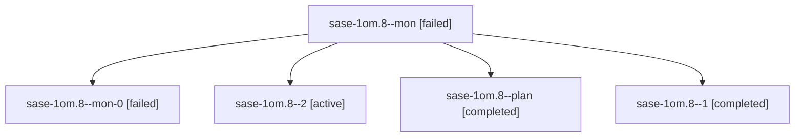

# Session: sase-1om.8

[Agent Hoods](../README.md) / [bbugyi200](../users/bbugyi200/README.md) / [athena](../users/bbugyi200/machines/athena/README.md) / [sase-1om](../users/bbugyi200/machines/athena/hoods/sase-1om/README.md) / sase-1om.8

Owner: `bbugyi200.athena` · Hood: `sase-1om` · Members: 5 · Bead: [sase-1om.8](https://github.com/sase-org/sase--beads/blob/main/pages/sase-1om/sase-1om.8.md)

## Lineage

The diagram is an optional enhancement; the ordered table below contains the same lineage in accessible text.

| Role | Agent | State | Model / provider | Timing | Commits | Prompt | Chat |
|---|---|---|---|---|---:|---|---|
| mon | sase-1om.8--mon | failed | muse-spark-1.3-contributor / muse | 2026-10-27T07:22:16.724649+00:00 → 2026-10-27T08:09:34.877604+00:00 | 0 | — | [Chat](../agents/bbugyi200.athena.sase-1om.8--mon/chat.md) |
| mon-0 | sase-1om.8--mon-0 | failed | muse-spark-1.3-contributor / muse | 2026-10-27T08:13:21.344971+00:00 → 2026-10-27T08:32:45.316076+00:00 | 0 | — | [Chat](../agents/bbugyi200.athena.sase-1om.8--mon-0/chat.md) |
| 2 | sase-1om.8--2 | active | muse-spark-1.3-contributor / muse | 2026-10-27T08:33:56.901799+00:00 | [1](../agents/bbugyi200.athena.sase-1om.8--2/README.md#commits) | [Prompt](../agents/bbugyi200.athena.sase-1om.8--2/prompt.md) | — |
| plan | sase-1om.8--plan | completed | muse-spark-1.3-contributor / muse | 2026-10-27T06:54:47.402635+00:00 → 2026-10-27T07:23:23.754318+00:00 | 0 | [Prompt](../agents/bbugyi200.athena.sase-1om.8--plan/prompt.md) | [Chat](../agents/bbugyi200.athena.sase-1om.8--plan/chat.md) |
| 1 | sase-1om.8--1 | completed | muse-spark-1.3-contributor / muse | 2026-10-27T08:10:35.173902+00:00 → 2026-10-27T08:13:58.855338+00:00 | 0 | [Prompt](../agents/bbugyi200.athena.sase-1om.8--1/prompt.md) | [Chat](../agents/bbugyi200.athena.sase-1om.8--1/chat.md) |

## Commits

| Role | Repo | Commit | Subject | Committed |
|---|---|---|---|---|
| 2 | sase | [`212a476`](https://github.com/sase-org/sase/commit/212a4767861c1a796aa1ba46bdfa6888f3edf808) | feat(ace): add agent capacity accounting and occupancy marks | 2026-10-27 05:40:30 EDT |

## Neighbors

| Agent | Relation | State |
|---|---|---|
| [sase-1om.1](bbugyi200.athena.sase-1om.1.md) (session · 3) | sase-1om hood | completed 2, failed 1 |
| [sase-1om.2](bbugyi200.athena.sase-1om.2.md) (session · 3) | sase-1om hood | completed 2, failed 1 |
| [sase-1om.3](../agents/bbugyi200.athena.sase-1om.3/README.md) | sase-1om hood | completed |
| [sase-1om.4](../agents/bbugyi200.athena.sase-1om.4/README.md) | sase-1om hood | completed |
| [sase-1om.5](../agents/bbugyi200.athena.sase-1om.5/README.md) | sase-1om hood | completed |
| [sase-1om.6](bbugyi200.athena.sase-1om.6.md) (session · 5) | sase-1om hood | completed 3, failed 2 |
| [sase-1om.7](bbugyi200.athena.sase-1om.7.md) (session · 5) | sase-1om hood | completed 3, failed 2 |
| [sase-1om.9](bbugyi200.athena.sase-1om.9.md) (session · 3) | sase-1om hood | active 1, completed 1, failed 1 |
| [sase-1om.land](../agents/bbugyi200.athena.sase-1om.land/README.md) | sase-1om hood | waiting |
