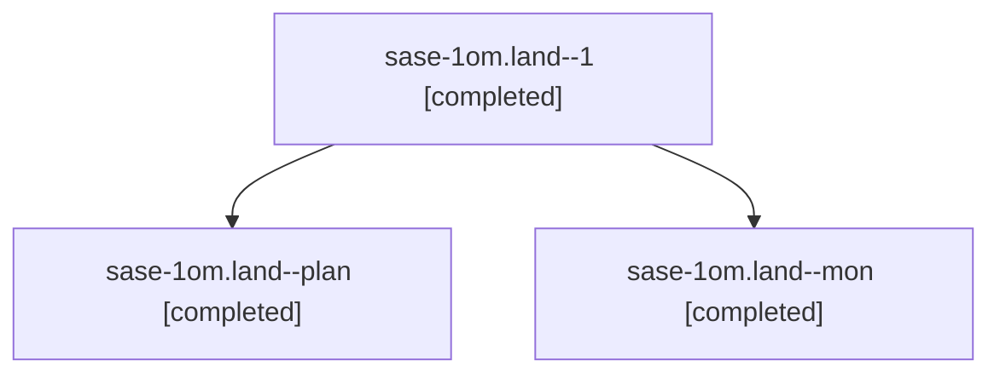

# Session: sase-1om.land

[Agent Hoods](../README.md) / [bbugyi200](../users/bbugyi200/README.md) / [athena](../users/bbugyi200/machines/athena/README.md) / [sase-1om](../users/bbugyi200/machines/athena/hoods/sase-1om/README.md) / sase-1om.land

Owner: `bbugyi200.athena` · Hood: `sase-1om` · Members: 3 · Bead: [sase-1om](https://github.com/sase-org/sase--beads/blob/main/pages/sase-1om/README.md)

## Lineage

The diagram is an optional enhancement; the ordered table below contains the same lineage in accessible text.

| Role | Agent | State | Model / provider | Timing | Commits | Prompt | Chat |
|---|---|---|---|---|---:|---|---|
| 1 | sase-1om.land--1 | completed | opus / claude | 2026-11-01T20:49:21.925389+00:00 → 2026-11-01T20:53:04.230797+00:00 | [1](../agents/bbugyi200.athena.sase-1om.land--1/README.md#commits) | [Prompt](../agents/bbugyi200.athena.sase-1om.land--1/prompt.md) | [Chat](../agents/bbugyi200.athena.sase-1om.land--1/chat.md) |
| plan | sase-1om.land--plan | completed | opus / claude | 2026-11-01T18:36:35.348675+00:00 → 2026-11-01T20:32:44.064959+00:00 | 0 | [Prompt](../agents/bbugyi200.athena.sase-1om.land--plan/prompt.md) | [Chat](../agents/bbugyi200.athena.sase-1om.land--plan/chat.md) |
| mon | sase-1om.land--mon | completed | opus / claude | 2026-11-01T20:32:20.900525+00:00 → 2026-11-01T20:47:07.834571+00:00 | 0 | — | [Chat](../agents/bbugyi200.athena.sase-1om.land--mon/chat.md) |

## Commits

| Role | Repo | Commit | Subject | Committed |
|---|---|---|---|---|
| 1 | sase | [`a5bc298`](https://github.com/sase-org/sase/commit/a5bc2987cc0e30b1ddec3997a645bb0897a8100e) | docs(tui): name the cap chip in stale load-gauge docstrings | 2026-11-01 15:51:01 EST |

## Neighbors

| Agent | Relation | State |
|---|---|---|
| [sase-1om.1](bbugyi200.athena.sase-1om.1.md) (session · 3) | sase-1om hood | completed 2, failed 1 |
| [sase-1om.2](bbugyi200.athena.sase-1om.2.md) (session · 3) | sase-1om hood | completed 2, failed 1 |
| [sase-1om.3](../agents/bbugyi200.athena.sase-1om.3/README.md) | sase-1om hood | completed |
| [sase-1om.4](../agents/bbugyi200.athena.sase-1om.4/README.md) | sase-1om hood | completed |
| [sase-1om.5](../agents/bbugyi200.athena.sase-1om.5/README.md) | sase-1om hood | completed |
| [sase-1om.6](bbugyi200.athena.sase-1om.6.md) (session · 5) | sase-1om hood | completed 3, failed 2 |
| [sase-1om.7](bbugyi200.athena.sase-1om.7.md) (session · 5) | sase-1om hood | completed 3, failed 2 |
| [sase-1om.8](bbugyi200.athena.sase-1om.8.md) (session · 5) | sase-1om hood | completed 3, failed 2 |
| [sase-1om.8.f0](../agents/bbugyi200.athena.sase-1om.8.f0/README.md) | sase-1om hood | completed |
| [sase-1om.9](bbugyi200.athena.sase-1om.9.md) (session · 3) | sase-1om hood | completed 2, failed 1 |
