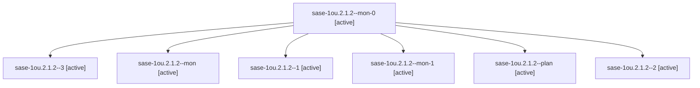

# Session: sase-1ou.2.1.2

[Agent Hoods](../README.md) / [bbugyi200](../users/bbugyi200/README.md) / [athena](../users/bbugyi200/machines/athena/README.md) / [sase-1ou](../users/bbugyi200/machines/athena/hoods/sase-1ou/README.md) / sase-1ou.2.1.2

Owner: `bbugyi200.athena` · Hood: `sase-1ou` · Members: 7 · Bead: [sase-1ou.2.1.2](https://github.com/sase-org/sase--beads/blob/main/pages/sase-1ou/sase-1ou.2.1.2.md)

## Lineage



The diagram is an optional enhancement; the ordered table below contains the same lineage in accessible text.

| Role | Agent | State | Model / provider | Timing | Commits | Prompt | Chat |
|---|---|---|---|---|---:|---|---|
| <a id="member-mon-0"></a>mon-0 | sase-1ou.2.1.2--mon-0 | active | gpt-6-astra / codex | 2026-10-27T19:19:27.384779+00:00 | 0 | — | [Chat](../agents/bbugyi200.athena.sase-1ou.2.1.2--mon-0/chat.md) |
| <a id="member-3"></a>3 | sase-1ou.2.1.2--3 | active | gpt-6-astra / codex | 2026-10-27T21:27:26.869294+00:00 | [1](../agents/bbugyi200.athena.sase-1ou.2.1.2--3/README.md#commits) | [Prompt](../agents/bbugyi200.athena.sase-1ou.2.1.2--3/prompt.md) | [Chat](../agents/bbugyi200.athena.sase-1ou.2.1.2--3/chat.md) |
| <a id="member-mon"></a>mon | sase-1ou.2.1.2--mon | active | gpt-6-astra / codex | 2026-10-27T18:50:46.745381+00:00 | 0 | — | [Chat](../agents/bbugyi200.athena.sase-1ou.2.1.2--mon/chat.md) |
| <a id="member-1"></a>1 | sase-1ou.2.1.2--1 | active | gpt-6-astra / codex | 2026-10-27T19:02:54.103609+00:00 | 0 | [Prompt](../agents/bbugyi200.athena.sase-1ou.2.1.2--1/prompt.md) | [Chat](../agents/bbugyi200.athena.sase-1ou.2.1.2--1/chat.md) |
| <a id="member-mon-1"></a>mon-1 | sase-1ou.2.1.2--mon-1 | active | gpt-6-astra / codex | 2026-10-27T20:23:52.246269+00:00 | 0 | — | [Chat](../agents/bbugyi200.athena.sase-1ou.2.1.2--mon-1/chat.md) |
| <a id="member-plan"></a>plan | sase-1ou.2.1.2--plan | active | gpt-6-astra / codex | 2026-10-27T18:37:56.080151+00:00 | 0 | [Prompt](../agents/bbugyi200.athena.sase-1ou.2.1.2--plan/prompt.md) | [Chat](../agents/bbugyi200.athena.sase-1ou.2.1.2--plan/chat.md) |
| <a id="member-2"></a>2 | sase-1ou.2.1.2--2 | active | gpt-6-astra / codex | 2026-10-27T19:33:05.138708+00:00 | 0 | [Prompt](../agents/bbugyi200.athena.sase-1ou.2.1.2--2/prompt.md) | [Chat](../agents/bbugyi200.athena.sase-1ou.2.1.2--2/chat.md) |

## Commits

| Role | Repo | Commit | Subject | Committed |
|---|---|---|---|---|
| 3 | sase | [`57d5f41`](https://github.com/sase-org/sase/commit/57d5f411e41e543ffa10d9a91ab45fd66f62ebb6) | fix(tool): delegate default contention budgets to Rust | 2026-10-27 17:40:35 EDT |

## Variables

| Role | Variable | Value |
|---|---|---|
| 1 | `artifacts` | \[{bead: sase-1ou.2.1.2, kind: file, label: ToolRun contention before-build.json, path: /home/bryan/.sase/artifacts/agents/gh\_sase-org\_\_sase/20261027150034/before-build-b95a7fdc1a7e.json, ref: file:ex… |
| 2 | `artifacts` | \[{bead: sase-1ou.2.1.2, kind: file, label: ToolRun contention completed verification bundle, path: /home/bryan/.sase/artifacts/agents/gh\_sase-org\_\_sase/20261027153040/evidence-bundle-511072056f0d.jso… |
| 3 | `artifacts` | \[{bead: sase-1ou.2.1.2, kind: file, label: ToolRun final budget verification evidence bundle, path: /home/bryan/.sase/artifacts/agents/gh\_sase-org\_\_sase/20261027172454/budget-evidence-bundle-c0c5b78e… |
| plan | `artifacts` | \[{bead: sase-1ou.2.1.2, kind: file, label: Frozen ToolRun application stress harness, path: /home/bryan/.sase/artifacts/agents/gh\_sase-org\_\_sase/20261027143633/run-051497f01113.py, ref: file:explicit… |

#### artifacts

**Role:** `1`

```yaml
- bead: sase-1ou.2.1.2
  kind: file
  label: ToolRun contention before-build.json
  path: /home/bryan/.sase/artifacts/agents/gh_sase-org__sase/20261027150034/before-build-b95a7fdc1a7e.json
  ref: file:explicit:e81105351838d35a34702195
  source_path: /home/bryan/.local/state/sase/workspaces/sase-org/sase/sase_19/.sase/toolrun-contention/before-build.json
- bead: sase-1ou.2.1.2
  kind: file
  label: ToolRun contention restored-build.json
  path: /home/bryan/.sase/artifacts/agents/gh_sase-org__sase/20261027150034/restored-build-3663aa883a78.json
  ref: file:explicit:1083872161ac8666fd9b1bda
  source_path: /home/bryan/.local/state/sase/workspaces/sase-org/sase/sase_19/.sase/toolrun-contention/restored-build.json
- bead: sase-1ou.2.1.2
  kind: file
  label: ToolRun contention before/summary.json
  path: /home/bryan/.sase/artifacts/agents/gh_sase-org__sase/20261027150034/summary-6ef8acc20eb5.json
  ref: file:explicit:5188d4e4e5c2a4d5dc6c79a1
  source_path: /home/bryan/.local/state/sase/workspaces/sase-org/sase/sase_19/.sase/toolrun-contention/before/summary.json
- bead: sase-1ou.2.1.2
  kind: file
  label: ToolRun baseline and controlled last-close proof with harnesses
  path: /home/bryan/.sase/artifacts/agents/gh_sase-org__sase/20261027150034/pre-after-evidence-93cf2d7f3734.json
  ref: file:explicit:a07183c91cc51db252271078
  source_path: /home/bryan/.local/state/sase/workspaces/sase-org/sase/sase_19/.sase/toolrun-contention/pre-after-evidence.json
```

#### artifacts

**Role:** `2`

```yaml
- bead: sase-1ou.2.1.2
  kind: file
  label: ToolRun contention completed verification bundle
  path: /home/bryan/.sase/artifacts/agents/gh_sase-org__sase/20261027153040/evidence-bundle-511072056f0d.json
  ref: file:explicit:b13e06f116130351ef4438d2
  source_path: /home/bryan/.local/state/sase/workspaces/sase-org/sase/sase_19/.sase/toolrun-contention/evidence-bundle.json
- bead: sase-1ou.2.1.2
  kind: file
  label: Corrected WAL probe deadline measurements
  path: /home/bryan/.sase/artifacts/agents/gh_sase-org__sase/20261027153040/controlled-audit-corrected-362ebcb0f967.json
  ref: file:explicit:c8e2e1dd2954f633e244ccb6
  source_path: /home/bryan/.local/state/sase/workspaces/sase-org/sase/sase_19/.sase/toolrun-contention/controlled-audit-corrected.json
```

#### artifacts

**Role:** `3`

```yaml
- bead: sase-1ou.2.1.2
  kind: file
  label: ToolRun final budget verification evidence bundle
  path: /home/bryan/.sase/artifacts/agents/gh_sase-org__sase/20261027172454/budget-evidence-bundle-c0c5b78e54dc.json
  ref: file:explicit:c0f4bd59f97240f4bbc90b82
  source_path: /home/bryan/.local/state/sase/workspaces/sase-org/sase/sase_19/.sase/toolrun-contention/budget-evidence-bundle.json
- bead: sase-1ou.2.1.2
  kind: markdown
  label: ToolRun caller integration final evidence and landing table
  path: /home/bryan/.sase/artifacts/agents/gh_sase-org__sase/20261027172454/land-evidence-f8af7bd71a01.md
  ref: file:explicit:b0d1fd4be5d7f8c6c632927d
  source_path: /home/bryan/.local/state/sase/workspaces/sase-org/sase/sase_19/.sase/toolrun-contention/land-evidence.md
```

#### artifacts

**Role:** `plan`

```yaml
- bead: sase-1ou.2.1.2
  kind: file
  label: Frozen ToolRun application stress harness
  path: /home/bryan/.sase/artifacts/agents/gh_sase-org__sase/20261027143633/run-051497f01113.py
  ref: file:explicit:6b50e3f8b87298d7ac6fc874
  source_path: /home/bryan/.local/state/sase/workspaces/sase-org/sase/sase_19/.sase/toolrun-contention/run.py
- bead: sase-1ou.2.1.2
  kind: file
  label: Frozen ToolRun stress extension provenance plugin
  path: /home/bryan/.sase/artifacts/agents/gh_sase-org__sase/20261027143633/stress_provenance-1d07f6758ff1.py
  ref: file:explicit:6fc26af0d95272457a17d879
  source_path: /home/bryan/.local/state/sase/workspaces/sase-org/sase/sase_19/.sase/toolrun-contention/stress_provenance.py
- bead: sase-1ou.2.1.2
  kind: file
  label: ToolRun baseline local build and restore driver
  path: /home/bryan/.sase/artifacts/agents/gh_sase-org__sase/20261027143633/before_batch-63a88034682b.py
  ref: file:explicit:dcdb074200fedcafa5a9f497
  source_path: /home/bryan/.local/state/sase/workspaces/sase-org/sase/sase_19/.sase/toolrun-contention/before_batch.py
```

Values are truncated for display; see each member's agent meta.json for the full values.

## Neighbors

| Agent | Relation | State |
|---|---|---|
| [sase-1ou.2](bbugyi200.athena.sase-1ou.2.md) (session · 3) | ancestor | failed 3 |
| [sase-1ou.2.1.1](../agents/bbugyi200.athena.sase-1ou.2.1.1/README.md) | sase-1ou.2.1 hood | active |
| [sase-1ou.2.1.land](bbugyi200.athena.sase-1ou.2.1.land.md) (session · 3) | sase-1ou.2.1 hood | active 3 |
| [sase-1ou.1](../agents/bbugyi200.athena.sase-1ou.1/README.md) | sase-1ou hood | completed |
| [sase-1ou.3](bbugyi200.athena.sase-1ou.3.md) (session · 7) | sase-1ou hood | completed 4, failed 3 |
| [sase-1ou.4](bbugyi200.athena.sase-1ou.4.md) (session · 5) | sase-1ou hood | completed 3, failed 2 |
| [sase-1ou.5](bbugyi200.athena.sase-1ou.5.md) (session · 3) | sase-1ou hood | failed 3 |
| [sase-1ou.5.1.1](../agents/bbugyi200.athena.sase-1ou.5.1.1/README.md) | sase-1ou hood | completed |
| [sase-1ou.5.1.2](../agents/bbugyi200.athena.sase-1ou.5.1.2/README.md) | sase-1ou hood | completed |
| [sase-1ou.5.1.3](bbugyi200.athena.sase-1ou.5.1.3.md) (session · 3) | sase-1ou hood | completed 2, failed 1 |
| [sase-1ou.5.1.4](bbugyi200.athena.sase-1ou.5.1.4.md) (session · 5) | sase-1ou hood | completed 3, failed 2 |
| [sase-1ou.5.1.land](../agents/bbugyi200.athena.sase-1ou.5.1.land/README.md) | sase-1ou hood | completed |
| [sase-1ou.6.1](../agents/bbugyi200.athena.sase-1ou.6.1/README.md) | sase-1ou hood | completed |
| [sase-1ou.6.land](bbugyi200.athena.sase-1ou.6.land.md) (session · 7) | sase-1ou hood | active 1, completed 3, failed 3 |
| [sase-1ou.land](bbugyi200.athena.sase-1ou.land.md) (session · 3) | sase-1ou hood | failed 3 |
