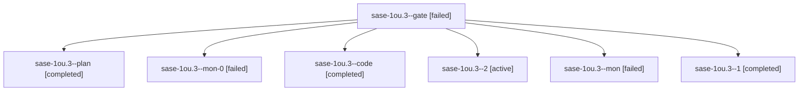

# Session: sase-1ou.3

[Agent Hoods](../README.md) / [bbugyi200](../users/bbugyi200/README.md) / [athena](../users/bbugyi200/machines/athena/README.md) / [sase-1ou](../users/bbugyi200/machines/athena/hoods/sase-1ou/README.md) / sase-1ou.3

Owner: `bbugyi200.athena` · Hood: `sase-1ou` · Members: 7 · Bead: [sase-1ou.3](https://github.com/sase-org/sase--beads/blob/main/pages/sase-1ou/sase-1ou.3.md)

## Lineage

The diagram is an optional enhancement; the ordered table below contains the same lineage in accessible text.

| Role | Agent | State | Model / provider | Timing | Commits | Prompt | Chat |
|---|---|---|---|---|---:|---|---|
| gate | sase-1ou.3--gate | failed | gpt-6-astra / codex | 2026-10-27T14:43:36.180578+00:00 → 2026-10-27T14:43:59.977125+00:00 | 0 | — | [Chat](../agents/bbugyi200.athena.sase-1ou.3--gate/chat.md) |
| plan | sase-1ou.3--plan | completed | gpt-6-astra / codex | 2026-10-27T14:29:50.756666+00:00 → 2026-10-27T15:05:55.108161+00:00 | 0 | [Prompt](../agents/bbugyi200.athena.sase-1ou.3--plan/prompt.md) | [Chat](../agents/bbugyi200.athena.sase-1ou.3--plan/chat.md) |
| mon-0 | sase-1ou.3--mon-0 | failed | muse-spark-1.3-contributor / muse | 2026-10-27T16:19:43.697399+00:00 → 2026-10-27T17:16:59.898795+00:00 | 0 | — | [Chat](../agents/bbugyi200.athena.sase-1ou.3--mon-0/chat.md) |
| code | sase-1ou.3--code | completed | muse-spark-1.3-contributor / muse | 2026-10-27T14:44:44.921985+00:00 → 2026-10-27T15:05:55.108161+00:00 | 0 | — | [Chat](../agents/bbugyi200.athena.sase-1ou.3--code/chat.md) |
| 2 | sase-1ou.3--2 | active | muse-spark-1.3-contributor / muse | 2026-10-27T17:18:35.721677+00:00 | [1](../agents/bbugyi200.athena.sase-1ou.3--2/README.md#commits) | [Prompt](../agents/bbugyi200.athena.sase-1ou.3--2/prompt.md) | — |
| mon | sase-1ou.3--mon | failed | muse-spark-1.3-contributor / muse | 2026-10-27T15:03:25.846613+00:00 → 2026-10-27T15:57:00.026337+00:00 | 0 | — | [Chat](../agents/bbugyi200.athena.sase-1ou.3--mon/chat.md) |
| 1 | sase-1ou.3--1 | completed | muse-spark-1.3-contributor / muse | 2026-10-27T15:58:49.699286+00:00 → 2026-10-27T16:20:24.003964+00:00 | 0 | [Prompt](../agents/bbugyi200.athena.sase-1ou.3--1/prompt.md) | [Chat](../agents/bbugyi200.athena.sase-1ou.3--1/chat.md) |

## Commits

| Role | Repo | Commit | Subject | Committed |
|---|---|---|---|---|
| 2 | sase | [`a42eedc`](https://github.com/sase-org/sase/commit/a42eedc1c4679612ccfbcc277f302c88c1960b2f) | fix(tests): make monitor capacity e2e load-robust via canonical artifact path | 2026-10-27 13:22:09 EDT |

## Neighbors

| Agent | Relation | State |
|---|---|---|
| [sase-1ou.1](../agents/bbugyi200.athena.sase-1ou.1/README.md) | sase-1ou hood | completed |
| [sase-1ou.2](bbugyi200.athena.sase-1ou.2.md) (session · 3) | sase-1ou hood | failed 3 |
| [sase-1ou.2.1.1](../agents/bbugyi200.athena.sase-1ou.2.1.1/README.md) | sase-1ou hood | completed |
| [sase-1ou.2.1.2](bbugyi200.athena.sase-1ou.2.1.2.md) (session · 2) | sase-1ou hood | completed 1, failed 1 |
| [sase-1ou.2.1.land](../agents/bbugyi200.athena.sase-1ou.2.1.land/README.md) | sase-1ou hood | waiting |
| [sase-1ou.4](bbugyi200.athena.sase-1ou.4.md) (session · 5) | sase-1ou hood | completed 3, failed 2 |
| [sase-1ou.5](bbugyi200.athena.sase-1ou.5.md) (session · 3) | sase-1ou hood | failed 3 |
| [sase-1ou.5.1.1](../agents/bbugyi200.athena.sase-1ou.5.1.1/README.md) | sase-1ou hood | completed |
| [sase-1ou.5.1.2](../agents/bbugyi200.athena.sase-1ou.5.1.2/README.md) | sase-1ou hood | completed |
| [sase-1ou.5.1.3](bbugyi200.athena.sase-1ou.5.1.3.md) (session · 3) | sase-1ou hood | completed 2, failed 1 |
| [sase-1ou.5.1.4](bbugyi200.athena.sase-1ou.5.1.4.md) (session · 2) | sase-1ou hood | active 1, completed 1 |
| [sase-1ou.5.1.land](../agents/bbugyi200.athena.sase-1ou.5.1.land/README.md) | sase-1ou hood | waiting |
| [sase-1ou.land](../agents/bbugyi200.athena.sase-1ou.land/README.md) | sase-1ou hood | waiting |
