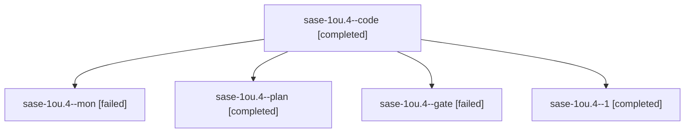

# Session: sase-1ou.4

[Agent Hoods](../README.md) / [bbugyi200](../users/bbugyi200/README.md) / [athena](../users/bbugyi200/machines/athena/README.md) / [sase-1ou](../users/bbugyi200/machines/athena/hoods/sase-1ou/README.md) / sase-1ou.4

Owner: `bbugyi200.athena` · Hood: `sase-1ou` · Members: 5 · Bead: [sase-1ou.4](https://github.com/sase-org/sase--beads/blob/main/pages/sase-1ou/sase-1ou.4.md)

## Lineage

The diagram is an optional enhancement; the ordered table below contains the same lineage in accessible text.

| Role | Agent | State | Model / provider | Timing | Commits | Prompt | Chat |
|---|---|---|---|---|---:|---|---|
| code | sase-1ou.4--code | completed | muse-spark-1.3-contributor / muse | 2026-10-27T14:41:57.135624+00:00 → 2026-10-27T15:40:28.875066+00:00 | 0 | — | [Chat](../agents/bbugyi200.athena.sase-1ou.4--code/chat.md) |
| mon | sase-1ou.4--mon | failed | muse-spark-1.3-contributor / muse | 2026-10-27T15:37:28.506644+00:00 → 2026-10-27T16:02:35.879627+00:00 | 0 | — | [Chat](../agents/bbugyi200.athena.sase-1ou.4--mon/chat.md) |
| plan | sase-1ou.4--plan | completed | gpt-6-astra / codex | 2026-10-27T14:30:04.807607+00:00 → 2026-10-27T15:40:28.875066+00:00 | 0 | [Prompt](../agents/bbugyi200.athena.sase-1ou.4--plan/prompt.md) | [Chat](../agents/bbugyi200.athena.sase-1ou.4--plan/chat.md) |
| gate | sase-1ou.4--gate | failed | gpt-6-astra / codex | 2026-10-27T14:40:38.922274+00:00 → 2026-10-27T14:41:17.853431+00:00 | 0 | — | [Chat](../agents/bbugyi200.athena.sase-1ou.4--gate/chat.md) |
| 1 | sase-1ou.4--1 | completed | muse-spark-1.3-contributor / muse | 2026-10-27T16:07:30.999909+00:00 → 2026-10-27T16:17:41.195921+00:00 | [1](../agents/bbugyi200.athena.sase-1ou.4--1/README.md#commits) | [Prompt](../agents/bbugyi200.athena.sase-1ou.4--1/prompt.md) | [Chat](../agents/bbugyi200.athena.sase-1ou.4--1/chat.md) |

## Commits

| Role | Repo | Commit | Subject | Committed |
|---|---|---|---|---|
| 1 | sase | [`691ef46`](https://github.com/sase-org/sase/commit/691ef461533d08759fa6d2fce30eee7bac48bddb) | fix(ace-tui): resolve Files ctrl+j page-anchor scroll race | 2026-10-27 12:12:53 EDT |

## Neighbors

| Agent | Relation | State |
|---|---|---|
| [sase-1ou.1](../agents/bbugyi200.athena.sase-1ou.1/README.md) | sase-1ou hood | completed |
| [sase-1ou.2](bbugyi200.athena.sase-1ou.2.md) (session · 3) | sase-1ou hood | failed 3 |
| [sase-1ou.2.1.1](../agents/bbugyi200.athena.sase-1ou.2.1.1/README.md) | sase-1ou hood | active |
| [sase-1ou.2.1.2](bbugyi200.athena.sase-1ou.2.1.2.md) (session · 7) | sase-1ou hood | active 7 |
| [sase-1ou.2.1.land](bbugyi200.athena.sase-1ou.2.1.land.md) (session · 3) | sase-1ou hood | active 3 |
| [sase-1ou.3](bbugyi200.athena.sase-1ou.3.md) (session · 7) | sase-1ou hood | completed 4, failed 3 |
| [sase-1ou.5](bbugyi200.athena.sase-1ou.5.md) (session · 3) | sase-1ou hood | failed 3 |
| [sase-1ou.5.1.1](../agents/bbugyi200.athena.sase-1ou.5.1.1/README.md) | sase-1ou hood | completed |
| [sase-1ou.5.1.2](../agents/bbugyi200.athena.sase-1ou.5.1.2/README.md) | sase-1ou hood | completed |
| [sase-1ou.5.1.3](bbugyi200.athena.sase-1ou.5.1.3.md) (session · 3) | sase-1ou hood | completed 2, failed 1 |
| [sase-1ou.5.1.4](bbugyi200.athena.sase-1ou.5.1.4.md) (session · 5) | sase-1ou hood | completed 3, failed 2 |
| [sase-1ou.5.1.land](../agents/bbugyi200.athena.sase-1ou.5.1.land/README.md) | sase-1ou hood | completed |
| [sase-1ou.6.1](../agents/bbugyi200.athena.sase-1ou.6.1/README.md) | sase-1ou hood | completed |
| [sase-1ou.6.land](bbugyi200.athena.sase-1ou.6.land.md) (session · 7) | sase-1ou hood | active 1, completed 3, failed 3 |
| [sase-1ou.land](bbugyi200.athena.sase-1ou.land.md) (session · 3) | sase-1ou hood | failed 3 |
