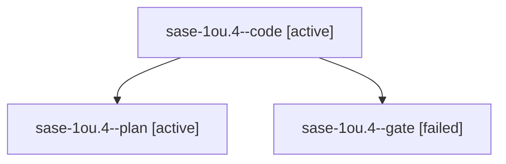

# Session: sase-1ou.4

[Agent Hoods](../README.md) / [bbugyi200](../users/bbugyi200/README.md) / [athena](../users/bbugyi200/machines/athena/README.md) / [sase-1ou](../users/bbugyi200/machines/athena/hoods/sase-1ou/README.md) / sase-1ou.4

Owner: `bbugyi200.athena` · Hood: `sase-1ou` · Members: 3 · Bead: [sase-1ou.4](https://github.com/sase-org/sase--beads/blob/main/pages/sase-1ou/sase-1ou.4.md)

## Lineage

The diagram is an optional enhancement; the ordered table below contains the same lineage in accessible text.

| Role | Agent | State | Model / provider | Timing | Commits | Prompt | Chat |
|---|---|---|---|---|---:|---|---|
| code | sase-1ou.4--code | active | muse-spark-1.3-contributor / muse | 2026-10-27T14:41:57.135624+00:00 | 0 | — | — |
| plan | sase-1ou.4--plan | active | gpt-6-astra / codex | 2026-10-27T14:30:04.807607+00:00 | 0 | [Prompt](../agents/bbugyi200.athena.sase-1ou.4--plan/prompt.md) | [Chat](../agents/bbugyi200.athena.sase-1ou.4--plan/chat.md) |
| gate | sase-1ou.4--gate | failed | gpt-6-astra / codex | 2026-10-27T14:40:38.922274+00:00 → 2026-10-27T14:41:17.853431+00:00 | 0 | — | [Chat](../agents/bbugyi200.athena.sase-1ou.4--gate/chat.md) |

## Neighbors

| Agent | Relation | State |
|---|---|---|
| [sase-1ou.1](../agents/bbugyi200.athena.sase-1ou.1/README.md) | sase-1ou hood | completed |
| [sase-1ou.2](bbugyi200.athena.sase-1ou.2.md) (session · 3) | sase-1ou hood | active 1, failed 2 |
| [sase-1ou.3](bbugyi200.athena.sase-1ou.3.md) (session · 1) | sase-1ou hood | active 1 |
| [sase-1ou.5](bbugyi200.athena.sase-1ou.5.md) (session · 3) | sase-1ou hood | failed 3 |
| [sase-1ou.5.1.1](../agents/bbugyi200.athena.sase-1ou.5.1.1/README.md) | sase-1ou hood | completed |
| [sase-1ou.5.1.2](../agents/bbugyi200.athena.sase-1ou.5.1.2/README.md) | sase-1ou hood | completed |
| [sase-1ou.5.1.3](bbugyi200.athena.sase-1ou.5.1.3.md) (session · 2) | sase-1ou hood | active 1, completed 1 |
| [sase-1ou.5.1.4](../agents/bbugyi200.athena.sase-1ou.5.1.4/README.md) | sase-1ou hood | waiting |
| [sase-1ou.5.1.land](../agents/bbugyi200.athena.sase-1ou.5.1.land/README.md) | sase-1ou hood | waiting |
| [sase-1ou.land](../agents/bbugyi200.athena.sase-1ou.land/README.md) | sase-1ou hood | waiting |
