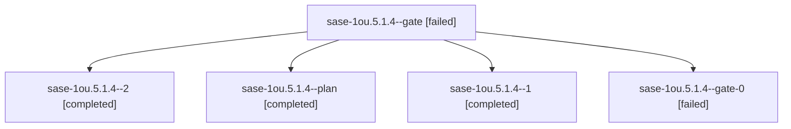

# Session: sase-1ou.5.1.4

[Agent Hoods](../README.md) / [bbugyi200](../users/bbugyi200/README.md) / [athena](../users/bbugyi200/machines/athena/README.md) / [sase-1ou](../users/bbugyi200/machines/athena/hoods/sase-1ou/README.md) / sase-1ou.5.1.4

Owner: `bbugyi200.athena` · Hood: `sase-1ou` · Members: 5 · Bead: [sase-1ou.5.1.4](https://github.com/sase-org/sase--beads/blob/main/pages/sase-1ou/sase-1ou.5.1.4.md)

## Lineage

The diagram is an optional enhancement; the ordered table below contains the same lineage in accessible text.

| Role | Agent | State | Model / provider | Timing | Commits | Prompt | Chat |
|---|---|---|---|---|---:|---|---|
| gate | sase-1ou.5.1.4--gate | failed | grok-4.6 / grok | 2026-10-27T16:05:09.932668+00:00 → 2026-10-28T16:37:11.316204+00:00 | 0 | — | [Chat](../agents/bbugyi200.athena.sase-1ou.5.1.4--gate/chat.md) |
| 2 | sase-1ou.5.1.4--2 | completed | grok-4.6 / grok | 2026-10-28T18:29:59.746901+00:00 → 2026-10-28T18:39:07.852237+00:00 | 0 | [Prompt](../agents/bbugyi200.athena.sase-1ou.5.1.4--2/prompt.md) | [Chat](../agents/bbugyi200.athena.sase-1ou.5.1.4--2/chat.md) |
| plan | sase-1ou.5.1.4--plan | completed | grok-4.6 / grok | 2026-10-27T15:48:40.076377+00:00 → 2026-10-27T16:06:18.287450+00:00 | 0 | [Prompt](../agents/bbugyi200.athena.sase-1ou.5.1.4--plan/prompt.md) | [Chat](../agents/bbugyi200.athena.sase-1ou.5.1.4--plan/chat.md) |
| 1 | sase-1ou.5.1.4--1 | completed | grok-4.6 / grok | 2026-10-28T16:39:20.030730+00:00 → 2026-10-28T16:48:53.481336+00:00 | 0 | [Prompt](../agents/bbugyi200.athena.sase-1ou.5.1.4--1/prompt.md) | [Chat](../agents/bbugyi200.athena.sase-1ou.5.1.4--1/chat.md) |
| gate-0 | sase-1ou.5.1.4--gate-0 | failed | grok-4.6 / grok | 2026-10-28T18:25:44.402891+00:00 → 2026-10-28T18:27:44.487149+00:00 | 0 | — | [Chat](../agents/bbugyi200.athena.sase-1ou.5.1.4--gate-0/chat.md) |

## Neighbors

| Agent | Relation | State |
|---|---|---|
| [sase-1ou.5](bbugyi200.athena.sase-1ou.5.md) (session · 3) | ancestor | failed 3 |
| [sase-1ou.5.1.1](../agents/bbugyi200.athena.sase-1ou.5.1.1/README.md) | sase-1ou.5.1 hood | completed |
| [sase-1ou.5.1.2](../agents/bbugyi200.athena.sase-1ou.5.1.2/README.md) | sase-1ou.5.1 hood | completed |
| [sase-1ou.5.1.3](bbugyi200.athena.sase-1ou.5.1.3.md) (session · 3) | sase-1ou.5.1 hood | completed 2, failed 1 |
| [sase-1ou.5.1.land](../agents/bbugyi200.athena.sase-1ou.5.1.land/README.md) | sase-1ou.5.1 hood | completed |
| [sase-1ou.1](../agents/bbugyi200.athena.sase-1ou.1/README.md) | sase-1ou hood | completed |
| [sase-1ou.2](bbugyi200.athena.sase-1ou.2.md) (session · 3) | sase-1ou hood | failed 3 |
| [sase-1ou.2.1.1](../agents/bbugyi200.athena.sase-1ou.2.1.1/README.md) | sase-1ou hood | active |
| [sase-1ou.2.1.2](bbugyi200.athena.sase-1ou.2.1.2.md) (session · 7) | sase-1ou hood | active 7 |
| [sase-1ou.2.1.land](bbugyi200.athena.sase-1ou.2.1.land.md) (session · 3) | sase-1ou hood | active 3 |
| [sase-1ou.3](bbugyi200.athena.sase-1ou.3.md) (session · 7) | sase-1ou hood | completed 4, failed 3 |
| [sase-1ou.4](bbugyi200.athena.sase-1ou.4.md) (session · 5) | sase-1ou hood | completed 3, failed 2 |
| [sase-1ou.6.1](../agents/bbugyi200.athena.sase-1ou.6.1/README.md) | sase-1ou hood | completed |
| [sase-1ou.6.land](bbugyi200.athena.sase-1ou.6.land.md) (session · 7) | sase-1ou hood | completed 4, failed 3 |
| [sase-1ou.land](bbugyi200.athena.sase-1ou.land.md) (session · 3) | sase-1ou hood | failed 3 |
