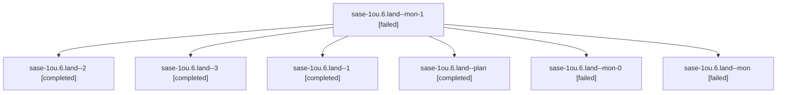

# Session: sase-1ou.6.land

[Agent Hoods](../README.md) / [bbugyi200](../users/bbugyi200/README.md) / [athena](../users/bbugyi200/machines/athena/README.md) / [sase-1ou](../users/bbugyi200/machines/athena/hoods/sase-1ou/README.md) / sase-1ou.6.land

Owner: `bbugyi200.athena` · Hood: `sase-1ou` · Members: 7 · Bead: [sase-1ou.6](https://github.com/sase-org/sase--beads/blob/main/pages/sase-1ou/sase-1ou.6.md)

## Lineage



The diagram is an optional enhancement; the ordered table below contains the same lineage in accessible text.

| Role | Agent | State | Model / provider | Timing | Commits | Prompt | Chat |
|---|---|---|---|---|---:|---|---|
| <a id="member-mon-1"></a>mon-1 | sase-1ou.6.land--mon-1 | failed | gpt-6-astra / codex | 2026-10-29T20:41:59.598280+00:00 → 2026-10-30T07:30:42.197295+00:00 | 0 | — | [Chat](../agents/bbugyi200.athena.sase-1ou.6.land--mon-1/chat.md) |
| <a id="member-2"></a>2 | sase-1ou.6.land--2 | completed | gpt-6-astra / codex | 2026-10-29T20:27:59.233718+00:00 → 2026-10-29T20:44:32.376592+00:00 | 0 | [Prompt](../agents/bbugyi200.athena.sase-1ou.6.land--2/prompt.md) | [Chat](../agents/bbugyi200.athena.sase-1ou.6.land--2/chat.md) |
| <a id="member-3"></a>3 | sase-1ou.6.land--3 | completed | gpt-6-astra / codex | 2026-10-30T07:33:08.612747+00:00 → 2026-10-30T11:48:44.572909+00:00 | 0 | [Prompt](../agents/bbugyi200.athena.sase-1ou.6.land--3/prompt.md) | [Chat](../agents/bbugyi200.athena.sase-1ou.6.land--3/chat.md) |
| <a id="member-1"></a>1 | sase-1ou.6.land--1 | completed | gpt-6-astra / codex | 2026-10-29T14:56:09.721563+00:00 → 2026-10-29T15:11:52.134044+00:00 | 0 | [Prompt](../agents/bbugyi200.athena.sase-1ou.6.land--1/prompt.md) | [Chat](../agents/bbugyi200.athena.sase-1ou.6.land--1/chat.md) |
| <a id="member-plan"></a>plan | sase-1ou.6.land--plan | completed | gpt-6-astra / codex | 2026-10-28T23:20:44.020707+00:00 → 2026-10-28T23:27:31.879181+00:00 | 0 | [Prompt](../agents/bbugyi200.athena.sase-1ou.6.land--plan/prompt.md) | [Chat](../agents/bbugyi200.athena.sase-1ou.6.land--plan/chat.md) |
| <a id="member-mon-0"></a>mon-0 | sase-1ou.6.land--mon-0 | failed | gpt-6-astra / codex | 2026-10-29T15:10:50.311592+00:00 → 2026-10-29T20:25:20.594103+00:00 | 0 | — | [Chat](../agents/bbugyi200.athena.sase-1ou.6.land--mon-0/chat.md) |
| <a id="member-mon"></a>mon | sase-1ou.6.land--mon | failed | gpt-6-astra / codex | 2026-10-28T23:26:56.327881+00:00 → 2026-10-29T14:52:56.159167+00:00 | 0 | — | [Chat](../agents/bbugyi200.athena.sase-1ou.6.land--mon/chat.md) |

## Variables

| Role | Variable | Value |
|---|---|---|
| 1 | `artifacts` | \[{bead: sase-1ou.6, kind: file, label: Files navigation CI recurrence and landing rejection (2026-10-29), path: /home/bryan/.sase/artifacts/agents/gh\_sase-org\_\_sase/20261029105155/ci-rejection-eviden… |
| 2 | `artifacts` | \[{bead: sase-1ou.6, kind: file, label: Pager view-release failure and same-source passing replay, path: /home/bryan/.sase/artifacts/agents/gh\_sase-org\_\_sase/20261029162420/pager\_followup\_evidence-8fb… |
| 3 | `artifacts` | \[{kind: file, label: Independent CI failures found during Files landing, path: /home/bryan/.sase/artifacts/agents/gh\_sase-org\_\_sase/20261030032941/independent-ci-failures-16aa51b24c73.txt, ref: file:… |

#### artifacts

**Role:** `1`

```yaml
- bead: sase-1ou.6
  kind: file
  label: Files navigation CI recurrence and landing rejection (2026-10-29)
  path: /home/bryan/.sase/artifacts/agents/gh_sase-org__sase/20261029105155/ci-rejection-evidence-5e7345b709e1.txt
  ref: file:explicit:c6f1c46fbe473d24b4235abb
  source_path: /home/bryan/.local/state/sase/workspaces/sase-org/sase/sase_16/.pytest_cache/sase-1ou6-land/ci-rejection-evidence.txt
```

#### artifacts

**Role:** `2`

```yaml
- bead: sase-1ou.6
  kind: file
  label: Pager view-release failure and same-source passing replay
  path: /home/bryan/.sase/artifacts/agents/gh_sase-org__sase/20261029162420/pager_followup_evidence-8fbe4d287e9b.json
  ref: file:explicit:fc9bf5b7e1fe28b8aee89a16
  source_path: /home/bryan/.local/state/sase/workspaces/sase-org/sase/sase_16/.pytest_cache/sase-1ou6-land/pager_followup_evidence.json
```

#### artifacts

**Role:** `3`

```yaml
- kind: file
  label: Independent CI failures found during Files landing
  path: /home/bryan/.sase/artifacts/agents/gh_sase-org__sase/20261030032941/independent-ci-failures-16aa51b24c73.txt
  ref: file:explicit:26a0e166c4b017177f87eabb
  source_path: /home/bryan/.local/state/sase/workspaces/sase-org/sase/sase_16/.pytest_cache/sase-1ou6-land/independent-ci-failures.txt
- bead: sase-1ou.6
  kind: file
  label: Files navigation two scheduled CI execution and outcome audit
  path: /home/bryan/.sase/artifacts/agents/gh_sase-org__sase/20261030032941/repair2-ci-proof-d3b46ec05135.json
  ref: file:explicit:5cb753815905737c4d199335
  source_path: /home/bryan/.local/state/sase/workspaces/sase-org/sase/sase_16/.pytest_cache/sase-1ou6-land/repair2-ci-proof.json
- bead: sase-1ou.6
  kind: file
  label: Files CI proof: seven test nodes across two schedules and six Python jobs
  path: /home/bryan/.sase/artifacts/agents/gh_sase-org__sase/20261030032941/repair2-ci-proof-be379db0fb39.json
  ref: file:explicit:111a68057073e254863c3f53
  source_path: /home/bryan/.local/state/sase/workspaces/sase-org/sase/sase_16/.pytest_cache/sase-1ou6-land/repair2-ci-proof.json
- kind: file
  label: Parent epic current baseline readiness gap
  path: /home/bryan/.sase/artifacts/agents/gh_sase-org__sase/20261030032941/parent-readiness-blocker-8f08bdbe5429.txt
  ref: file:explicit:97b5de2f1cb43b4acd045a68
  source_path: /home/bryan/.local/state/sase/workspaces/sase-org/sase/sase_16/.pytest_cache/sase-1ou6-land/parent-readiness-blocker.txt
- bead: sase-1ou
  kind: file
  label: Parent readiness audit after Files landing
  path: /home/bryan/.sase/artifacts/agents/gh_sase-org__sase/20261030032941/parent-readiness-audit-3bb84f701006.json
  ref: file:explicit:c6e07453bd869de455458b66
  source_path: /home/bryan/.local/state/sase/workspaces/sase-org/sase/sase_16/.pytest_cache/sase-1ou6-land/parent-readiness-audit.json
- bead: sase-1ou
  kind: file
  label: Backlog continuation triage and dormant flake evidence
  path: /home/bryan/.sase/artifacts/agents/gh_sase-org__sase/20261030032941/backlog-triage-84648756848c.json
  ref: file:explicit:890dff19d49df1c066f5a3eb
  source_path: /home/bryan/.local/state/sase/workspaces/sase-org/sase/sase_16/.pytest_cache/sase-1ou6-land/backlog-triage.json
- kind: file
  label: Archive help repeated CI drift evidence
  path: /home/bryan/.sase/artifacts/agents/gh_sase-org__sase/20261030032941/archive-help-drift-evidence-cfca8933be96.json
  ref: file:explicit:f6dcad4959daf9ca825677a8
  source_path: /home/bryan/.local/state/sase/workspaces/sase-org/sase/sase_16/.pytest_cache/sase-1ou6-land/archive-help-drift-evidence.json
- kind: file
  label: Backlog triage and final successor ownership
  path: /home/bryan/.sase/artifacts/agents/gh_sase-org__sase/20261030032941/backlog-triage-5e4050f4afbf.json
  ref: file:explicit:39ab0d09639578d8bb12c6be
  source_path: /home/bryan/.local/state/sase/workspaces/sase-org/sase/sase_16/.pytest_cache/sase-1ou6-land/backlog-triage.json
- kind: markdown
  label: Validated next-batch candidate plan; not proposed
  path: /home/bryan/.sase/artifacts/agents/gh_sase-org__sase/20261030032941/sase_plan_backlog_ci_stability-b0b36415f3d1.md
  ref: file:explicit:060938ad37af1e43b8abbd72
  source_path: /home/bryan/.local/state/sase/workspaces/sase-org/sase/sase_16/.pytest_cache/sase-1ou6-land/sase_plan_backlog_ci_stability.md
- kind: file
  label: Final parent landing verification and follow-up evidence
  path: /home/bryan/.sase/artifacts/agents/gh_sase-org__sase/20261030032941/parent-readiness-final-ae8b98767f30.json
  ref: file:explicit:bf04ac5b4d503b6fe8c54dbb
  source_path: /home/bryan/.local/state/sase/workspaces/sase-org/sase/sase_16/.pytest_cache/sase-1ou6-land/parent-readiness-final.json
```

Values are truncated for display; see each member's agent meta.json for the full values.

## Neighbors

| Agent | Relation | State |
|---|---|---|
| [sase-1ou.6.1](../agents/bbugyi200.athena.sase-1ou.6.1/README.md) | sase-1ou.6 hood | completed |
| [sase-1ou.1](../agents/bbugyi200.athena.sase-1ou.1/README.md) | sase-1ou hood | completed |
| [sase-1ou.2](bbugyi200.athena.sase-1ou.2.md) (session · 3) | sase-1ou hood | failed 3 |
| [sase-1ou.2.1.1](../agents/bbugyi200.athena.sase-1ou.2.1.1/README.md) | sase-1ou hood | active |
| [sase-1ou.2.1.2](bbugyi200.athena.sase-1ou.2.1.2.md) (session · 7) | sase-1ou hood | active 7 |
| [sase-1ou.2.1.land](bbugyi200.athena.sase-1ou.2.1.land.md) (session · 3) | sase-1ou hood | active 3 |
| [sase-1ou.3](bbugyi200.athena.sase-1ou.3.md) (session · 7) | sase-1ou hood | completed 4, failed 3 |
| [sase-1ou.4](bbugyi200.athena.sase-1ou.4.md) (session · 5) | sase-1ou hood | completed 3, failed 2 |
| [sase-1ou.5](bbugyi200.athena.sase-1ou.5.md) (session · 3) | sase-1ou hood | failed 3 |
| [sase-1ou.5.1.1](../agents/bbugyi200.athena.sase-1ou.5.1.1/README.md) | sase-1ou hood | completed |
| [sase-1ou.5.1.2](../agents/bbugyi200.athena.sase-1ou.5.1.2/README.md) | sase-1ou hood | completed |
| [sase-1ou.5.1.3](bbugyi200.athena.sase-1ou.5.1.3.md) (session · 3) | sase-1ou hood | completed 2, failed 1 |
| [sase-1ou.5.1.4](bbugyi200.athena.sase-1ou.5.1.4.md) (session · 5) | sase-1ou hood | completed 3, failed 2 |
| [sase-1ou.5.1.land](../agents/bbugyi200.athena.sase-1ou.5.1.land/README.md) | sase-1ou hood | completed |
| [sase-1ou.land](bbugyi200.athena.sase-1ou.land.md) (session · 3) | sase-1ou hood | failed 3 |
