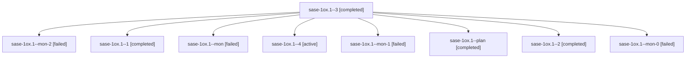

# Session: sase-1ox.1

[Agent Hoods](../README.md) / [bbugyi200](../users/bbugyi200/README.md) / [athena](../users/bbugyi200/machines/athena/README.md) / [sase-1ox](../users/bbugyi200/machines/athena/hoods/sase-1ox/README.md) / sase-1ox.1

Owner: `bbugyi200.athena` · Hood: `sase-1ox` · Members: 9 · Bead: [sase-1ox.1](https://github.com/sase-org/sase--beads/blob/main/pages/sase-1ox/sase-1ox.1.md)

## Lineage

The diagram is an optional enhancement; the ordered table below contains the same lineage in accessible text.

| Role | Agent | State | Model / provider | Timing | Commits | Prompt | Chat |
|---|---|---|---|---|---:|---|---|
| 3 | sase-1ox.1--3 | completed | grok-4.6 / grok | 2026-10-27T17:28:09.844193+00:00 → 2026-10-27T17:37:49.271439+00:00 | 0 | [Prompt](../agents/bbugyi200.athena.sase-1ox.1--3/prompt.md) | [Chat](../agents/bbugyi200.athena.sase-1ox.1--3/chat.md) |
| mon-2 | sase-1ox.1--mon-2 | failed | grok-4.6 / grok | 2026-10-27T17:37:04.257858+00:00 → 2026-10-27T17:58:18.543985+00:00 | 0 | — | [Chat](../agents/bbugyi200.athena.sase-1ox.1--mon-2/chat.md) |
| 1 | sase-1ox.1--1 | completed | grok-4.6 / grok | 2026-10-27T15:38:55.541385+00:00 → 2026-10-27T15:48:11.374623+00:00 | 0 | [Prompt](../agents/bbugyi200.athena.sase-1ox.1--1/prompt.md) | [Chat](../agents/bbugyi200.athena.sase-1ox.1--1/chat.md) |
| mon | sase-1ox.1--mon | failed | grok-4.6 / grok | 2026-10-27T15:16:32.581178+00:00 → 2026-10-27T15:23:44.578327+00:00 | 0 | — | [Chat](../agents/bbugyi200.athena.sase-1ox.1--mon/chat.md) |
| 4 | sase-1ox.1--4 | active | grok-4.6 / grok | 2026-10-27T17:59:46.486301+00:00 | [1](../agents/bbugyi200.athena.sase-1ox.1--4/README.md#commits) | [Prompt](../agents/bbugyi200.athena.sase-1ox.1--4/prompt.md) | — |
| mon-1 | sase-1ox.1--mon-1 | failed | grok-4.6 / grok | 2026-10-27T16:30:04.194727+00:00 → 2026-10-27T17:26:44.370023+00:00 | 0 | — | [Chat](../agents/bbugyi200.athena.sase-1ox.1--mon-1/chat.md) |
| plan | sase-1ox.1--plan | completed | grok-4.6 / grok | 2026-10-27T14:51:12.955682+00:00 → 2026-10-27T15:17:15.701309+00:00 | 0 | [Prompt](../agents/bbugyi200.athena.sase-1ox.1--plan/prompt.md) | [Chat](../agents/bbugyi200.athena.sase-1ox.1--plan/chat.md) |
| 2 | sase-1ox.1--2 | completed | grok-4.6 / grok | 2026-10-27T16:22:30.799077+00:00 → 2026-10-27T16:30:59.518484+00:00 | 0 | [Prompt](../agents/bbugyi200.athena.sase-1ox.1--2/prompt.md) | [Chat](../agents/bbugyi200.athena.sase-1ox.1--2/chat.md) |
| mon-0 | sase-1ox.1--mon-0 | failed | grok-4.6 / grok | 2026-10-27T15:47:01.735647+00:00 → 2026-10-27T16:23:11.782051+00:00 | 0 | — | [Chat](../agents/bbugyi200.athena.sase-1ox.1--mon-0/chat.md) |

## Commits

| Role | Repo | Commit | Subject | Committed |
|---|---|---|---|---|
| 4 | sase | [`d16b79f`](https://github.com/sase-org/sase/commit/d16b79f3c13c80d787e0f2975a1953e9c7479dab) | feat(capacity): add tiered view-model verdict, gauge, and durations | 2026-10-27 14:07:09 EDT |

## Neighbors

| Agent | Relation | State |
|---|---|---|
| [sase-1ox.2](../agents/bbugyi200.athena.sase-1ox.2/README.md) | sase-1ox hood | waiting |
| [sase-1ox.3](../agents/bbugyi200.athena.sase-1ox.3/README.md) | sase-1ox hood | waiting |
| [sase-1ox.land](../agents/bbugyi200.athena.sase-1ox.land/README.md) | sase-1ox hood | waiting |
