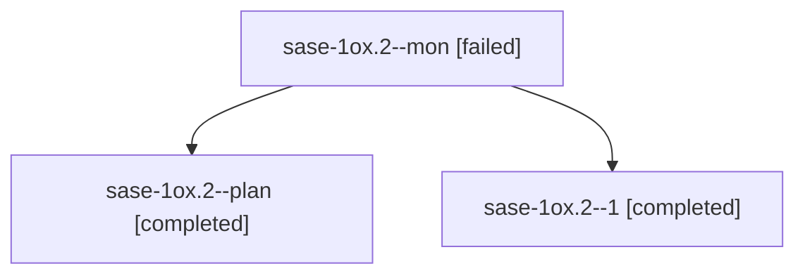

# Session: sase-1ox.2

[Agent Hoods](../README.md) / [bbugyi200](../users/bbugyi200/README.md) / [athena](../users/bbugyi200/machines/athena/README.md) / [sase-1ox](../users/bbugyi200/machines/athena/hoods/sase-1ox/README.md) / sase-1ox.2

Owner: `bbugyi200.athena` · Hood: `sase-1ox` · Members: 3 · Bead: [sase-1ox.2](https://github.com/sase-org/sase--beads/blob/main/pages/sase-1ox/sase-1ox.2.md)

## Lineage

The diagram is an optional enhancement; the ordered table below contains the same lineage in accessible text.

| Role | Agent | State | Model / provider | Timing | Commits | Prompt | Chat |
|---|---|---|---|---|---:|---|---|
| mon | sase-1ox.2--mon | failed | gpt-6-luna / codex | 2026-10-27T18:23:06.806363+00:00 → 2026-10-27T18:25:37.068072+00:00 | 0 | — | [Chat](../agents/bbugyi200.athena.sase-1ox.2--mon/chat.md) |
| plan | sase-1ox.2--plan | completed | gpt-6-luna / codex | 2026-10-27T18:11:37.116386+00:00 → 2026-10-27T18:23:53.637726+00:00 | 0 | [Prompt](../agents/bbugyi200.athena.sase-1ox.2--plan/prompt.md) | [Chat](../agents/bbugyi200.athena.sase-1ox.2--plan/chat.md) |
| 1 | sase-1ox.2--1 | completed | gpt-6-luna / codex | 2026-10-27T18:26:54.216891+00:00 → 2026-10-27T19:00:22.386698+00:00 | [1](../agents/bbugyi200.athena.sase-1ox.2--1/README.md#commits) | [Prompt](../agents/bbugyi200.athena.sase-1ox.2--1/prompt.md) | [Chat](../agents/bbugyi200.athena.sase-1ox.2--1/chat.md) |

## Commits

| Role | Repo | Commit | Subject | Committed |
|---|---|---|---|---|
| 1 | sase | [`c8bc7a5`](https://github.com/sase-org/sase/commit/c8bc7a58e20799a3a310ac397d2d79ce6739956f) | feat(tui): redesign capacity inspector | 2026-10-27 14:56:24 EDT |

## Neighbors

| Agent | Relation | State |
|---|---|---|
| [sase-1ox.1](bbugyi200.athena.sase-1ox.1.md) (session · 9) | sase-1ox hood | completed 5, failed 4 |
| [sase-1ox.3](../agents/bbugyi200.athena.sase-1ox.3/README.md) | sase-1ox hood | completed |
| [sase-1ox.land](bbugyi200.athena.sase-1ox.land.md) (session · 3) | sase-1ox hood | active 2, failed 1 |
