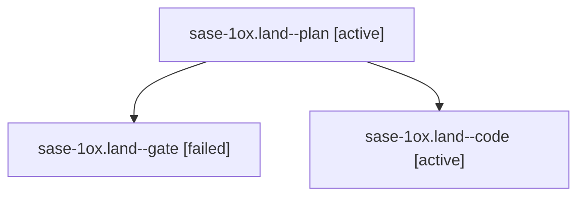

# Session: sase-1ox.land

[Agent Hoods](../README.md) / [bbugyi200](../users/bbugyi200/README.md) / [athena](../users/bbugyi200/machines/athena/README.md) / [sase-1ox](../users/bbugyi200/machines/athena/hoods/sase-1ox/README.md) / sase-1ox.land

Owner: `bbugyi200.athena` · Hood: `sase-1ox` · Members: 3 · Bead: [sase-1ox](https://github.com/sase-org/sase--beads/blob/main/pages/sase-1ox/README.md)

## Lineage

The diagram is an optional enhancement; the ordered table below contains the same lineage in accessible text.

| Role | Agent | State | Model / provider | Timing | Commits | Prompt | Chat |
|---|---|---|---|---|---:|---|---|
| plan | sase-1ox.land--plan | active | gpt-6-astra / codex | 2026-10-27T19:32:02.978622+00:00 | 0 | [Prompt](../agents/bbugyi200.athena.sase-1ox.land--plan/prompt.md) | [Chat](../agents/bbugyi200.athena.sase-1ox.land--plan/chat.md) |
| gate | sase-1ox.land--gate | failed | gpt-6-astra / codex | 2026-10-27T19:43:42.362419+00:00 → 2026-10-27T19:44:20.207934+00:00 | 0 | — | [Chat](../agents/bbugyi200.athena.sase-1ox.land--gate/chat.md) |
| code | sase-1ox.land--code | active | grok-4.6 / grok | 2026-10-27T19:45:04.825223+00:00 | [1](../agents/bbugyi200.athena.sase-1ox.land--code/README.md#commits) | — | — |

## Commits

| Role | Repo | Commit | Subject | Committed |
|---|---|---|---|---|
| code | sase | [`83b1822`](https://github.com/sase-org/sase/commit/83b1822411e5495f0c26b42defd46e2b07ad5629) | fix(ace): land remaining capacity inspector presentation defects | 2026-10-27 16:26:00 EDT |

## Neighbors

| Agent | Relation | State |
|---|---|---|
| [sase-1ox.1](bbugyi200.athena.sase-1ox.1.md) (session · 9) | sase-1ox hood | completed 5, failed 4 |
| [sase-1ox.2](bbugyi200.athena.sase-1ox.2.md) (session · 3) | sase-1ox hood | completed 2, failed 1 |
| [sase-1ox.3](../agents/bbugyi200.athena.sase-1ox.3/README.md) | sase-1ox hood | completed |
