# Session: sase-1p1.12

[Agent Hoods](../README.md) / [bbugyi200](../users/bbugyi200/README.md) / [athena](../users/bbugyi200/machines/athena/README.md) / [sase-1p1](../users/bbugyi200/machines/athena/hoods/sase-1p1/README.md) / sase-1p1.12

Owner: `bbugyi200.athena` · Hood: `sase-1p1` · Members: 20 · Bead: [sase-1p1.12](https://github.com/sase-org/sase--beads/blob/main/pages/sase-1p1/sase-1p1.12.md)

## Lineage

```mermaid
flowchart TD
  n0["sase-1p1.12--4 [completed]"]
  n1["sase-1p1.12--8 [completed]"]
  n0 --> n1
  n2["sase-1p1.12--mon-1 [failed]"]
  n0 --> n2
  n3["sase-1p1.12--mon-8 [active]"]
  n0 --> n3
  n4["sase-1p1.12--plan [completed]"]
  n0 --> n4
  n5["sase-1p1.12--mon-7 [failed]"]
  n0 --> n5
  n6["sase-1p1.12--9 [completed]"]
  n0 --> n6
  n7["sase-1p1.12--6 [completed]"]
  n0 --> n7
  n8["sase-1p1.12--mon-0 [failed]"]
  n0 --> n8
  n9["sase-1p1.12--7 [completed]"]
  n0 --> n9
  n10["sase-1p1.12--5 [completed]"]
  n0 --> n10
  n11["sase-1p1.12--mon [failed]"]
  n0 --> n11
  n12["sase-1p1.12--mon-6 [failed]"]
  n0 --> n12
  n13["sase-1p1.12--mon-3 [failed]"]
  n0 --> n13
  n14["sase-1p1.12--3 [completed]"]
  n0 --> n14
  n15["sase-1p1.12--mon-5 [failed]"]
  n0 --> n15
  n16["sase-1p1.12--2 [completed]"]
  n0 --> n16
  n17["sase-1p1.12--1 [completed]"]
  n0 --> n17
  n18["sase-1p1.12--mon-4 [failed]"]
  n0 --> n18
  n19["sase-1p1.12--mon-2 [failed]"]
  n0 --> n19
```

The diagram is an optional enhancement; the ordered table below contains the same lineage in accessible text.

| Role | Agent | State | Model / provider | Timing | Commits | Prompt | Chat |
|---|---|---|---|---|---:|---|---|
| 4 | sase-1p1.12--4 | completed | grok-4.6 / grok | 2026-10-28T08:34:26.917543+00:00 → 2026-10-28T08:57:36.126796+00:00 | 0 | [Prompt](../agents/bbugyi200.athena.sase-1p1.12--4/prompt.md) | [Chat](../agents/bbugyi200.athena.sase-1p1.12--4/chat.md) |
| 8 | sase-1p1.12--8 | completed | grok-4.6 / grok | 2026-10-28T11:07:32.413548+00:00 → 2026-10-28T11:21:56.348616+00:00 | 0 | [Prompt](../agents/bbugyi200.athena.sase-1p1.12--8/prompt.md) | [Chat](../agents/bbugyi200.athena.sase-1p1.12--8/chat.md) |
| mon-1 | sase-1p1.12--mon-1 | failed | grok-4.6 / grok | 2026-10-28T07:24:59.407114+00:00 → 2026-10-28T08:04:51.544469+00:00 | 0 | — | [Chat](../agents/bbugyi200.athena.sase-1p1.12--mon-1/chat.md) |
| mon-8 | sase-1p1.12--mon-8 | active | grok-4.6 / grok | 2026-10-28T11:58:21.412300+00:00 | 0 | — | — |
| plan | sase-1p1.12--plan | completed | grok-4.6 / grok | 2026-10-28T03:57:07.197362+00:00 → 2026-10-28T05:45:34.128901+00:00 | 0 | [Prompt](../agents/bbugyi200.athena.sase-1p1.12--plan/prompt.md) | [Chat](../agents/bbugyi200.athena.sase-1p1.12--plan/chat.md) |
| mon-7 | sase-1p1.12--mon-7 | failed | grok-4.6 / grok | 2026-10-28T11:20:52.567300+00:00 → 2026-10-28T11:39:55.455419+00:00 | 0 | — | [Chat](../agents/bbugyi200.athena.sase-1p1.12--mon-7/chat.md) |
| 9 | sase-1p1.12--9 | completed | grok-4.6 / grok | 2026-10-28T11:42:43.950450+00:00 → 2026-10-28T11:59:39.335517+00:00 | 0 | [Prompt](../agents/bbugyi200.athena.sase-1p1.12--9/prompt.md) | [Chat](../agents/bbugyi200.athena.sase-1p1.12--9/chat.md) |
| 6 | sase-1p1.12--6 | completed | grok-4.6 / grok | 2026-10-28T10:08:07.139133+00:00 → 2026-10-28T10:19:40.170992+00:00 | 0 | [Prompt](../agents/bbugyi200.athena.sase-1p1.12--6/prompt.md) | [Chat](../agents/bbugyi200.athena.sase-1p1.12--6/chat.md) |
| mon-0 | sase-1p1.12--mon-0 | failed | grok-4.6 / grok | 2026-10-28T06:38:47.515255+00:00 → 2026-10-28T06:52:20.548904+00:00 | 0 | — | [Chat](../agents/bbugyi200.athena.sase-1p1.12--mon-0/chat.md) |
| 7 | sase-1p1.12--7 | completed | grok-4.6 / grok | 2026-10-28T10:38:25.981206+00:00 → 2026-10-28T10:47:38.509832+00:00 | 0 | [Prompt](../agents/bbugyi200.athena.sase-1p1.12--7/prompt.md) | [Chat](../agents/bbugyi200.athena.sase-1p1.12--7/chat.md) |
| 5 | sase-1p1.12--5 | completed | grok-4.6 / grok | 2026-10-28T09:11:08.992836+00:00 → 2026-10-28T09:46:31.373345+00:00 | 0 | [Prompt](../agents/bbugyi200.athena.sase-1p1.12--5/prompt.md) | [Chat](../agents/bbugyi200.athena.sase-1p1.12--5/chat.md) |
| mon | sase-1p1.12--mon | failed | grok-4.6 / grok | 2026-10-28T05:44:53.709321+00:00 → 2026-10-28T06:25:12.196319+00:00 | 0 | — | [Chat](../agents/bbugyi200.athena.sase-1p1.12--mon/chat.md) |
| mon-6 | sase-1p1.12--mon-6 | failed | grok-4.6 / grok | 2026-10-28T10:46:58.227633+00:00 → 2026-10-28T11:05:28.727401+00:00 | 0 | — | [Chat](../agents/bbugyi200.athena.sase-1p1.12--mon-6/chat.md) |
| mon-3 | sase-1p1.12--mon-3 | failed | grok-4.6 / grok | 2026-10-28T08:56:33.472270+00:00 → 2026-10-28T09:09:45.589057+00:00 | 0 | — | [Chat](../agents/bbugyi200.athena.sase-1p1.12--mon-3/chat.md) |
| 3 | sase-1p1.12--3 | completed | grok-4.6 / grok | 2026-10-28T08:06:27.103345+00:00 → 2026-10-28T08:18:34.178759+00:00 | 0 | [Prompt](../agents/bbugyi200.athena.sase-1p1.12--3/prompt.md) | [Chat](../agents/bbugyi200.athena.sase-1p1.12--3/chat.md) |
| mon-5 | sase-1p1.12--mon-5 | failed | grok-4.6 / grok | 2026-10-28T10:18:45.725444+00:00 → 2026-10-28T10:37:10.653780+00:00 | 0 | — | [Chat](../agents/bbugyi200.athena.sase-1p1.12--mon-5/chat.md) |
| 2 | sase-1p1.12--2 | completed | grok-4.6 / grok | 2026-10-28T06:53:43.982950+00:00 → 2026-10-28T07:26:02.728067+00:00 | 0 | [Prompt](../agents/bbugyi200.athena.sase-1p1.12--2/prompt.md) | [Chat](../agents/bbugyi200.athena.sase-1p1.12--2/chat.md) |
| 1 | sase-1p1.12--1 | completed | grok-4.6 / grok | 2026-10-28T06:26:44.026775+00:00 → 2026-10-28T06:39:55.222122+00:00 | 0 | [Prompt](../agents/bbugyi200.athena.sase-1p1.12--1/prompt.md) | [Chat](../agents/bbugyi200.athena.sase-1p1.12--1/chat.md) |
| mon-4 | sase-1p1.12--mon-4 | failed | grok-4.6 / grok | 2026-10-28T09:45:36.351999+00:00 → 2026-10-28T10:06:48.481607+00:00 | 0 | — | [Chat](../agents/bbugyi200.athena.sase-1p1.12--mon-4/chat.md) |
| mon-2 | sase-1p1.12--mon-2 | failed | grok-4.6 / grok | 2026-10-28T08:17:55.578194+00:00 → 2026-10-28T08:32:56.034924+00:00 | 0 | — | [Chat](../agents/bbugyi200.athena.sase-1p1.12--mon-2/chat.md) |

## Neighbors

| Agent | Relation | State |
|---|---|---|
| [sase-1p1.1](bbugyi200.athena.sase-1p1.1.md) (session · 3) | sase-1p1 hood | completed 2, failed 1 |
| [sase-1p1.10](../agents/bbugyi200.athena.sase-1p1.10/README.md) | sase-1p1 hood | completed |
| [sase-1p1.11](../agents/bbugyi200.athena.sase-1p1.11/README.md) | sase-1p1 hood | completed |
| [sase-1p1.13](../agents/bbugyi200.athena.sase-1p1.13/README.md) | sase-1p1 hood | waiting |
| [sase-1p1.2](../agents/bbugyi200.athena.sase-1p1.2/README.md) | sase-1p1 hood | completed |
| [sase-1p1.3](bbugyi200.athena.sase-1p1.3.md) (session · 5) | sase-1p1 hood | completed 3, failed 2 |
| [sase-1p1.4](bbugyi200.athena.sase-1p1.4.md) (session · 5) | sase-1p1 hood | completed 3, failed 2 |
| [sase-1p1.5](../agents/bbugyi200.athena.sase-1p1.5/README.md) | sase-1p1 hood | completed |
| [sase-1p1.6](../agents/bbugyi200.athena.sase-1p1.6/README.md) | sase-1p1 hood | completed |
| [sase-1p1.7](../agents/bbugyi200.athena.sase-1p1.7/README.md) | sase-1p1 hood | completed |
| [sase-1p1.8](../agents/bbugyi200.athena.sase-1p1.8/README.md) | sase-1p1 hood | completed |
| [sase-1p1.9](../agents/bbugyi200.athena.sase-1p1.9/README.md) | sase-1p1 hood | completed |
| [sase-1p1.land](../agents/bbugyi200.athena.sase-1p1.land/README.md) | sase-1p1 hood | waiting |
