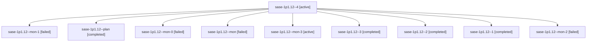

# Session: sase-1p1.12

[Agent Hoods](../README.md) / [bbugyi200](../users/bbugyi200/README.md) / [athena](../users/bbugyi200/machines/athena/README.md) / [sase-1p1](../users/bbugyi200/machines/athena/hoods/sase-1p1/README.md) / sase-1p1.12

Owner: `bbugyi200.athena` · Hood: `sase-1p1` · Members: 10 · Bead: [sase-1p1.12](https://github.com/sase-org/sase--beads/blob/main/pages/sase-1p1/sase-1p1.12.md)

## Lineage

The diagram is an optional enhancement; the ordered table below contains the same lineage in accessible text.

| Role | Agent | State | Model / provider | Timing | Commits | Prompt | Chat |
|---|---|---|---|---|---:|---|---|
| 4 | sase-1p1.12--4 | active | grok-4.6 / grok | 2026-10-28T08:34:26.917543+00:00 | 0 | [Prompt](../agents/bbugyi200.athena.sase-1p1.12--4/prompt.md) | [Chat](../agents/bbugyi200.athena.sase-1p1.12--4/chat.md) |
| mon-1 | sase-1p1.12--mon-1 | failed | grok-4.6 / grok | 2026-10-28T07:24:59.407114+00:00 → 2026-10-28T08:04:51.544469+00:00 | 0 | — | [Chat](../agents/bbugyi200.athena.sase-1p1.12--mon-1/chat.md) |
| plan | sase-1p1.12--plan | completed | grok-4.6 / grok | 2026-10-28T03:57:07.197362+00:00 → 2026-10-28T05:45:34.128901+00:00 | 0 | [Prompt](../agents/bbugyi200.athena.sase-1p1.12--plan/prompt.md) | [Chat](../agents/bbugyi200.athena.sase-1p1.12--plan/chat.md) |
| mon-0 | sase-1p1.12--mon-0 | failed | grok-4.6 / grok | 2026-10-28T06:38:47.515255+00:00 → 2026-10-28T06:52:20.548904+00:00 | 0 | — | [Chat](../agents/bbugyi200.athena.sase-1p1.12--mon-0/chat.md) |
| mon | sase-1p1.12--mon | failed | grok-4.6 / grok | 2026-10-28T05:44:53.709321+00:00 → 2026-10-28T06:25:12.196319+00:00 | 0 | — | [Chat](../agents/bbugyi200.athena.sase-1p1.12--mon/chat.md) |
| mon-3 | sase-1p1.12--mon-3 | active | grok-4.6 / grok | 2026-10-28T08:56:33.472270+00:00 | 0 | — | — |
| 3 | sase-1p1.12--3 | completed | grok-4.6 / grok | 2026-10-28T08:06:27.103345+00:00 → 2026-10-28T08:18:34.178759+00:00 | 0 | [Prompt](../agents/bbugyi200.athena.sase-1p1.12--3/prompt.md) | [Chat](../agents/bbugyi200.athena.sase-1p1.12--3/chat.md) |
| 2 | sase-1p1.12--2 | completed | grok-4.6 / grok | 2026-10-28T06:53:43.982950+00:00 → 2026-10-28T07:26:02.728067+00:00 | 0 | [Prompt](../agents/bbugyi200.athena.sase-1p1.12--2/prompt.md) | [Chat](../agents/bbugyi200.athena.sase-1p1.12--2/chat.md) |
| 1 | sase-1p1.12--1 | completed | grok-4.6 / grok | 2026-10-28T06:26:44.026775+00:00 → 2026-10-28T06:39:55.222122+00:00 | 0 | [Prompt](../agents/bbugyi200.athena.sase-1p1.12--1/prompt.md) | [Chat](../agents/bbugyi200.athena.sase-1p1.12--1/chat.md) |
| mon-2 | sase-1p1.12--mon-2 | failed | grok-4.6 / grok | 2026-10-28T08:17:55.578194+00:00 → 2026-10-28T08:32:56.034924+00:00 | 0 | — | [Chat](../agents/bbugyi200.athena.sase-1p1.12--mon-2/chat.md) |

## Neighbors

| Agent | Relation | State |
|---|---|---|
| [sase-1p1.1](bbugyi200.athena.sase-1p1.1.md) (session · 3) | sase-1p1 hood | completed 2, failed 1 |
| [sase-1p1.10](../agents/bbugyi200.athena.sase-1p1.10/README.md) | sase-1p1 hood | completed |
| [sase-1p1.11](../agents/bbugyi200.athena.sase-1p1.11/README.md) | sase-1p1 hood | completed |
| [sase-1p1.13](../agents/bbugyi200.athena.sase-1p1.13/README.md) | sase-1p1 hood | waiting |
| [sase-1p1.2](../agents/bbugyi200.athena.sase-1p1.2/README.md) | sase-1p1 hood | completed |
| [sase-1p1.3](bbugyi200.athena.sase-1p1.3.md) (session · 5) | sase-1p1 hood | completed 3, failed 2 |
| [sase-1p1.4](bbugyi200.athena.sase-1p1.4.md) (session · 5) | sase-1p1 hood | completed 3, failed 2 |
| [sase-1p1.5](../agents/bbugyi200.athena.sase-1p1.5/README.md) | sase-1p1 hood | completed |
| [sase-1p1.6](../agents/bbugyi200.athena.sase-1p1.6/README.md) | sase-1p1 hood | completed |
| [sase-1p1.7](../agents/bbugyi200.athena.sase-1p1.7/README.md) | sase-1p1 hood | active |
| [sase-1p1.8](../agents/bbugyi200.athena.sase-1p1.8/README.md) | sase-1p1 hood | completed |
| [sase-1p1.9](../agents/bbugyi200.athena.sase-1p1.9/README.md) | sase-1p1 hood | completed |
| [sase-1p1.land](../agents/bbugyi200.athena.sase-1p1.land/README.md) | sase-1p1 hood | waiting |
