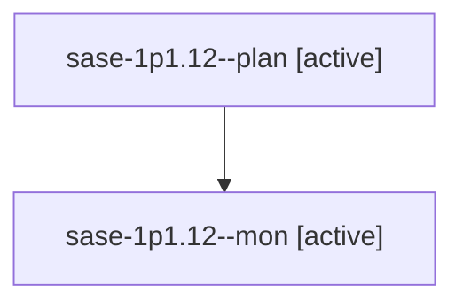

# Session: sase-1p1.12

[Agent Hoods](../README.md) / [bbugyi200](../users/bbugyi200/README.md) / [athena](../users/bbugyi200/machines/athena/README.md) / [sase-1p1](../users/bbugyi200/machines/athena/hoods/sase-1p1/README.md) / sase-1p1.12

Owner: `bbugyi200.athena` · Hood: `sase-1p1` · Members: 2 · Bead: [sase-1p1.12](https://github.com/sase-org/sase--beads/blob/main/pages/sase-1p1/sase-1p1.12.md)

## Lineage

The diagram is an optional enhancement; the ordered table below contains the same lineage in accessible text.

| Role | Agent | State | Model / provider | Timing | Commits | Prompt | Chat |
|---|---|---|---|---|---:|---|---|
| plan | sase-1p1.12--plan | active | grok-4.6 / grok | 2026-10-28T03:57:07.197362+00:00 | 0 | [Prompt](../agents/bbugyi200.athena.sase-1p1.12--plan/prompt.md) | [Chat](../agents/bbugyi200.athena.sase-1p1.12--plan/chat.md) |
| mon | sase-1p1.12--mon | active | grok-4.6 / grok | 2026-10-28T05:44:53.709321+00:00 | 0 | — | — |

## Neighbors

| Agent | Relation | State |
|---|---|---|
| [sase-1p1.1](bbugyi200.athena.sase-1p1.1.md) (session · 3) | sase-1p1 hood | completed 2, failed 1 |
| [sase-1p1.10](../agents/bbugyi200.athena.sase-1p1.10/README.md) | sase-1p1 hood | waiting |
| [sase-1p1.11](../agents/bbugyi200.athena.sase-1p1.11/README.md) | sase-1p1 hood | waiting |
| [sase-1p1.13](../agents/bbugyi200.athena.sase-1p1.13/README.md) | sase-1p1 hood | waiting |
| [sase-1p1.2](../agents/bbugyi200.athena.sase-1p1.2/README.md) | sase-1p1 hood | completed |
| [sase-1p1.3](bbugyi200.athena.sase-1p1.3.md) (session · 5) | sase-1p1 hood | completed 3, failed 2 |
| [sase-1p1.4](bbugyi200.athena.sase-1p1.4.md) (session · 5) | sase-1p1 hood | completed 3, failed 2 |
| [sase-1p1.5](../agents/bbugyi200.athena.sase-1p1.5/README.md) | sase-1p1 hood | completed |
| [sase-1p1.6](../agents/bbugyi200.athena.sase-1p1.6/README.md) | sase-1p1 hood | completed |
| [sase-1p1.7](../agents/bbugyi200.athena.sase-1p1.7/README.md) | sase-1p1 hood | active |
| [sase-1p1.8](../agents/bbugyi200.athena.sase-1p1.8/README.md) | sase-1p1 hood | completed |
| [sase-1p1.9](../agents/bbugyi200.athena.sase-1p1.9/README.md) | sase-1p1 hood | active |
| [sase-1p1.land](../agents/bbugyi200.athena.sase-1p1.land/README.md) | sase-1p1 hood | waiting |
