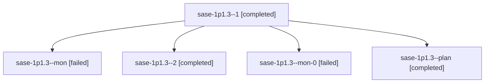

# Session: sase-1p1.3

[Agent Hoods](../README.md) / [bbugyi200](../users/bbugyi200/README.md) / [athena](../users/bbugyi200/machines/athena/README.md) / [sase-1p1](../users/bbugyi200/machines/athena/hoods/sase-1p1/README.md) / sase-1p1.3

Owner: `bbugyi200.athena` · Hood: `sase-1p1` · Members: 5 · Bead: [sase-1p1.3](https://github.com/sase-org/sase--beads/blob/main/pages/sase-1p1/sase-1p1.3.md)

## Lineage

The diagram is an optional enhancement; the ordered table below contains the same lineage in accessible text.

| Role | Agent | State | Model / provider | Timing | Commits | Prompt | Chat |
|---|---|---|---|---|---:|---|---|
| 1 | sase-1p1.3--1 | completed | gpt-6-luna / codex | 2026-10-27T22:03:11.168108+00:00 → 2026-10-27T22:12:45.830244+00:00 | 0 | [Prompt](../agents/bbugyi200.athena.sase-1p1.3--1/prompt.md) | [Chat](../agents/bbugyi200.athena.sase-1p1.3--1/chat.md) |
| mon | sase-1p1.3--mon | failed | gpt-6-luna / codex | 2026-10-27T21:30:30.486946+00:00 → 2026-10-27T22:04:20.159155+00:00 | 0 | — | [Chat](../agents/bbugyi200.athena.sase-1p1.3--mon/chat.md) |
| 2 | sase-1p1.3--2 | completed | gpt-6-luna / codex | 2026-10-27T22:58:48.022608+00:00 → 2026-10-28T00:24:50.956973+00:00 | [1](../agents/bbugyi200.athena.sase-1p1.3--2/README.md#commits) | [Prompt](../agents/bbugyi200.athena.sase-1p1.3--2/prompt.md) | [Chat](../agents/bbugyi200.athena.sase-1p1.3--2/chat.md) |
| mon-0 | sase-1p1.3--mon-0 | failed | gpt-6-luna / codex | 2026-10-27T22:10:09.006554+00:00 → 2026-10-27T22:57:19.008017+00:00 | 0 | — | [Chat](../agents/bbugyi200.athena.sase-1p1.3--mon-0/chat.md) |
| plan | sase-1p1.3--plan | completed | gpt-6-luna / codex | 2026-10-27T20:59:26.019808+00:00 → 2026-10-27T21:31:23.468715+00:00 | 0 | [Prompt](../agents/bbugyi200.athena.sase-1p1.3--plan/prompt.md) | [Chat](../agents/bbugyi200.athena.sase-1p1.3--plan/chat.md) |

## Commits

| Role | Repo | Commit | Subject | Committed |
|---|---|---|---|---|
| 2 | sase | [`f8a8b5a`](https://github.com/sase-org/sase/commit/f8a8b5a4f616081f2150488344c67e5f113aaa77) | refactor(tui): split panel spread widget | 2026-10-27 19:46:04 EDT |

## Neighbors

| Agent | Relation | State |
|---|---|---|
| [sase-1p1.1](bbugyi200.athena.sase-1p1.1.md) (session · 3) | sase-1p1 hood | completed 2, failed 1 |
| [sase-1p1.10](../agents/bbugyi200.athena.sase-1p1.10/README.md) | sase-1p1 hood | waiting |
| [sase-1p1.11](../agents/bbugyi200.athena.sase-1p1.11/README.md) | sase-1p1 hood | waiting |
| [sase-1p1.12](../agents/bbugyi200.athena.sase-1p1.12/README.md) | sase-1p1 hood | waiting |
| [sase-1p1.13](../agents/bbugyi200.athena.sase-1p1.13/README.md) | sase-1p1 hood | waiting |
| [sase-1p1.2](../agents/bbugyi200.athena.sase-1p1.2/README.md) | sase-1p1 hood | completed |
| [sase-1p1.4](bbugyi200.athena.sase-1p1.4.md) (session · 5) | sase-1p1 hood | completed 3, failed 2 |
| [sase-1p1.5](../agents/bbugyi200.athena.sase-1p1.5/README.md) | sase-1p1 hood | completed |
| [sase-1p1.6](../agents/bbugyi200.athena.sase-1p1.6/README.md) | sase-1p1 hood | completed |
| [sase-1p1.7](../agents/bbugyi200.athena.sase-1p1.7/README.md) | sase-1p1 hood | active |
| [sase-1p1.8](../agents/bbugyi200.athena.sase-1p1.8/README.md) | sase-1p1 hood | active |
| [sase-1p1.9](../agents/bbugyi200.athena.sase-1p1.9/README.md) | sase-1p1 hood | waiting |
| [sase-1p1.land](../agents/bbugyi200.athena.sase-1p1.land/README.md) | sase-1p1 hood | waiting |
