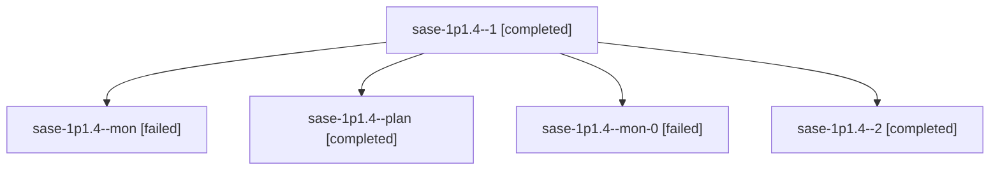

# Session: sase-1p1.4

[Agent Hoods](../README.md) / [bbugyi200](../users/bbugyi200/README.md) / [athena](../users/bbugyi200/machines/athena/README.md) / [sase-1p1](../users/bbugyi200/machines/athena/hoods/sase-1p1/README.md) / sase-1p1.4

Owner: `bbugyi200.athena` · Hood: `sase-1p1` · Members: 5 · Bead: [sase-1p1.4](https://github.com/sase-org/sase--beads/blob/main/pages/sase-1p1/sase-1p1.4.md)

## Lineage

The diagram is an optional enhancement; the ordered table below contains the same lineage in accessible text.

| Role | Agent | State | Model / provider | Timing | Commits | Prompt | Chat |
|---|---|---|---|---|---:|---|---|
| 1 | sase-1p1.4--1 | completed | muse-spark-1.3-contributor / muse | 2026-10-28T01:28:50.791876+00:00 → 2026-10-28T01:36:36.015056+00:00 | 0 | [Prompt](../agents/bbugyi200.athena.sase-1p1.4--1/prompt.md) | [Chat](../agents/bbugyi200.athena.sase-1p1.4--1/chat.md) |
| mon | sase-1p1.4--mon | failed | muse-spark-1.3-contributor / muse | 2026-10-28T01:08:31.667756+00:00 → 2026-10-28T01:26:58.642053+00:00 | 0 | — | [Chat](../agents/bbugyi200.athena.sase-1p1.4--mon/chat.md) |
| plan | sase-1p1.4--plan | completed | muse-spark-1.3-contributor / muse | 2026-10-28T00:25:47.223773+00:00 → 2026-10-28T01:09:12.002366+00:00 | 0 | [Prompt](../agents/bbugyi200.athena.sase-1p1.4--plan/prompt.md) | [Chat](../agents/bbugyi200.athena.sase-1p1.4--plan/chat.md) |
| mon-0 | sase-1p1.4--mon-0 | failed | muse-spark-1.3-contributor / muse | 2026-10-28T01:34:50.808779+00:00 → 2026-10-28T01:41:57.231992+00:00 | 0 | — | [Chat](../agents/bbugyi200.athena.sase-1p1.4--mon-0/chat.md) |
| 2 | sase-1p1.4--2 | completed | muse-spark-1.3-contributor / muse | 2026-10-28T01:43:44.134843+00:00 → 2026-10-28T01:54:24.334100+00:00 | [1](../agents/bbugyi200.athena.sase-1p1.4--2/README.md#commits) | [Prompt](../agents/bbugyi200.athena.sase-1p1.4--2/prompt.md) | [Chat](../agents/bbugyi200.athena.sase-1p1.4--2/chat.md) |

## Commits

| Role | Repo | Commit | Subject | Committed |
|---|---|---|---|---|
| 2 | sase | [`ad90e3d`](https://github.com/sase-org/sase/commit/ad90e3dff14d059a157b7cbdeaddf1daa9db38a4) | feat(footprint): add TUI action counters, dispatch seams, and flush thread | 2026-10-27 21:50:22 EDT |

## Neighbors

| Agent | Relation | State |
|---|---|---|
| [sase-1p1.1](bbugyi200.athena.sase-1p1.1.md) (session · 3) | sase-1p1 hood | completed 2, failed 1 |
| [sase-1p1.10](../agents/bbugyi200.athena.sase-1p1.10/README.md) | sase-1p1 hood | completed |
| [sase-1p1.11](../agents/bbugyi200.athena.sase-1p1.11/README.md) | sase-1p1 hood | completed |
| [sase-1p1.12](bbugyi200.athena.sase-1p1.12.md) (session · 27) | sase-1p1 hood | completed 14, failed 13 |
| [sase-1p1.13](../agents/bbugyi200.athena.sase-1p1.13/README.md) | sase-1p1 hood | completed |
| [sase-1p1.2](../agents/bbugyi200.athena.sase-1p1.2/README.md) | sase-1p1 hood | completed |
| [sase-1p1.3](bbugyi200.athena.sase-1p1.3.md) (session · 5) | sase-1p1 hood | completed 3, failed 2 |
| [sase-1p1.5](../agents/bbugyi200.athena.sase-1p1.5/README.md) | sase-1p1 hood | completed |
| [sase-1p1.6](../agents/bbugyi200.athena.sase-1p1.6/README.md) | sase-1p1 hood | completed |
| [sase-1p1.7](../agents/bbugyi200.athena.sase-1p1.7/README.md) | sase-1p1 hood | completed |
| [sase-1p1.8](../agents/bbugyi200.athena.sase-1p1.8/README.md) | sase-1p1 hood | completed |
| [sase-1p1.9](../agents/bbugyi200.athena.sase-1p1.9/README.md) | sase-1p1 hood | completed |
| [sase-1p1.land](bbugyi200.athena.sase-1p1.land.md) (session · 6) | sase-1p1 hood | active 1, completed 3, failed 2 |
