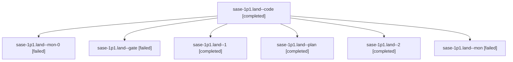

# Session: sase-1p1.land

[Agent Hoods](../README.md) / [bbugyi200](../users/bbugyi200/README.md) / [athena](../users/bbugyi200/machines/athena/README.md) / [sase-1p1](../users/bbugyi200/machines/athena/hoods/sase-1p1/README.md) / sase-1p1.land

Owner: `bbugyi200.athena` · Hood: `sase-1p1` · Members: 7 · Bead: [sase-1p1](https://github.com/sase-org/sase--beads/blob/main/pages/sase-1p1/README.md)

## Lineage

The diagram is an optional enhancement; the ordered table below contains the same lineage in accessible text.

| Role | Agent | State | Model / provider | Timing | Commits | Prompt | Chat |
|---|---|---|---|---|---:|---|---|
| code | sase-1p1.land--code | completed | muse-spark-1.3-contributor / muse | 2026-10-28T16:16:41.877857+00:00 → 2026-10-28T17:02:54.646366+00:00 | 0 | — | [Chat](../agents/bbugyi200.athena.sase-1p1.land--code/chat.md) |
| mon-0 | sase-1p1.land--mon-0 | failed | muse-spark-1.3-contributor / muse | 2026-10-28T17:45:55.510054+00:00 → 2026-10-28T18:04:42.748322+00:00 | 0 | — | [Chat](../agents/bbugyi200.athena.sase-1p1.land--mon-0/chat.md) |
| gate | sase-1p1.land--gate | failed | opus / claude | 2026-10-28T16:14:36.931867+00:00 → 2026-10-28T16:15:55.854759+00:00 | 0 | — | [Chat](../agents/bbugyi200.athena.sase-1p1.land--gate/chat.md) |
| 1 | sase-1p1.land--1 | completed | muse-spark-1.3-contributor / muse | 2026-10-28T17:29:10.907356+00:00 → 2026-10-28T17:48:00.163216+00:00 | 0 | [Prompt](../agents/bbugyi200.athena.sase-1p1.land--1/prompt.md) | [Chat](../agents/bbugyi200.athena.sase-1p1.land--1/chat.md) |
| plan | sase-1p1.land--plan | completed | opus / claude | 2026-10-28T15:38:34.153771+00:00 → 2026-10-28T17:02:54.646366+00:00 | 0 | [Prompt](../agents/bbugyi200.athena.sase-1p1.land--plan/prompt.md) | [Chat](../agents/bbugyi200.athena.sase-1p1.land--plan/chat.md) |
| 2 | sase-1p1.land--2 | completed | muse-spark-1.3-contributor / muse | 2026-10-28T18:06:53.886147+00:00 → 2026-10-28T18:19:22.420821+00:00 | [1](../agents/bbugyi200.athena.sase-1p1.land--2/README.md#commits) | [Prompt](../agents/bbugyi200.athena.sase-1p1.land--2/prompt.md) | [Chat](../agents/bbugyi200.athena.sase-1p1.land--2/chat.md) |
| mon | sase-1p1.land--mon | failed | muse-spark-1.3-contributor / muse | 2026-10-28T17:00:33.658739+00:00 → 2026-10-28T17:27:09.324456+00:00 | 0 | — | [Chat](../agents/bbugyi200.athena.sase-1p1.land--mon/chat.md) |

## Commits

| Role | Repo | Commit | Subject | Committed |
|---|---|---|---|---|
| 2 | sase | [`d8b91b9`](https://github.com/sase-org/sase/commit/d8b91b934fc3d7a3a5722b65fda50213fa866db8) | feat(footprint): land sase-side export/import for epic sase-1p1 | 2026-10-28 14:12:06 EDT |

## Neighbors

| Agent | Relation | State |
|---|---|---|
| [sase-1p1.1](bbugyi200.athena.sase-1p1.1.md) (session · 3) | sase-1p1 hood | completed 2, failed 1 |
| [sase-1p1.10](../agents/bbugyi200.athena.sase-1p1.10/README.md) | sase-1p1 hood | completed |
| [sase-1p1.11](../agents/bbugyi200.athena.sase-1p1.11/README.md) | sase-1p1 hood | completed |
| [sase-1p1.12](bbugyi200.athena.sase-1p1.12.md) (session · 27) | sase-1p1 hood | completed 14, failed 13 |
| [sase-1p1.13](../agents/bbugyi200.athena.sase-1p1.13/README.md) | sase-1p1 hood | completed |
| [sase-1p1.2](../agents/bbugyi200.athena.sase-1p1.2/README.md) | sase-1p1 hood | completed |
| [sase-1p1.3](bbugyi200.athena.sase-1p1.3.md) (session · 5) | sase-1p1 hood | completed 3, failed 2 |
| [sase-1p1.4](bbugyi200.athena.sase-1p1.4.md) (session · 5) | sase-1p1 hood | completed 3, failed 2 |
| [sase-1p1.5](../agents/bbugyi200.athena.sase-1p1.5/README.md) | sase-1p1 hood | completed |
| [sase-1p1.6](../agents/bbugyi200.athena.sase-1p1.6/README.md) | sase-1p1 hood | completed |
| [sase-1p1.7](../agents/bbugyi200.athena.sase-1p1.7/README.md) | sase-1p1 hood | completed |
| [sase-1p1.8](../agents/bbugyi200.athena.sase-1p1.8/README.md) | sase-1p1 hood | completed |
| [sase-1p1.9](../agents/bbugyi200.athena.sase-1p1.9/README.md) | sase-1p1 hood | completed |
